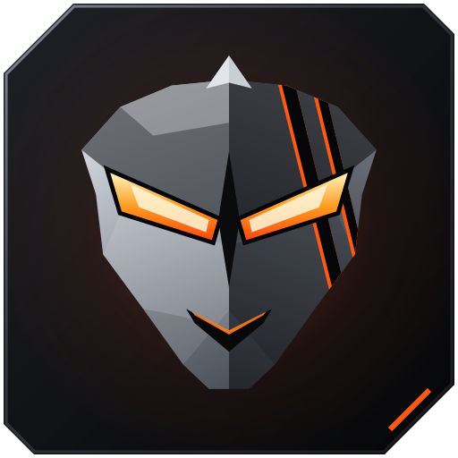

# SpaceFace app icon — the Warmask



The mark for everything the **operating system** shows: the taskbar button, title bar, Alt-Tab, the desktop
shortcut / installer / `.exe`, the macOS dock, the Linux launcher, the browser tab and iOS home screen. It is not
an in-game UI element (the in-game monogram stays in `assets/ui/kit/marks/`).

## The idea

A scarred, split-plane helm: bare-steel left half, gunmetal right half, two slit eyes burning ember-orange,
a fanged jaw cut, and a pair of claw slashes across the right cheek with the heat showing through. No ship, planet,
star or rocket — it reads as a face first, which is the name. The tile is a chamfered armour plate (asymmetric
cut corners), not a rounded app-store square, so it is recognisable by silhouette in a row of Windows icons.

## Files

| File | Use |
| --- | --- |
| `build-icons.mjs` | **Source of truth.** One geometry; emits every SVG master and every raster. |
| `spaceface-launcher.svg` | Full mark on the chamfered plate. Source for sizes >= 40 px. |
| `spaceface-favicon.svg` | Small optical master on the plate: fewer cuts, fatter eyes, no accent bar. Source for 16 / 20 / 24 / 32 px. |
| `spaceface-emblem.svg` | Transparent full-colour mark (dark backgrounds, store art). |
| `spaceface-emblem-small.svg` | Transparent optical master for 16-32 px. |
| `spaceface-emblem-mono.svg` | One colour (black) — decals, engraving, light backgrounds. |
| `spaceface-emblem-reverse.svg` | One colour (warm bone) — dark backgrounds. |
| `exports/spaceface.ico` | Windows: 16, 20, 24, 32, 40, 48, 64, 128, 256 — each frame rendered from its own master. |
| `exports/spaceface.icns` | macOS (128 / 256 / 512 / 1024 PNG payloads). |
| `exports/spaceface-launcher-*.png` | 16 … 1024 px plates; `-256` is the Electron window icon off Windows, `-512` is Linux. |
| `exports/spaceface-emblem-*.png` | 256 … 2048 px transparent mark. |
| `exports/apple-touch-icon.png`, `exports/favicon-32.png` | Browser fallbacks (copied to `assets/ui/app-icon/`). |

`assets/ui/app-icon/` (`favicon.svg`, `favicon-32.png`, `apple-touch-icon.png`) is the copy the web bundle ships:
`scripts/lib/releasePackaging.mjs` copies `assets/ui`, not `assets/brand`. `index.html` links those.

## Regenerate

```sh
node assets/brand/build-icons.mjs             # rewrite SVG masters, exports/, assets/ui/app-icon/
node assets/brand/build-icons.mjs --preview --no-svg --out=<scratch dir>   # contact sheet only, repo untouched
```

Needs only `sharp` (already a dev dependency) — no Python or Cairo. The script decodes every ICO frame after writing
it and fails if a size or alpha channel is wrong. Change the mark by editing the geometry constants at the top of the
script, never an exported file.

## Where it is wired

- `package.json` `build.win.icon` / `build.mac.icon` / `build.linux.icon` — exe, installer, dmg, AppImage.
- `electron/main.cjs` — `APP_ICON` (ICO on Windows, PNG elsewhere) for the live window, and
  `setAppUserModelId('com.spaceface.game')` so the taskbar/pinned shortcut bind to this icon.
- `index.html` — tab icon, 32 px PNG fallback, iOS touch icon.

## Provenance

Newly authored paths and gradients for this repository. No third-party logo, stock icon, font glyph, traced
image or generated bitmap. Not a trademark-clearance report.
