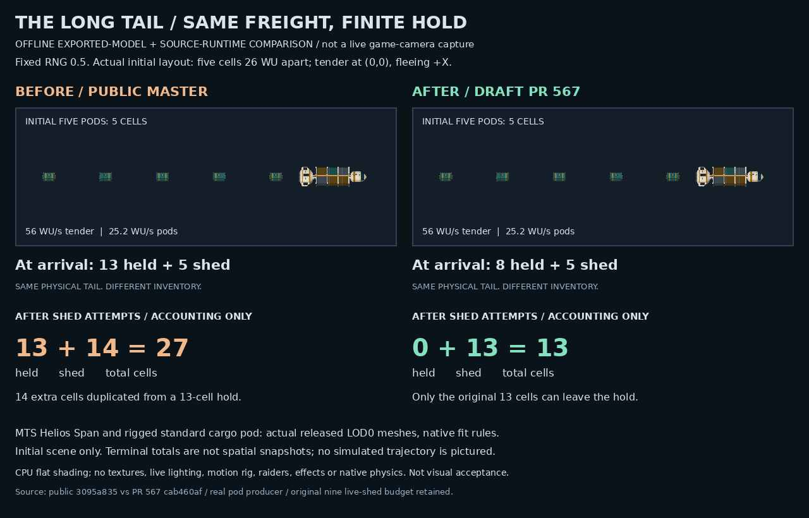

# Long Tail finite cargo custody

## Player-facing correction
The existing breached fuel courier now sheds its own finite fuel hold instead of creating a second supply outside that hold. The authored 10–16 units are shared by the five seeded trail pods, up to nine live shed slots, and ordinary damage/death spill. A high 16-unit roll can truthfully leave two units aboard when the nine live slots finish; this change does not invent extra release opportunities.

Only successfully admitted pods debit cargo. Denied admissions retain the stock and do not consume a live slot. The existing flat cargo and ordinary cargo manifest remain synchronized, preserving unrelated commodity lines and manifest identity. Dead or already-spilled couriers cannot shed again. Invalid manifests, missing stock, and unsafe/unrepresentable quantities fail closed. Empty-hold scan/comms appear only when the actual hold is empty; the defense receipt no longer invents depletion when cargo remains.

Original crew, timing, chase geometry, pod physics, rewards, and resolution behavior remain unchanged. No shared cargo owner, save schema, asset, or new ledger is introduced.

## Verification
Run `npm run check:long-tail-cargo-conservation` for the 18-case focused regression gate, added once to the default check chain. Independent review passed 23 tests: 18 new conservation cases plus five unchanged original Long Tail tests. The bounded coverage includes finite holds, rejected admissions, ordinary spill/death custody, malformed/legacy stock, exhaustion, and honest receipts.

The final candidate also passed 23/23 with the exact public-parent trafficRoleOps violence method substituted in memory. Relevant helper functions and constants were byte-identical; public lootShards, industrialBeam and encounter catalog owners were qualified. This is evidence for those actual production contracts, not qualification of the entire transitive runtime graph.

## Actual pod warm declaration
The ordinary jettisoned-cargo producer selects the rigged standard pod, `places/place_cargo_pod_standard.glb`, in the actual renderer selector. The encounter previously declared a different capsule path. The follow-up changes only that warm declaration/comment and adds an actual producer-to-renderer file/slot/declaration assertion. Exact public selector and violence-method overlays passed the combined 23 cases. This verifies the declaration/selector contract, not decode timing, hitch removal, or live appearance.

The focused command is appended to the existing check chain. Its initial prepended placement unnecessarily shifted round-robin ownership of existing commands; appending preserves public-parent command ordering. This ordering correction accompanies the real warm-asset fix and is not a workaround for the failed precheck.

## Offline comparison

The image compares public parent `3095a835` with initial conservation head `cab460af` at fixed RNG 0.5. Actual fire/tick and pod production supply initial positions and accounting, with mocked ship spawning and fixed ship positions. The visual shows the initial five one-cell pods at 26-WU intervals, courier at the origin, tender velocity 56 WU/s and pod velocity 25.2 WU/s. The separate terminal numbers are accounting only, not a trajectory or later spatial scene.

Decoded released MTS Helios Span and standard rigged pod LOD0 meshes use original rest pose and native fit rules. CPU flat shading omits textures, live/PBR lighting, rig motion, raiders, effects, and native physics. No live-camera or visual acceptance is claimed. Initial geometry is unchanged by conservation; this follow-up's sole warm declaration change does not alter those pictured custody results.

Image SHA-256: `1d361dd835ee120d0814b9e0ceaa166a43da725bc46f6bd30b1d7c2842f73ef3`.

## Initial hosted CI
At initial head `cab460af4151532d7ac0d5db15e1dc5f9caa25b2`, [check run 40040105147](https://github.com/coldshalamov/SpaceFace/actions/runs/40040105147) ended in failure. The focused gate was **NOT RUN**: static shard 1 skipped its check group after the existing extreme-chase/debris-cell visual-continuity failure. Browser shard 3 reached its 30-minute cap and was cancelled.

Completed sim, browser 1/2/4, and one shifted static shard have the same failure-command sets as the exact public parent; feel repeats its two named parent failures. The other completed static shard covers commands skipped in the parent, so its failures are not paired-base-qualified. No attributable Long Tail failure was identified. No aggregate pass, full runtime acceptance, CI rerun, merge, or deployment is claimed. Follow-up exact-head CI is tracked separately on the draft PR.

## Boundaries
No broad local check/check:ci suite was run. The complete current-native dependency graph, full Save/Continue, browser/rendered appearance, and whole-game acceptance remain unverified. Hosted exact-head CI is tracked separately on the draft pull request; local focused passes are not an aggregate CI pass.

The five-path PR contains only the encounter, focused test, minimal package script wiring, this report, and the offline comparison JPEG. It is based on public master without private ancestry. Draft only; no merge or deployment.
