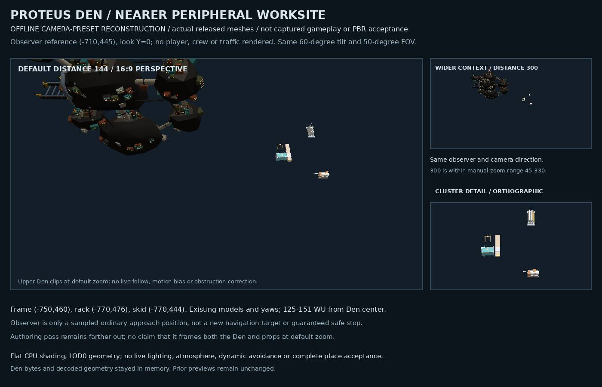

# Proteus Den working margin

## Scope and placement

This increment replaces Proteus's random everyday-kit scatter with a compact western service grouping beside an optional pause/reference pass. It reuses three already-admitted released bodies, not new assets. The composition is anchored to the unique `station_proteus` in `sector_proteus_well`; it translates with that station and falls back to the existing picker when the named anchor is missing, ambiguous or invalid.

At the authored Den position (-640, 520), the world X/Z positions and yaw radians are:

| Model / placement identity | X | Z | Yaw |
| --- | ---: | ---: | ---: |
| `place_illicit_transfer_frame` | -750 | 460 | 0 |
| `place_parts_rack` | -770 | 476 | π/2 |
| `place_power_skid_patched` | -770 | 444 | 0 |

The pause reference is (-850, 600), radius 36. The reference pass runs (-1025, 470) → (-850, 470) → (-850, 600) → (-850, 730) → (-1025, 730). These outer references do not promise that the Den and props are jointly visible at the default camera distance. They are authoring references, not navigation targets or gameplay triggers. There is no hidden-cache cue, new actor, cargo, reward, berth, docking/trust change or sanctuary. Existing traffic routes are unchanged; no crew operation or distant seam visibility is claimed.

The seed-only warm mapper preserves station identity alongside position so the authored recipe can match runtime. Non-Proteus placement and random-number consumption remain unchanged. Triton POI warm enumeration is unchanged and outside this fix.

## Checks and qualification

- Focused gate: `npm run check:proteus-den-working-margin` runs exactly `node --test test/proteus-den-working-margin.test.mjs`, once in `scripts.check`. Writer and independent final runs each passed 11/11.
- Writer compared 1,728 non-Proteus placement/RNG cases across three 576-case owner variants (public master, the separately published sibling helper, and the separate Archive candidate). Independent review compared 576 non-Proteus cases and 180 generic kit/wreck warm cases.
- Focused coverage includes unique/missing/ambiguous/translated anchors, RNG independence, census-envelope spacing, unchanged authored route references, scope invariants, and seeded warm recipe/stub parity.
- Conservative pairwise prop gaps: 12.76, 13.08 and 22.32 WU. The outer pause/pass retains clearance for a 48-WU representative hull. The nearer layout also checks the Den's centered visual and fixed-offset recipe envelopes, and every authored join for the existing runner/picket using their measured public smuggler/pirate hull envelopes. These calculations do not establish passage between props, native avoidance, route overshoot, attachments, unmeasured clamp volumes or generated-world collision closure.
- Fresh public base: `3095a835eb3dbda178d359bbb0541e3ee6124f4c`. Exact inverse edits restore both source bases and package bytes, including original EOF/CRLF formatting. Additive compatibility was checked separately; no sibling PR or unpublished Archive changes are included.
- Actual native avoidance, full Save/Continue execution, hostile-traffic interaction, whole-world collision closure and live visual readability remain unverified. Draft source acceptance is not merge, deployment or flight acceptance.

## Preview and provenance

This flat CPU-shaded, fixed-pose camera-preset reconstruction uses the actual released medium Den and three prop GLBs. It applies the authored transforms, unit prop scale, the medium Den mount scale and visual X/Z recentering. The default 144-distance panel intentionally shows the partial Den crop; the wider 300-distance context panel is a separate view, not proof of default full framing. Traffic, crew, atmosphere, native flight, camera follow and dynamic camera corrections are absent. The observer at (-710, 445) is a source-envelope sample with an 18-WU Drifter hull reference, not a navigation target. This is not captured gameplay, PBR, full-framing or whole-scene acceptance.

Sources are under `assets/ships/release/parts/places/` at the public base above:

| Source GLB | Bytes | Git blob |
| --- | ---: | --- |
| `place_station_blackmarket.glb` | 1984572 | `d16714490c88bb98ca2fcd4bbc6f7988ceee3cbc` |
| `place_illicit_transfer_frame.glb` | 26248 | `5bdcc07dfe26ef99f9e8ccba942babcc13f1e806` |
| `place_parts_rack.glb` | 25328 | `456610b1ac2430617ef9b2c1611caeaedfcdd3d1` |
| `place_power_skid_patched.glb` | 25568 | `7d487e7886d5d0e045ab84e55dff314d07cf3249` |

Final SHA-256 receipts:

- Placement: `6f83cc2f2b9fcbcddb11526b9864fa783d504ceff057bc1c0340d3d8bee0e355`
- Warm mapper: `4435337e72941f4755fee4a1b6a78487423c1b0e511b683b784e848b030625a5`
- Focused test: `df01f51a7aa1ec92442019e12b535d046de18ab9f10787edb33d783f7e55cb8d`
- Package: `ac6d10a25472827e105119eb07f77723e8e1193ed7464697869b93ec607138b4`
- Nearer camera reconstruction (92731 bytes): `8cdc1d1096422f682d047209e150c6fa880a4b3a9a1e5dd7e0600e84d9f0d1ff`
