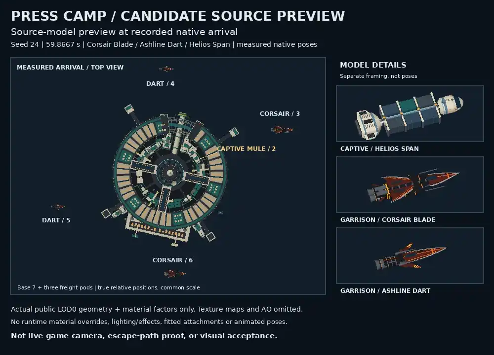

# Press Camp: truthful consequences, powered escape and capture cleanup

## Nonlethal Line extraction

The pilot can latch the original captive inside the camp, tow it at least 360 WU from the hardstand,
and deliberately cut the Line. The captive calls when clear and then uses its existing powered escape
and capture-cleanup owner. The camp and garrison stay alive; the rescue grants Free standing without
the demolition award. A snapped Line can be reattached, while an early cut, missing/recycled body,
foreign control, or a late release cannot manufacture a rescue. Existing destruction outcomes remain.

The native fixture uses the stock Kestrel, default FlightV3 and standard Line with raw forward input;
the original Mule moves under real Rapier before the canonical cut and continues under its own drive.
The unchanged save envelope retains settlement without replaying its reward.

## Historical guard-only increment (1bf56445)

The following sections describe the independent guard-only head, not the powered successor below.

## Guard-only scope
Scene358 now retains witnesses for its original camp, garrison and captive. Missing, stored or recycled actors do not count as destroyed originals. Actual combat death observed while the original occupant is still present is retained across reap-before-tick, so a genuine destroyed camp still settles once. Missing unproven cast resolves neutral contact_lost without invented pay or liberation.

Captive release requires the original actor/generation and retained AI/activity, normalized body and intent identity. Player-owned/captured, absent, dead or foreign-controlled captives are left untouched. A settlement latch is set before comms, grant, reputation or resolution callbacks, preventing synchronous reentry from paying twice. Save/loaded/sector lifecycle and stale-live guards remain within the existing transient encounter policy; continuous crossing retains the real current encounter.

No shared director, AI, capture, Save, schema, physics, model or geometry edits. This increment is independent of PR583. Existing camp hull1400, radius42, combat bounty520, scene award120, Reach-3/eligible Free+2 and three authored loot pods remain. Actual model/native separation was observed separately; no overlap geometry correction is claimed.

## Focused qualification
Final source6b085d84 and focused testfc788643 passed27/27 locally. Tests cover missing/replaced base, genuine killed/reaped base with replacement, unavailable/captured/player/foreign AI/activity/intent/body captive, four synchronous reentry seams, genuine versus missing garrison, stale lifecycle, timeout and continuous crossing.
Original-source negative control passed6/21 initial cases and failed15. The final27-case suite adds lifecycle and intent/body coverage;6/21 is not mislabeled a27-case baseline run.

## Native owner and unchanged-envelope evidence
Final native file4ce54f8f passed two cases on selected actual AI/flight/aiPorts/Rapier/combat/economy/Save systems:
- Garrison destroyed through actual combat.kill: camp and original captive remain alive, no scene grant; combat credits2341 remain2341 after serialize→JSON→load and resumed ticks.
- Original base killed and removed before settlement: exactly one120 scene grant plus the pre-existing520 combat bounty yields640 total, not two camp bounties. Continue retains640 and cannot replay the scene grant.
Final proof retains the complete serialized physics payload and checksum. An earlier fixture deleted both as a convenience and established only scalar Save evidence; that weakening was removed and an unchanged-envelope probe and final two-case run passed. The earlier scalar attempt is not claimed as exact native restore proof.

Final native raw summary (exit0, stderr empty):
- garrison_broken, grants[], moved0WU, alive true, credits2341→2341;
- base_destroyed, grants[[120,press_camp:base_burned]], credits640→640;
- tests2, pass2, fail0, skip0, cancelled0, duration1568.623355ms.

The local dependency graph is explicitly selected/read-only and mixed, not the whole current public graph. Component admission is forced and deaths are injected through the real combat owner, not personally flown combat or an ordinary scheduler route. The player is a qualification entity; no full populated-world/browser/GPU/performance acceptance follows. Hosted guard-only validation subsequently passed 29/29 on run40115047781, synthetic8aef94f8f2bd80bc9e0830c234ddc4927a5d9775 (public parent dda5189b plus guard head1bf56445).

## Historical guard-only motion boundary
The passive captive still moves **0WU** during the observed10-second native tail, retaining its existing held activity even though the old release flags/label change. This guard-only increment does not implement or claim physical escape, home arrival or a played rescue. A separate motion/capture-commit experiment is unfinished and excluded from these source files. Existing loose release copy is not evidence of travel.

## Publication and gate
Five files: scene358, two new focused/native test files, package alias/check-chain addition and this report. The reachable check:press-camp-consequences leaf runs27 focused +2 native tests, expected29 TAP tests. Current graph classification is static shard2/3, no unclassified commands; all prior command relative order and workflows remain unchanged. No local aggregate was executed.

Source, both portable tests and this handoff are preserved in Git on a sole fresh public-master parent. Fresh open-PR census found no scene/test overlap. No merge or deployment. The guard-only hosted artifact12568346640 verified29/29, command2322ms, TAP2176.889184ms. ZIP SHA256 b1248bc87c33c58cc3f4a924833ec5481677a01ef818a324063f1296349f1821. Broader CI is not claimed green.

## Powered successor and explicit dependency

This successor depends on PR583 at90f59e716b3726387036b0d8fa1be8888572fde2. Do not merge before that dependency is reviewed/landed. Public ancestry preserves the guard head and PR583 plus newer public master work. The inherited Tail custody implementation remains a separate review boundary; it is not presented as newly authored Camp code.

The Camp delta changes scene358, aiPorts and shipControlTransfer, its two tests, adds activity-capture-control-native.test.mjs, and updates the package gate and this report/evidence. It does not change shared director, Save, schema, physics, model or geometry. Existing Tail runtime/tests/report are inherited unchanged except the two explicitly extended shared owners.

The original captive now receives a scene-owned outward flee activity with passive maneuver permission and hold-fire doctrine. Ordinary AI/flight/aiPorts/native physics performs propulsion. No teleport, immunity, enemy removal, home-arrival claim or player-input override is added. The existing guard checks, single settlement, awards and loot are preserved.

aiPorts exposes an optional capture snapshot for an exact opaque activity lease. Canonical successful capture/helm transfer invokes that snapshot after ownership commit and before synchronous capture/control-changing subscribers. Only the captured lease's pending/held maneuver and owned physics receipt are cancelled. The optional scene callback clears its own activity/flee/permission state only while original actor, generation, body, AI and activity still match. Foreign successor control/impulses survive. Callback exceptions cannot break the committed transfer or prevent the other hull/existing freight cleanup. Failed admission does not call cleanup. Existing freight cleanup runs first, then generic activity cleanup, with both snapshots retained before the transition. The existing freight hook remains intact; no fleet-wide AI shutdown or new serialization owner is introduced.

### Evidence and limits
Exact final source blobs:
- scene358:4897f72da8ecda5c3cb8f795d13407789f9f013e
- aiPorts:7dd04ce5e000c5b1ae82e4107f77241e4675a97d
- shipControlTransfer:4e415403faa18c2509a6a7b02400f14a08e900c3

Local final runs passed27 focused,3 native and10 capture-control cases, separately executed,40 total. Complete raw stdout, byte hashes, dependency pins and failure history are in [PRESS_CAMP_PHYSICAL_ESCAPE_PROOF.json](PRESS_CAMP_PHYSICAL_ESCAPE_PROOF.json).
- Genuine garrison defeat followed by ordinary propulsion moved the original captive313.706646WU over the10-second observed tail, versus0WU in the guard head. Both camp and captive remained alive; no scene grant;2341 combat credits survived unchanged-envelope Continue.
- Original base death still yields520 pre-existing combat bounty plus exactly120 scene grant,640 total; Continue does not replay.
- An intermediate motion-only experiment exposed a real early-subscriber defect: capture succeeded but a queued maneuver applied5371.048353 force and an early Save restored owned flee. Final pending and held cases both observe0 early force, null activity, false flee/permission, including real unchanged-envelope Save/load before later subscribers.
- Actual canonical full-control transfer covers normal success, throwing source cleanup (destination and both freight hooks still run, one event), and failed admission (zero cleanup). Foreign AI/activity/lease/body/occupant and foreign control/impulse preservation are covered.

These local runs use selected canonical systems plus exact public dependency overlays, not the whole current public checkout. Admission is forced; deaths use the actual combat owner injection; capture uses real API adapters rather than a player gesture. No naturally scheduled route, personally played rescue, browser/GPU visual or performance acceptance is claimed. Unowned transient encounter actors follow existing Save policy; this is not a promise that an unowned escape voyage survives Continue. Captured owned-hull cleanup and scalar rewards are specifically tested.

### Reachable hosted gates
The existing Tail leaf remains reachable with its six files and27 expected TAP tests. The Camp leaf now runs three files and40 expected TAP tests. With the preserved current check-chain order, Tail is static2/3 and Camp is static3/3; no classification/workflow/prerequisite changes or duplicate action suites. Current successor hosted validation is pending and must be read from its actual synthetic checkout, not borrowed from the passing historical guard or Tail heads.

### Compatibility correction and public ancestry
The first generic-before-freight candidate failed the unchanged inherited full-transfer assertion: freight cancelActivity returned false because generic cancellation had already consumed its receipt. No assertion was weakened. Final transfer4e415403 reverses only cleanup order to freight-first/generic-second. The affected old14 scene +9 custody cases, four-mode native freight/Continue,10-scenario lease API and full-transfer fixture all passed after the correction. New27+3+10 Camp cases were also rerun and passed. The old seven-scenario choice-native was not rerun locally; its unchanged file remains in the full inherited hosted27-test leaf.

Final raw results and the actual initial failure are preserved in PRESS_CAMP_PHYSICAL_ESCAPE_PROOF.json. The independently observed early-subscriber before/after is preserved separately in PRESS_CAMP_CAPTURE_BOUNDARY_PROOF.json, with private environment references removed and that sanitization declared.

Public commit parents are guard590 at1bf564454881810647e54d766857e2eb6c2d4cbc, dependency583 at90f59e716b3726387036b0d8fa1be8888572fde2, and refreshed master74025c32fac6c9499ae7f5c102074b87411dabf2. All newer master paths are preserved. Inherited Tail paths are its scene367, encounterScripts, encounterDirector, six Tail/custody test files and Tail report. aiPorts/shipControlTransfer are inherited owners with this explicitly reviewed extension. Camp owns scene358, its two test files, new activity-capture-control-native test, Camp report/evidence; package combines the two reachable leaves without changing any prior command order. PR589's new station-layout documentation/UI hunks are disjoint and are not absorbed from its open branch.

## Authored base visual parity successor

The powered successor c435d10d subsequently passed both hosted leaves: Tail27/27 and Camp40/40 on actual synthetic92d398eac5c1f78c2eff13ac00c486e9b3e7ceea against base8dca1ab351690e1e24d210473e4d71e1e5e04b1d. Full run40116199932 ended failure at17:58:47UTC; browser3 was cancelled. These passing gates are historical results for c435, not automatically results for the visual successor.

The next scene-local delta binds the base to place_station_trade_hub before spawn and adds that GLB to the existing warmAssets declaration. Source scene fc236adf692478d1eeb6738720378898d5813e4f otherwise retains the powered gameplay exactly. Previously, the supported selector chose a legacy procedural station while modelTruth already supplied the authored Tradehub collision skin. This was a visual/body representation mismatch, not a demonstrated invisible-base crash.

The new test87474111c1a98737d5b34593ef07d7a5983f915f checks the first presentation journal entry and spawn event, actual public createSimHost production init and zero-step spawnInfos, clone/read-model projection, and real visualOverrides/partsLibrary selection. Baseline fails0/1 on the absent binding; candidate passes1/1. The unchanged27 focused checks also pass locally. Native baseline/candidate comparisons retain the exact physical specification, fixed body type,22 colliders, position(9200,0,9200), identity rotation, radius42 and skin:place_station_trade_hub. Dockless status and empty services are unchanged. No actor relocation, collider, geometry, radius, reward, control or shared-renderer edit is included.

[Exact local visual-parity proof](PRESS_CAMP_AUTHORED_PARITY_PROOF.json) retains stdout, pins and limitations. This is an in-process supported worker-host transport test, not an OS/browser worker or final GPU residency test. The visual object is correctly awaiting authored admission; that is not misrepresented as final GLB residency.

The source preview uses the candidate-selected authored models and measured native poses. It is a source-derived rendered comparison, not an in-game camera screenshot or GPU/playability acceptance. The captive and pods are partly occluded in the top view; live-camera readability remains open. Actors were not moved to improve the image.

The existing Camp leaf adds only this named test, now41 expected TAP tests across four files; Tail remains27 across six files. Static classification stays Camp3/3 and Tail2/3. No workflow/command ordering changes. The new head requires its own hosted results; no previous pass is relabeled.

### Source-preview bundle

[Provenance](press-camp-source-preview/provenance.json), [portable reproduction](press-camp-source-preview/reproduce.py), and [measured poses](press-camp-source-preview/measured-poses.json) preserve model hashes, source transforms and limitations. The image is1000×720 WebP,42056 bytes, SHA256 e2d78a9960b07907977cd2d93e43344afb1d0a5c5a252699be4d776a55f343ac. It uses material factors, not texture maps/AO/runtime materials/lighting/effects/fitted attachments/animation. The portable extraction was syntax-checked after sanitization, not rerendered; original RAM rendering and root pixel review succeeded. Environment/library versions can affect bytes.

This successor preserves current public master29b08e55bd3d8354e1d82e960376e057c7cddfdd via a two-public-parent child of c435d10d and that master. New master changes include disjoint station UI/docs and subsequently landed audio, weapons, traffic and their tests; exact source/test/design subtree comparison found no owned-path overlap. Those changes are preserved, not copied from an open foreign branch. PR583 remains the explicit inherited dependency.
