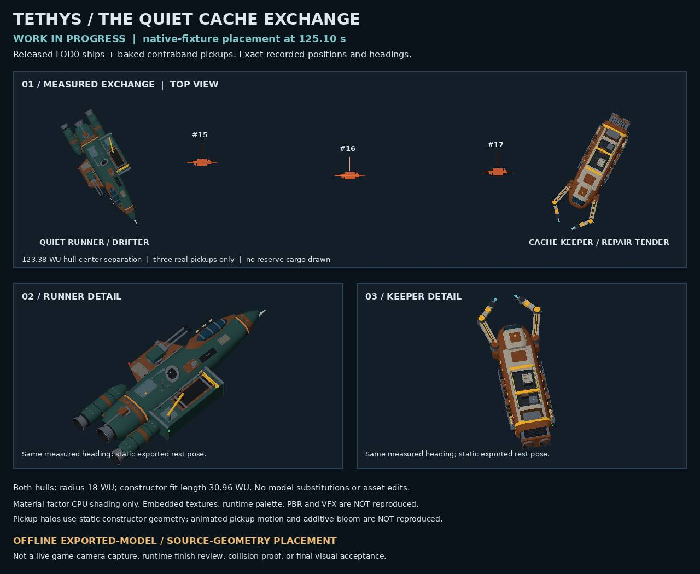

# Tethys WIP model placement preview

This is an offline static composition of the repository's Drifter and repair-tender models with generic pickup geometry, using the earlier successful native fixture's measured transforms at 125.10 seconds. It is not a game-camera screenshot, runtime PBR/lighting acceptance, or collision proof.

The capture and provenance intentionally retain their original, older source pins and then-pending qualifications. Subsequent final-source testing established the Save/return and hull-versus-collection-sphere evidence described in [the shipment report](../TETHYS_FINITE_SHIPMENT.md); it does not retroactively turn this image into a final-runtime capture. The implementation owner confirmed that later ownership/import/news changes did not change these normal choreography poses.

- [Original capture](native-placement-wip.json)
- [Model/source hashes and image provenance](provenance.json)

Pickups are persistent collectibles, not SG02 rigid bodies. The rendered role meshes are not the native collision skins. The render helper is retained in the private recovery set; no private filesystem paths are published here.
