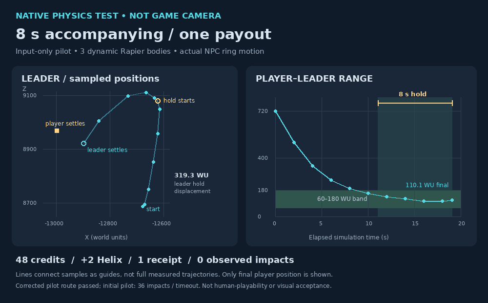

<!-- LIFETIME: DURABLE -->

## Active normal-runtime narrative bridge: 2026-10-24 22:49 UTC

All twelve goals remain OPEN. The [bridge WIP recovery](../world-experience-2026-10-24/narrative-bridge-wip/README.md) is an explicitly **WIP_UNQUALIFIED / INCOMPLETE** checkpoint, not production integration. It preserves seven scoped current-public source replacements, two published tests, partial baseline assertions and an actual exit137 execution gap. The cause of that termination is unproven; no terminal candidate result is invented. Exact public base is3bf67c9617e285561330a413472bd11a94bf2f7b.

Owner: current bridge implementation/review owners and publisher; preserver owns this evidence-only handoff. Scope is the small normal-runtime narrative bridge port from root-owned PR480 ancestry. No P08/PR485 overlays, broad PR480 import, foreign ownership absorption or held assets are included.

The immutable snapshot's census is pending and records its actual earlier discrepancies. Later generator compatibility correction is active and **not included** in the WIP: retain179 existing forwards plus9 new, known84 unchanged, with measured148/31/18/6/188 counts. A narrow LastShift test is prepared but not run. Do not relabel this preserved failed/incomplete attempt as the later candidate or a passing gate.

Next: finish the bounded generator correction, run the narrow LastShift and affected owner checks, review exact current-public hunks and preserve final raw outcomes before runtime publication. PR598 remains recovery-only, while the19-case prerequisite-guidance archive remains a separate uninstalled successor. Complete Save, earned traversal, browser/visual and whole-game acceptance remain open. Existing holds and parked work are unchanged.

## Current P08 recovery delivery checkpoint: 2026-10-24 22:28 UTC

All twelve goals remain OPEN. Draft [PR598](https://github.com/coldshalamov/SpaceFace/pull/598) now publishes the complete candidate recovery at `8ecf700ff7100e1f65d182bae32e746eb3bdb29d`, sole public parent `3bf67c9617e285561330a413472bd11a94bf2f7b`, tree `4b33a9c207f2860dbb1040e65001209eb5c2591c`. All59 recovery-only paths and exact blobs were verified. The package reconstructs67 intended text paths and44 original asset paths using six gzip/two XZ unique objects and35 raw entries. Full source/model Git persistence for this candidate is established. This is **not production installation, runtime integration, or campaign acceptance**.

The original source-set image, portable renderer and provenance are preserved inside the recovery bundle. The image was inspected and delivered as CPU source-v4/guidepaint2 geometry with sampled textures/material factors, not live game-camera/PBR acceptance. No new model is inferred from this review.

Qualification remains layered:128 distinct author-run base-candidate cases (65+12+3+1+38+9) are separate from independent static/designed-probe/certificate checks. The unchanged public baseline reproduces invalid_orchard_frame_source during production Save. A separate own-PR485 overlay subsequently passes4 Save cases,5 source-loss cases and1 native convoy case; this does not prove the complete PR485 suite, earned campaign or full current-master integration. Preserve final38 receipt ae113b00, prior null attempts9d76f2b1, terminal4 de96e548, terminal5 13ee0ccd and native1 516c32da. The native1 immediate-motion logs are complete but its exit manifest is partial; do not overstate closure.

[CI40138008537](https://github.com/coldshalamov/SpaceFace/actions/runs/40138008537) is running. Actual synthetic `52492118e1a0aa184601bf9199434fb5dc78d259` has the verified matching tree and expected parents. This recovery-only PR installs no P08 runtime gate, so its general CI is not hosted qualification of the intended campaign. No overall-green result is claimed.

PR597 remains1360f039 with20/20 hosted focused passes but terminal full failure20:50:32. Eight completed groups match actual-base failed headings/test names; candidate browser3 cancelled while its parent completed four failed probes, so ninth-group comparison is incomplete. Earlier Nursery32, coverage-only caption8 and Bar9 retain their separate full-red results.

The separate [prerequisite-guidance successor](../world-experience-2026-10-24/hundred-hand-guidance-successor/README.md) is now source-archived after19/19 author-run checks and independent static GREEN. It renders truthful progress for0–2 and3–4 validated evidence families, preserves exact command routing, and fixes the reproduced sparse-array validation failure. It is a read-only view: no eligibility, knowledge/discovery, graph, economy or receipt-owner mutation. The immutable17-case predecessor and missing-guidance/sparse failures remain preserved. Apply the final prompt replacement only to its sealed af81cc83 base, not over the17-case prompt. This archive does not alter PR598's frozen67-path recipe/index/restorer and is not automatically applied, installed or hosted-tested. Complete earned prerequisites, full Save/traversal, browser/PBR/performance and final acceptance remain open.

Next: follow recovery-only CI and qualify a separately reviewed runtime integration without weakening ownership guards. Existing holds, parked work, original scope and acceptance fields remain unchanged.

## Current hosted successor and ordinary Sker admission: 2026-10-24 17:40 UTC

All twelve goals remain OPEN. Current [PR590c435d10d](https://github.com/coldshalamov/SpaceFace/pull/590), dependent on PR583, passes both hosted leaves in [run40116199932](https://github.com/coldshalamov/SpaceFace/actions/runs/40116199932): **Tail27/27 and Camp40/40**, zero failures/skips/cancellations. Actual synthetic `92d398eac5c1f78c2eff13ac00c486e9b3e7ceea` uses newer base `8dca1ab351690e1e24d210473e4d71e1e5e04b1d`, tree `6d9783b2e414efb82b8c7fbac6791683acfc61e4`; all20 owned blobs match and newer station-layout work is retained. Broader CI remains active/failing. Completed static2/static3/sim/feel failing-command lists and assertion markers match that actual base; browser/static1 comparison is incomplete, not blanket baseline equivalence.

[Exact hosted diagnostics and ordinary-admission proof](../world-experience-2026-10-24/press-camp-evidence/README.md) preserve final313.706646WU escape, pending/held early capture force0 and neutral owned Continue, unchanged640/2341 credits, plus inherited finite-custody checks. Tail artifact12570015022 SHA256 `8ceed9e7c3e7b8151608a3ed0e687e3d06dca2808c3fb67e3abba056c038c07a`; Camp artifact12569625281 SHA256 `68fcfe4f45f467516e24e1810ff1e1b774156bb9ef4354da063776b3d91e828b`. These logs are exact decoded ZIP-member bytes, without the extra newline noted for the earlier bundle.

Separate read-only ordinary admission uses seed24, storyBeat1 and a configured later arrival in Sker Haven's Reach Gate-Camp, with the unfiltered343-entry catalog and normal sector-entry planner/pacing/proximity. Planned59.454677s becomes admitted59.833333s; primary lane-watch voice and original cast appear. Native base22colliders, captive Mule1 and guards10/8/8/10 are observed. No authored request, forced selection, pending deletion, security/pressure/deadline edits or source change produced the route. Seed24 was chosen from24 bounded pure planning evaluations, not physics brute force.

This is a later-game fixture: NEW_GAME still starts in Helios, storyBeat0 fails the actual gate and beat1 passes; the player was placed400WU from the camp, not flown there. Public catalog/core pins match the candidate and all343 actual peer hashes are retained, but peer contents were not individually revalidated against current master. It is a selected canonical/public overlay, not whole-current-checkout admission, human play or live-camera acceptance. Initial observer mistakes about comms events and dynamic telemetry for the static base are retained as fixture corrections. This first observer captures six actor poses, not loot-pod poses or authoritative visual-selector fields; do not invent pods or infer model choice from body definitions. A separate visual observation may add that evidence.

The short goal register updates current State/Next only; full historical acceptance/reviewer fields remain in its archive. Next: complete current CI follow-through and inspect the actual arrival composition using verified visual selectors, then advance the next connected authored experience. Live-browser hold, parked work, dependency review and final acceptance remain unchanged.

## Press Camp powered successor and concise goal register: 2026-10-24 17:28 UTC

All twelve goals remain OPEN. [PR590](https://github.com/coldshalamov/SpaceFace/pull/590) now publishes reviewed powered escape and capture-control successor `c435d10d6f78e441ae8b16132b9881e3fc829fbd`, tree `39bbbdbeb93157929a17454d2a6db04b336ac46c`. Its three public parents are guard-only1bf56445, explicit dependency [PR58390f59e71](https://github.com/coldshalamov/SpaceFace/pull/583), and master74025c32. All20 changed paths are verified. This is a dependent draft, not a merge, integration or acceptance; no merge before the dependency is reviewed/landed.

The original captive now moves outward under ordinary propulsion: selected native313.706646WU over10seconds versus historical guard-only0WU. Exact activity snapshots and canonical pre-event capture cleanup stop owned pending/held propulsion before synchronous observers save a newly owned hull. The first generic-first ordering candidate failed an unchanged inherited freight-transfer assertion; corrected freight-first/generic-second preserves that contract without weakening tests. Failed and foreign-successor behavior stays guarded.

Local27 focused +3 native +10 capture-control checks reran and passed; affected inherited14scene+9custody, four native custody/Continue modes,10 API scenarios and full-transfer checks also passed. The old seven-scenario choice-native was not rerun locally and remains in the hosted Tail leaf. [Committed report and full failed/final raw proof](https://github.com/coldshalamov/SpaceFace/blob/c435d10d6f78e441ae8b16132b9881e3fc829fbd/design/program/world-experience-2026-10-24/PRESS_CAMP_TRUTHFUL_CONSEQUENCES.md) retain exact pins, including physical proof613030a6 and capture-boundary proof1d0fabd8. Forced component admission, injected combat-owner death, API capture adapters and a selected mixed graph remain limitations. No ordinary played combat, home arrival, durable unowned escape voyage, GPU or performance acceptance.

[Current run40116199932](https://github.com/coldshalamov/SpaceFace/actions/runs/40116199932) is pending: inherited Tail27 on static2/3 and Camp40 on static3/3. Historical guard-only run40115047781 passed29/29, artifact12568346640 SHA256 `b1248bc87c33c58cc3f4a924833ec5481677a01ef818a324063f1296349f1821`; that does not prove the successor. PR583's older full run ended FAILURE17:20:58 despite27/27, and PR584 ended FAILURE17:17:40 despite3/3. PR583's final browser3 had confirmation-overlay click interception and a flight visual-probe failure; actual-base browser3 was cancelled, so no equivalence claim.

Correction to the17:17 startup diagnosis below: eight missing material bindings was an earlier refusedFrames120 snapshot, not proven present at final timeout. A later catch snapshot contains firstPlayableFrameAt98436.605, resolved residency, postOpening.released=true and rosterPending0 while the flight veil remains held; absent wait-start/deadline/snapshot-performance timestamps prevent proving that stamp existed at the deadline. Queued1 plus flushed1 yields pendingDrain2 and may legitimately hold the veil. The eight labels are ordinal plan indices, not asset names. The Bar readiness failure remains **UNATTRIBUTED**, with no proven fix or blanket baseline-equivalence claim.

[OPEN_GOALS.md](OPEN_GOALS.md) is now a short twelve-goal register with outcome/state/owner/evidence/next/awaiting fields. The previous full175k-character history is [archived byte-for-byte](archive/OPEN_GOALS_FULL_2026-10-24T1720Z.md) using its original blob `a9159aed008420b097a0d3b015fe087ffd29a41a`; acceptance/reviewer records and original scope are preserved, not closed or discarded. Continue current exact-head qualification and connected world work; live-browser/asset holds, parked queues and schedules remain unchanged.

## Current unmatched CI observation: 2026-10-24 17:17 UTC

PR583's27/27 component gate does not make broader CI green. Against actual base2d02f8bb, the publisher found an unmatched `check-bar-mission-readiness` failure:90-second timeout in fresh NewGame's opening render gate, tick0/simTime0, flightVeilHoldsSim=true, GPU admission=false and eight missing material bindings. Artifact12566999120 was verified SHA256 `f4aaacc58d49487576430583c24dce26aaa30a0d78fb5f8485cf9ba6f55567a1`.

Renderer a4be81ca, fixture35a2fa30 and every path outside the thirteen owned custody paths match that actual base. There is no evidence capture/custody executed at this stalled startup point, but matching unchanged renderer files do not establish the cause. Causal status is **UNATTRIBUTED**, not baseline-equivalent and not proven harmless. No unrelated renderer fix, assertion weakening or unchanged-head rerun is authorized by this observation. Publisher retains exact-head CI ownership; all twelve goals and broader acceptance remain open.

## Press Camp guard delivery and active capture qualification: 2026-10-24 17:14 UTC

All twelve goals remain OPEN. [PR590](https://github.com/coldshalamov/SpaceFace/pull/590) publishes scene-local truthful consequences at `1bf564454881810647e54d766857e2eb6c2d4cbc`, sole public-master parent `dda5189bbefcc878dd4dcf61f42973a369530ae9`, tree `1a08d3be9a868432e711e2fd61d825fc169aad46`. Five exact paths are verified: scene358, focused/native tests, package gate and [report](https://github.com/coldshalamov/SpaceFace/blob/1bf564454881810647e54d766857e2eb6c2d4cbc/design/program/world-experience-2026-10-24/PRESS_CAMP_TRUTHFUL_CONSEQUENCES.md). [Run40115047781](https://github.com/coldshalamov/SpaceFace/actions/runs/40115047781) expects29 TAP tests and is pending; synthetic `8aef94f8f2bd80bc9e0830c234ddc4927a5d9775` has the candidate tree. No PR583 dependency or shared-runtime change is in this guard-only head.

Missing/recycled actors no longer invent camp destruction,120-credit payment or captive liberation. Observed original death survives reap-before-tick; actor/generation/AI/activity/body/intent/ownership guards and a settlement latch prevent stale actions and duplicate effects. The destroyed-base route correctly retains520 combat bounty plus120 scene payment =640; breaking the garrison preserves the camp and three authored loot pods.

Local27 focused and two native unchanged-envelope Save/load cases pass on the selected mixed graph. Garrison credits2341 remain2341 without scene grant; destroyed-base640 remains640 with exactly one120 scene grant. Initial original-source6/21 versus candidate21/21 failures and later fixture corrections remain historical evidence. Forced admission and injected combat.kill are not ordinary played combat or full world acceptance. **Physical escape in the published guard-only version remains0WU over10seconds and unaccepted.**

The separate approved two-shared-file capture extension and physical departure work remain under their existing owners, not part of PR590's current head. An earlier-capture-subscriber probe reproduced stale force5371 and unchanged Save restoring owned flee; the revised selected-graph probe reports force0, null activity and false control flags before the subscriber, with unchanged early Save restoring owned neutral state. Exact before/after stdout and pins are being preserved; these results are not full-current-checkout or ordinary capture acceptance. Do not absorb or duplicate this writer.

Exact guard-only local stdout, graph pins and the explicit zero-displacement result are preserved in [Press Camp guard evidence](../world-experience-2026-10-24/press-camp-evidence/guard-native-proof.json), Git blob `5ca5e8098ee42cc14e9f9d4bb1b461fa2f07aba2`, SHA256 `40e9bf76cb13b7290ff7b51ef9b92f3c791329dd4264c32f460e1350f4f1bd3d`. Separate capture-boundary baseline and candidate stdout/pins are independently raw-verified; that small proof is not a complete source backup. 

PR582's current25/25 gate remains valid, but [run40112157007](https://github.com/coldshalamov/SpaceFace/actions/runs/40112157007) ended FAILURE17:10:45, browser3 cancelled17:10:39. Six comparable completed groups match actual80a base; base browser2/3/4 are incomplete. Other current hosted gate evidence remains separately linked above. Next: finish the active Press Camp departure/capture-control qualification and preserve its failed and final measurements, while publisher follows exact hosted heads. Live-browser hold, all acceptance boundaries and schedules remain unchanged.

## Current hosted component gates: 2026-10-24 16:57 UTC

All twelve goals remain OPEN. Current hosted checks now pass: [PR582 a683e630](https://github.com/coldshalamov/SpaceFace/pull/582) **25/25**, [PR58390f59e71](https://github.com/coldshalamov/SpaceFace/pull/583) **27/27**, and [PR5846db87ee7](https://github.com/coldshalamov/SpaceFace/pull/584) **3/3**, including the actual Node factory import. Broader CI is still active/red; these results are not whole-repository, ordinary gameplay, visual or performance acceptance.

The [preserved hosted diagnostic/output bundle](../world-experience-2026-10-24/hosted-custody-evidence/README.md) contains complete relevant command diagnostics, TAP and native output with immutable artifact and checkout pins. PR583 now has actual hosted measurements for intact Mule, physical thief, restored recovery and restored escape, plus all seven original native choice scenarios. This supersedes the earlier absence of retained final local measurements only through new hosted evidence; the old independent FAIL rows remain historical, never relabeled passing. Forced admission, injected disable/lethal setup and capture-API adapters remain explicit limitations.

- PR582 [run40112157007](https://github.com/coldshalamov/SpaceFace/actions/runs/40112157007), artifact12566389559 SHA256 `c76b6a6f1b97865e176a995d2f0a76d829db6b289313ef37bf36bdebf3ba768a`:25/25, exit0, command7844ms. Synthetic `5c3bbc0bdbca689587626324ca936ae514a324da` includes newer base80a21733; all nine owned blobs match, not an asserted whole-tree match to branch head.
- PR583 [run40112700622](https://github.com/coldshalamov/SpaceFace/actions/runs/40112700622), artifact12568055074 SHA256 `775d62fa9eb44d315eb5c9cd50a42d9ffa622559092b148dd29db77286439a2a`:27/27, exit0, command11620ms. Synthetic `920bfab97ca6e2c2a5022de26d9e5ac146e50127`, parents2d02f8bb+90f59e71, tree `fe07697a116eabe82634b0e8189199c195b3e4e6`; all thirteen scoped blobs match while newer base work is retained.
- PR584 [run40112425563](https://github.com/coldshalamov/SpaceFace/actions/runs/40112425563), artifact12567940738 SHA256 `b28d8ef63d3b26492bd3a053e4c5aed02a7f7dd473e1c55d0233e8fb68d781c1`:3/3, exit0, command1822ms; factory-import case1587.047ms. Synthetic `56fdb76decbc44eeb4997f2039d4ec40ac4329f8`, tree `aec53d4c5ad71669e6114a8b76eed2df5ceef0ea` equals candidate; all three owned files match.

The next connected sector increment is Press Camp under its existing owner: initial baseline6/21 versus candidate21/21 focused checks are preserved, but native physical departure initially failed. A guarded passive-maneuver release correction is under qualification, not published or accepted. Do not duplicate that writer or claim a final native pass. Continue exact current CI follow-through and the active experience implementation, then ordinary route/Save and visual review. No goal closure, merge/deploy or schedule change.

## Current custody publication and qualification: 2026-10-24 16:42 UTC

All twelve goals remain OPEN. These are open, unmerged drafts, not whole-game or sector acceptance.

- [PR583](https://github.com/coldshalamov/SpaceFace/pull/583): verified custody head `90f59e716b3726387036b0d8fa1be8888572fde2`, parents `bc2cad189c45b3f4015297127ab2d44243301902` + `80a217334d8e4236a77677296ade95940883bc32`, tree `7183cff74c135cbc4a9fd609a3de82ecf5ae0661`. Thirteen scoped paths preserve source/tests/package/report and newer landed work. [Exact implementation and limits](https://github.com/coldshalamov/SpaceFace/blob/90f59e716b3726387036b0d8fa1be8888572fde2/design/program/world-experience-2026-10-24/SALVAGE_TAIL_PHYSICAL_CHOICES.md). Expected27 hosted TAP tests are pending, not the historical14/14 result.
- [PR582](https://github.com/coldshalamov/SpaceFace/pull/582): `a683e630496a6bed4abf966fbc9249f4bfc2dc6f` retains landed factory exports from masterca65bf9f, all nine owned blobs unchanged. [Run40112157007](https://github.com/coldshalamov/SpaceFace/actions/runs/40112157007) qualification pending. Previous78860f9b's23/25 included two upstream named-mop import failures, also observed on its actual base; that is not the new head's result.
- [PR584](https://github.com/coldshalamov/SpaceFace/pull/584): `6db87ee7c58ae277035ddc39d93b160d437983e0` retains master80a21733. Only isolated test/package/report differ from master. A third actual Node factory-import/membership case augments the two pure-manifest cases. Local syntax/source review only; no dynamic-import pass. [Run40112425563](https://github.com/coldshalamov/SpaceFace/actions/runs/40112425563) qualification pending.

The replacement convoy now uses the existing finite original-manifest owner after real spill while retaining authored Shadow/Bait pursuit beforehand. Its same-key custody wait rejects stale choices and waits for conserved freight before settlement. Intact-Mule capture preserves cargo; thief capture preserves unrelated owned cargo while secured original freight returns through finite custody. Player-owned hulls cannot continue NPC pickup/escape. Exact actor/generation/body/AI/activity leases release only their owned controls before capture/control-changing observers, preserving newer foreign writes and physical coast. Restored recovery/escape reacquire their canonical owner's lease. Existing470/474 guards and disjoint515/569 hunks remain preserved.

Final scene `be3278fb284b33b3f4cb1185773b2674f92b0fe8` replaces the loss receipt's blanket spillage assertion with a neutral reference to the cargo-custody report. This text-only delta passed14 focused cases and leaves four shared runtime hashes unchanged; the public commit preserves it beyond earlier recovery packets.

Local selected/hybrid evidence:14 focused Tail +9 custody cases,10 lease scenarios, one narrow actual transfer-API probe, four native capture/Save scenarios, all seven existing native choice scenarios, and32 separately run stock custody cases. Not one full-current-checkout aggregate. The original lost-Continue regression failed its obsolete zero-active-record assumption; the revised test preserves one conserved open record, advances actual ticks to deadline, verifies one hauler_lost/-3 and no replay after terminal Save/load. Native evidence uses real physics/pickup/serialization but forced component admission, injected disable/lethal setup, narrow capture adapter and explicit queued controls. It is not ordinary player combat/capture, naturally discovered full rescue, browser/GPU or performance acceptance.

Historical PR583bc2cad gate14/14 belongs to run40109453670, terminal FAILURE16:29:41 with browser3 cancelled16:29:35; completed static2/static3/sim/feel failure sets match actual9a88 base, other base groups incomplete. Historical PR58474cba gate2/2 belongs to run40109520149, terminal FAILURE16:34:51, not the new three-case gate. New upstream base observations do not imply branch ancestry changed.

The final test recovery packet retains fixtures and reported pass results, not the final four-mode measured stdout rows. The separate independent-review packet retains earlier FAIL rows at earlier pins; those are not final runtime measurements. Final-mode passes are owner-reported and exact fixtures/source are independently verified; hosted qualification remains pending. 

Next: publisher owns exact current-head hosted results and attributable fixes; feature owners retain their narrow paths. Then validate connected ordinary arrival, choices, combat/custody and Save consequences. Earlier normal-planner Concord Core admission is separate configured progressed-state evidence, not a complete first-fight/custody route. Public source and independently verified recovery evidence are preserved; review, integration, visuals and acceptance remain open. No merge/deploy, new model, schedule change or relaxation of holds.

## Current external landing, refreshed gates and custody work: 2026-10-24 16:13 UTC

All twelve goals remain OPEN. [PR585](https://github.com/coldshalamov/SpaceFace/pull/585) and [PR586](https://github.com/coldshalamov/SpaceFace/pull/586) have externally merged as `03fb16fd792001ce5abc668711d5611e28a9972d` and `b683b23ce299fe7dd746da9547c34d1cac5aff05`. Verified master `9a88f14bdbc35797de4bb1bb589ff0004e6a41a6` includes both. Root did not merge master; do not continue waiting for these already-landed repairs.

Authorized proper public merge children refreshed the still-open draft branches, preserving their prior heads and landed master work:
- [PR582](https://github.com/coldshalamov/SpaceFace/pull/582): `f14e56367bc50831eaaddea5e7c9eb0d393cf148`, [run40109456149](https://github.com/coldshalamov/SpaceFace/actions/runs/40109456149). Current gate24/25: native rescue/Save and23focused pass; the new visual fixture alone imports non-exported `entityInfoBlock`. Artifact12565778984 SHA256 `0898469e64a97ad5ace95335a6ea2492f6836593cedc18cdeea828da152eca19`. The original visual owner is fixing the test against the real public route; no runtime defect is inferred from that import mistake.
- [PR583](https://github.com/coldshalamov/SpaceFace/pull/583): `bc2cad189c45b3f4015297127ab2d44243301902`, [run40109453670](https://github.com/coldshalamov/SpaceFace/actions/runs/40109453670). Hosted gate14/14 PASS, command6852ms/TAP6756.815ms. Artifact12566195910 SHA256 `2463ffa14f6fc78968c57a3ec5f229409a9b14f73974ff6353d8dc4dc9902eaf`; logged syntheticeb464f6f. Broader CI remains publisher-owned and active, not full-green acceptance.
- [PR584](https://github.com/coldshalamov/SpaceFace/pull/584): `74cba4909ad0bd7bfd4026fefef7afa5bdd059ee`, [run40109520149](https://github.com/coldshalamov/SpaceFace/actions/runs/40109520149). It now contains only package/isolated-test/report work; landed manifestc45fd450 and existing fulltesta73362a1 are untouched. There is no duplicate runtime repair. New CI is active/pending separately from old results.

Each refreshed synthetic tree was verified against its candidate; owned582/583 source blobs stayed unchanged. Earlier terminal results remain historical. In particular old PR584 run40104569872 ended FAILURE15:24:45, browser3 cancelled15:24:37 with no final report; startup2/2 and RUCKUS passed. Partial browser artifact12564514857 SHA256 `fcaea361e2732a60642df9d7ef0365dfdf563e4db375d735d57e442956183fad` contains click timeouts and station-egress AUTHORED_LIBRARY_UNAVAILABLE, not completed visual acceptance. Completed failed-command sets are subsets of actualc564base, while deeper newly observable assertions are not baseline-equivalent.

Current finite-custody work is meaningful but still unpublished: the source owner reports native4/API10/transfer/focused9/prompt14/cargo32 checks passing on the selected/hybrid graph. The frozen replay driver now checks every original base pin and final source hash; all five replay/syntax checks pass. Its trimmed native fixture's exact rerun remains owner-active at this checkpoint. These are not full current-checkout, ordinary-play or whole-sector acceptance. The initial syntax-only packet below is superseded by independently verified current source/AI-lease/test/review packets, while its history remains recoverable.

Approved ownership remains narrow: encounterScripts; director normalizer/clear hunks; scene367; AiPorts/public-receipt paths and any explicitly approved pre-capture hook. Existing470/474 guard insertions are preserved, not treated as authorization to absorb their drafts. Source work continues in RAM while frozen artifacts are saved; no competing writer or blanket shared-AI authority is introduced. Next executable actions are exact custody/native review and draft delivery, plus the isolated PR582 fixture correction and refreshed CI checks under their existing owners. Browser/integration holds, Archive publication limits and both schedules remain unchanged. No merge/deploy or goal closure is implied.

## Current ordinary Tail admission and startup gate: 2026-10-24 15:16 UTC

All twelve goals remain OPEN. The following separates newly observed ordinary admission, hosted startup success and unfinished cargo implementation.

On exact [PR583 head9c645e68](https://github.com/coldshalamov/SpaceFace/pull/583), seed22/configured simulation600/day1 in Concord Core, normal sector entry schedules Salvage Tail at860.493845 seconds and naturally publishes the original encounter plus all three choices at861.083333. At861.1 the original Mule/two raiders materialize alongside the player in Rapier. No authored-request shortcut, rule/weight/peer suppression, gate override or sanctuary bypass was used. This is configured progressed state, not a played first raid or flown first arrival.

The planner also queues the guarantee before the opening-raid prerequisite exists. A non-mutating comparison through the actual gate on copied state rejects the absent prerequisite and admits the present one; no second full native absent-prerequisite wait was run. All three originals initially lie within Helios's1400-WU sanctuary. The authorized hostile-spawn trigger does not bypass engagementAuthority's firing protection. Admission/three choices therefore do not prove ordinary combat permission or a complete first-fight/Save route. Exact raw result, fixture and pins are preserved independently; no runtime source was changed for this probe.

[PR584 head9fdc03d9](https://github.com/coldshalamov/SpaceFace/pull/584) now has hosted startup gate2/2 PASS, exit0, command212ms/TAP64.487ms. Artifact12564332140 SHA256 `9c252db8d972a661b8b09ccb677360242371fd21f25fb2b4dff7912bc87224d4`; actual synthetic `5e3597dcccb4bc3b29675b0ccaff089977654e23`, parentsc564312e+9fdc03d9, equals candidate tree `ddfd4a71b4238f2a8f5aea982093d2670b8d9501`. [Main40104569872](https://github.com/coldshalamov/SpaceFace/actions/runs/40104569872) remains active, while [RUCKUS40104569871](https://github.com/coldshalamov/SpaceFace/actions/runs/40104569871) succeeded. Static2 has68/78 commands passing; remaining failures are newly reachable past the import blocker and are not all baseline-equivalent. This does not mean PR584 landed, full boot succeeded or consumer PR582/583 became fixed.

Finite Tail cargo custody remains an active, unfinished implementation. Its authorized owner has an initial three-module recipe for encounterScripts, encounterDirector's normalizer/clear hunks and scene367; publisher checked other PR515/569 hunks are disjoint. Only syntax checks have passed on that initial packet: it is UNTESTED, unpublished and not acceptance evidence. The source owner continues RAM tests; the separate native qualifier must prove real death/spill, finite pickup and terminal custody without inventing inventory. No broader director/shared-owner authority is implied.

The ordinary proof and initial custody recipe are independently saved and full-byte/identity verified, with a compact restoration successor. Existing exact public source, tested history, visual bundles and original failed evidence remain preserved. Next executable work is custody source/native qualification through those owners and terminal startup CI under its publisher. Browser/integration holds, Archive publication limits and both continuation schedules are unchanged. No merge/deploy or whole-sector/game completion.

## Current startup repair and terminal consumer CI: 2026-10-24 14:55 UTC

All twelve goals remain OPEN. The previously unassigned manifest investigation was approved, implemented and published by its exact owner; the earlier “no approved shared writer” statement is now historical.

[Draft PR584](https://github.com/coldshalamov/SpaceFace/pull/584) is verified at `9fdc03d9da03d13726eb9312115486c283e328f0`, a proper public merge child of initial repair `4ec577514f871c401123b6cc78df5f4eb75e0f17` and current master `c564312e4466303e658b50b380cb3e08e7ce94f2`, tree `ddfd4a71b4238f2a8f5aea982093d2670b8d9501`. The initial head became conflicting after newer Wex registrations landed and had no CI run. The non-forced successor preserves Wex and all newer master work, with exact 233-init/180-update counts and narrow 3/3 qualification. Five remote files were verified. [Check40104569872](https://github.com/coldshalamov/SpaceFace/actions/runs/40104569872) and [RUCKUS40104569871](https://github.com/coldshalamov/SpaceFace/actions/runs/40104569871) are running; no hosted pass or full boot is claimed yet.

The [startup repair](https://github.com/coldshalamov/SpaceFace/blob/9fdc03d9da03d13726eb9312115486c283e328f0/design/program/world-experience-2026-10-24/RUNTIME_MANIFEST_STARTUP_REPAIR.md) removes only dangling init/update references whose factories/composition exports were absent. DOCKET clock entries, prompt capabilities and all existing feature source remain intact. Planned shipbreaking, tender, outfit, disaster and workshop integrations remain OPEN, not cancelled or completed. Existing PR509/480 capability hunks and unrelated draft ancestry were not absorbed. The new reachable startup leaf contains two isolated tests; the third local check is the existing count/order case, not a third hosted leaf test.

[PR582e70d49d6](https://github.com/coldshalamov/SpaceFace/pull/582) now has terminal FAILURE in [run40102946852](https://github.com/coldshalamov/SpaceFace/actions/runs/40102946852), completed14:49:16. Its intended 25-case gate never ran: zero passes/two file-load failures from the undefined manifest registration. Artifact12563478588 SHA256 `f1092206fc3e4a8f6841511b9f7e7a461615acae12952797e375b6f2c3e5ea6d`. All prior failing markers/command IDs match actual-parent run40101470760; the newly named gate adds the two import failures. Synthetic13c1c087 uses newer base719a82b and retains all seven owned files; its full tree is not claimed equal to the PR head. Historical46ea8158 hosted24/24 remains separate.

[PR5839c645e68](https://github.com/coldshalamov/SpaceFace/pull/583) likewise ended FAILURE14:40:17 in [run40102222783](https://github.com/coldshalamov/SpaceFace/actions/runs/40102222783), with the same parent failure markers and its added gate's zero passes/two file-load failures before the intended14 tests. Local selected-graph13focused/seven native scenarios do not override these hosted results. PR584 is separate: neither consumer PR has been automatically merged, rebased or declared fixed by publication of the repair.

The original startup recipe is independently raw-verified, while the public five-path successor preserves the complete package/registration/test/report reconciliation. Existing recovery lineage, images, failed evidence and goal acceptance fields remain intact. Next executable work is the hosted startup result and coherent current-checkout validation under the publisher, followed by the still-open native finite-manifest/predation gap through the authorized gameplay owner. Browser/integration holds, Archive publication limits and both continuation schedules remain unchanged. No merge into master, deployment or whole-game acceptance.

## Current connected choices and rescue silhouette: 2026-10-24 14:34 UTC

All twelve goals and original twenty-concept/P00–P21 scope remain OPEN. This delta supersedes older current-state claims while retaining their dated evidence.

[Draft PR583](https://github.com/coldshalamov/SpaceFace/pull/583), head `9c645e68c4094ec29e3493ce38818fac66076224`, publishes five scoped paths over public parent `719a82b85c07417e8661460147ed3977031ceb57`. Helios Salvage Tail scene367 now makes shadow, bait and decline alter the original Mule/Reach encounter, rather than merely labeling identical behavior. Shadow uses a 0.22 powered course and existing 26-second fire hold; bait uses a brief lateral burn then zero-input coast with immediate raider release. Actual prompt lifecycle consumes an expired/damaged unanswered offer without inventing a player answer. Original generation/body/AI and exact intent/hold ownership guard cleanup; terminal reentry is latched. The [feature report](https://github.com/coldshalamov/SpaceFace/blob/9c645e68c4094ec29e3493ce38818fac66076224/design/program/world-experience-2026-10-24/SALVAGE_TAIL_PHYSICAL_CHOICES.md) preserves full evidence and limits.

Final local evidence is 13 focused passes plus seven native scenarios inside one native test file, not twenty hosted TAP cases. Native maneuver routes have real player inputs, flight, raider fire/damage and retained zero-trauma contacts. Gate-respecting authored admission is not normal scheduler discovery. Terminal Save checks inject lethal damage through the real combat owner; capture uses the actual API with a narrow adapter, not player-flown gestures. Completed 320 credits/cooldowns/statistics persist, but no scene367 story-completion or defended receipt-ring entry is claimed. Native Mule death still has predation null and no finite pickups: the existing manifest/predation gap remains OPEN, not cargo-custody success.

[PR583 run40102222783](https://github.com/coldshalamov/SpaceFace/actions/runs/40102222783) remains active, but its targeted gate has FAILED import in both files (0/2) before the intended 14 cases. `SHIPBREAKING_YARD_INIT_IDS` is undefined at authoritativeSystemManifest.js:59, manifest blob `92330210960e2053d804614be41d07b16c5c38fc`; the actual parent has the same failure. Synthetic `4b64adbaef20abde56db76491be27d2231f502e8` has candidate tree `4a990c01c8092174a892cc38acb1d53752a3ea57`. Artifact12563217923 SHA256 `a7adae55cfee22ec5ecc7010e73fdc236f28813b14ad2df2ed87b7cb63982166`. Local selected-graph success does not establish current full-graph acceptance. A separate manifest investigation must establish ownership before any shared fix; no shared writer is approved by this checkpoint.

[PR582](https://github.com/coldshalamov/SpaceFace/pull/582) now advances to `e70d49d69b6801ebf4ba8ea19dd2801437d7d09c`, sole parent46ea8158. The original escape pod now binds the existing civilian survivor capsule before spawn, rather than the generic freight container. Model geometry, body/collision, gameplay flags and rescue behavior are unchanged; this is creative reuse, not a new model. The [published actual exported-package comparison](https://github.com/coldshalamov/SpaceFace/blob/e70d49d69b6801ebf4ba8ea19dd2801437d7d09c/design/program/world-experience-2026-10-24/pitborn-pod-preview/README.md) shows both existing silhouettes at equal 10-WU longest extent. Corrected pixels were inspected, including preserved imported transforms. CPU rendering applies actual albedo/normal/roughness/metallic maps, not authored AO. It is not live-game lighting/camera or visual acceptance. Public sanitized reproduction source is syntax-checked, not a claimed rerender.

The successor's 24 focused selected-graph checks pass; exact public manifest import is blocked separately. [New run40102946852](https://github.com/coldshalamov/SpaceFace/actions/runs/40102946852) is active with an intended 25-TAP gate, not a verified pass. Historical PR58246ea8158 had hosted24 passes but [run40099448954](https://github.com/coldshalamov/SpaceFace/actions/runs/40099448954) ended FAILURE14:15:01, browser3 cancelled14:14:52 without a final report. Actual-parent static2/static3/feel failure sets match; other base groups were cancelled, so comparison is incomplete. PR580 remains terminal red with focused32 and its separately recorded unmatched Market wait.

All four scene367 recovery layers/proofs and all four capsule image/reproduction/provenance/source artifacts have independent exact-byte/identity verification. Git preserves actual source, tests, reports and visual bundle, not just downloadable backups. Current next actions are manifest ownership/root-cause resolution and the open native finite-cargo gap through authorized owners. Existing browser/integration holds, Archive publication limit and both continuation schedules remain unchanged. No merge, deployment or whole-sector/game acceptance.

## Current admission and hosted results: 2026-10-24 13:52 UTC

All twelve goals remain OPEN. This delta supersedes the 13:47 pending/admission statements, not their historical evidence.

[PR580](https://github.com/coldshalamov/SpaceFace/pull/580), head `c770f20ff92d86f8cdc1c59f0f58f22266d0d451`, has terminal FAILURE in [run 40097265920](https://github.com/coldshalamov/SpaceFace/actions/runs/40097265920), completed 13:44:41 UTC. Its focused gate passed 32 checks. Browser 3 was cancelled, as was the actual base's browser 3; a Market wait rejection remains unmatched despite observed 5000→4965 credits and cargo +1 at simulation time 0. It is not proven flaky or unrelated. No blanket-green attribution.

[Draft PR582](https://github.com/coldshalamov/SpaceFace/pull/582), head `46ea815817f706c61b5aca77ccc23af144fd9405`, has hosted 24/24 focused/native checks passing, exit 0, 4,973 ms. Artifact 12561834461 SHA256 `4006c19075717991cc6cb9619004f72d2ef03e9006e4ba64b94a2272f05d38e0`; synthetic `963c25372be85f53cc966317af60a43a6d626e92` has candidate tree `ea9bd985490028bb8b3ab1f5b88fc1ced8e6634e`. [Main run 40099448954](https://github.com/coldshalamov/SpaceFace/actions/runs/40099448954) is still active. Actual base run 40099007885 was cancelled; ten other static-2 failing commands match, which does not establish complete base equivalence.

Exact PR582 scene `557c7146` now has bounded natural admission evidence: configured progressed Vesta seed 113/storybeat 7, starting at Dead Freighter Drift, normal sector entry with unchanged planner weights/gates/peers and no force/requestAuthoredEncounter call. Scheduled slot 115.502 seconds admits at 116.583 seconds; all three original Rapier cast bodies exist at 116.6 seconds. The actual three-minute briefing, lawful claim, all 13 wreck units and towable pod are present; prior patrol resolves cleanly and both planned peers remain pending. This is not flown/new-player arrival, populated full-sector terrain/traffic, rescue replay, browser capture or another Save proof.

The original native command exited 1 on `180.00000000000003 !== 180` after emitting complete results. Ten separately applied retained-result checks pass with only the duration comparison changed to tolerance below 1e-9. The corrected fixture is preserved for reproduction but was not rerun; do not call the original command green. The ordinary packet and compact recovery index are independently raw-byte verified. Existing source/revision/native/visual recoveries and the Git-preserved [measured preview](../world-experience-2026-10-24/pitborn-native-preview/README.md) remain intact.

Scene 367 choice differentiation is the next active investigation, with no source writer approved at this checkpoint. Generic motive metadata alone was rejected as a non-player-facing change; no metadata edit was made. Existing ownership, both specific approval holds, Archive publication limits and both schedules remain unchanged. No game source or PR CI was restarted for this handoff.

## Current physical recovery and presentation: 2026-10-24 13:47 UTC

All twelve goals remain OPEN, including the original [twenty-concept map](TWENTY_CONCEPT_MAP.json), [P00–P21 implementation scope](IMPLEMENTATION.md) and [build map](../../../build_map.md). This checkpoint supersedes older current-state/next-operation claims without erasing historical evidence or acceptance requirements.

[Draft PR582](https://github.com/coldshalamov/SpaceFace/pull/582), head `46ea815817f706c61b5aca77ccc23af144fd9405`, publishes five scoped files over public parent `372b696716fbacf304185e4afa75117e16acaf08`. Pitborn no longer calls a distant pod recovered or a finite wreck worked merely because 180 seconds elapsed. Original tender propulsion, original-pod ownership and low-speed physical handoff now govern recovery; a genuinely transporting player can still win after fallback starts. NPC pickup pays nothing and retains the lawful claim and all 13 wreck units. Final scene `557c7146` passes 23 focused checks and one native test; hosted CI is pending, not green. The [feature report](https://github.com/coldshalamov/SpaceFace/blob/46ea815817f706c61b5aca77ccc23af144fd9405/design/program/world-experience-2026-10-24/PITBORN_PHYSICAL_RECOVERY.md) preserves exact source, regression failures and qualification limits.

Final native evidence uses real Wasp/player flight, Rapier bodies and kernel tether, but forced component admission and a fixture pilot. Original pod transport is 1477.233 WU; handoff at 190.083333 seconds gives the original 260-credit/+4 receipt once and releases the intact 13-unit pool. Actual completed Save/load retains the receipt without replay. One low-speed player/pod contact has zero trauma; no contact-free claim. Natural Vesta admission from ordinary sector entry is the current active investigation, not yet proof. Pointer/gesture tether input, full current graph, ordinary visits, live camera and performance remain open.

The [new measured Pitborn trajectory](../world-experience-2026-10-24/pitborn-native-preview/README.md) is pixel-reviewed and now preserved with portable source, public input samples and provenance. Exact RAM rerender reproduces the original 13,982-byte WebP. Ten-second player/pod samples have straight connectors; only the tender terminal point is shown. This is not a game-camera capture, model render or new asset. The full source recovery and final native/plot artifacts have independent raw-byte verification; no recovery artifact substitutes for the runtime PR.

[PR580](https://github.com/coldshalamov/SpaceFace/pull/580) is now at `c770f20ff92d86f8cdc1c59f0f58f22266d0d451`, with bounded repair-work presentation delivered through actual event/consumer ownership. Its hosted focused gate passes 32 checks. Broad CI remains pending as of 13:47 UTC; do not reuse the prior 32103806 run's terminal result as this successor's result. Cue surface expiry is bounded to 0.45 seconds, detached particles to less than 0.837 seconds; no GPU visual acceptance is claimed. Earlier Hawser departure, Wasp textured review and terminal historical CI evidence remain below.

Owners retain their exact paths: Pitborn scene/test/native owner continues ordinary-admission qualification; publishers own CI; this handoff changes review artifacts and registers only, not game branches. Browser-document refresh and integration absorption of PR558/471/570/571 remain separately held. Archive large-object publication remains unresolved; small GitHub delivery works. Both continuation schedules remain unchanged. No merge, deployment, whole-sector or whole-game acceptance is implied.

## Current delivery and visual review: 2026-10-24 12:57 UTC

All twelve goals remain OPEN. This section supersedes dated current-state/next-operation claims below without removing historical evidence, acceptance fields or the original [twenty-concept map](TWENTY_CONCEPT_MAP.json), [P00–P21 implementation scope](IMPLEMENTATION.md) and [build map](../../../build_map.md).

[PR580](https://github.com/coldshalamov/SpaceFace/pull/580) is published at `32103806c3b34779022e3b2be274efc997db27f8`. The original Hawser and Mule now depart under real propulsion after the unchanged once-only 300-credit/+6 receipt. Scoped custody cleanup relinquishes only original owned intent/expiry packets on confirmed capture or committed control transfer, preserving foreign successors. Native tail evidence has zero pair contacts, minimum 35.0081-WU clearance and retirement by +21 seconds; focused capture/Save qualification uses the exact public transfer owner. It does not prove player-flown capture, home arrival or docking.

[Hosted run 40092100386](https://github.com/coldshalamov/SpaceFace/actions/runs/40092100386) is terminal FAILURE, not pending: the focused gate passed 23/23, exit 0. Static-2 artifact 12559546862 SHA256 `0b171275df49446f9c4080c21318a18772572862e5b932e3b664830699d07e36`. Completed static 2/3, simulation and browser 1/4 failing-command sets match the actual synthetic base; browser 2 is only a subset, and browser 3 was cap-cancelled with an incomplete base comparison. No blanket unrelated-failure or full-green claim. PR577 and PR578 broad monitors are also terminal red, with focused hosted 11/11 and 18/18 respectively.

The [Wasp textured studio review](../world-experience-2026-10-24/wasp-material-preview/README.md) preserves an actual exported-package image and reproducible source. All six embedded maps were decoded; albedo, normal, roughness and metallic maps were applied, while authored AO red was not. Dark paneling and highlights remain readable. No asset change or new model count is justified by this review; live-camera lighting, performance and visual acceptance remain open.

All four original Wasp review artifacts now have full-byte, SHA256 and identity/version readback verification. The seven departure recovery packets retain final and meaningful failed attempts; restore the attended-repair base before the final departure recipe. This recovery evidence does not substitute for the published source or acceptance.

The next allocated unit is a bounded repair-work pulse tied to actual qualifying Hawser work, owned by the existing scene author in scene 362 and actionVfx only. Production event transport was inspected; generation/sector/freshness admission, pause expiry and reduced-motion checks remain implementation work, not delivered behavior. Shared VFX/lighting and other owners stay untouched.

Both specific approval holds remain pending: browser API documentation refresh and absorption of PR558/471/570/571 for integration. The 12:22:41 UTC Archive object read still returned 404 with unchanged staging ref; no large write or credential retry occurred. Small GitHub delivery works. Both continuation schedules remain unchanged. No merge, deployment, ordinary-play or whole-game acceptance is implied.

## Hawser exported-model preview: 2026-10-24 11:22 UTC

The [completion preview and reproducible source](../world-experience-2026-10-24/hawser-native-preview/README.md) show three existing released models at recorded final native poses (154.083 seconds), with a separately framed Hawser detail. This is CPU material-factor geometry only: embedded KTX2 maps are not sampled, and it is not live game-camera/PBR/VFX or visual acceptance. No assets changed and no new models are counted.

PR580's hosted gate passed 13/13 in run 40088669919, static-2 artifact 12557648197. The actual synthetic merge `b1d42d3` has the same tree as the published head. Broad CI remains pending under its publisher. Source-only inspection closed the competing default-job/traffic enrollment question without a runtime change or full-default-native claim. All twelve goals and approval holds remain OPEN; schedules are unchanged.

## Hawser attended repair delivered: 2026-10-24 11:12 UTC

[Draft PR580](https://github.com/coldshalamov/SpaceFace/pull/580) is verified at `ad9b52dd00bf8cf78e64ba3ff70f7cb12390f3c5`, with five paths and sole public parent `a3c49d376fc7734c41ea218ceb63a4c4c9afd262`. Existing SalvageWatch/Hawser scene 362 now requires physical attended repair instead of paying after a timer while the tug is remote. The scene-only controller uses real propulsion and original actor/body/generation/role/control ownership; repair requires a 15–70-WU surface gap, relative speed at most 5 and 55 observed attended seconds. Pressure or separation pauses work and requires a real return. No shared AI, traffic, Save, generator or assets changed, and threats are not suppressed.

The exact final reviewed source passes eleven focused plus two native tests. Earlier native runs remain historical, not substitutes for final qualification; the final replay was repeated after lifecycle and foreign-actor review corrections. The [attended-repair report](https://github.com/coldshalamov/SpaceFace/blob/ad9b52dd00bf8cf78e64ba3ff70f7cb12390f3c5/design/program/world-experience-2026-10-24/HAWSER_ATTENDED_REPAIR.md) records real stock equipment, impacts and actual approach/work/completed Save behavior. This is not natural scheduler, return-home/docking, full-graph, visual or performance acceptance. A model preview is in progress, not yet a completed live-camera result.

Run 40088669919 remains active under the publisher. Its verified synthetic merge has the same full tree as the published head. PR577 run 40085344535 is now terminal FAILURE: eight worker jobs failed and browser 3 was cancelled near its limit, while focused 11/11 passed. Parent/tested-base runs were partly cancelled, so attribution remains partial. PR578 run 40086172183 also ended FAILURE with focused 18/18 passing; inspected completed failure-command sets match the actual parent, but both browser-3 runs were cancelled and the partial PR artifact is uninspected. Neither broad run is green.

All twelve goals remain OPEN. Integration-absorption and browser-document approval holds remain separate and pending; reminders grant neither. Archive recovery/publication limits and both schedules are unchanged. Existing owners retain active work; no competing source queue is created here.

## Grandee causal consequences delivered: 2026-10-24 10:34 UTC

Hosted update: Grandee's gate passed 18/18 (exit 0, 1,180 ms) in run 40086172183, artifact 12556829425. The verified synthetic checkout `f3a6cd53` has the same full tree as corrected head `e7d2d8d3`. All eleven static-2 failed command IDs and the two FEEL failures match the actual public parent; broader CI remains active, not green.

[Draft PR578](https://github.com/coldshalamov/SpaceFace/pull/578) is verified at `e7d2d8d3a637035b0816b00353921a2bf5dfac1e`, a report-only child of `19a8419648db273ec98154cbe2175301b55ca979`; the initial six-path increment has sole public parent `ee049a838cff81446865cd8bbb46d056391f9965`. Grandee now warns only for positive player damage to the original target, memorializes only confirmed original death, and applies the -8 consequence only when byPlayer is true. Missing/unloaded targets abort neutrally; terminal guards and neutral loss/remembrance copy prevent unsupported blame. See the [causal-consequences report](https://github.com/coldshalamov/SpaceFace/blob/e7d2d8d3a637035b0816b00353921a2bf5dfac1e/design/program/world-experience-2026-10-24/GRANDEE_CAUSAL_CONSEQUENCES.md).

Focused checks pass 17/17 versus baseline 5/17, plus an actual combat/director/Save-owner test at 1/1. Save preserves the deed without replay; its 1,800-second TTL is inclusive and expires at 1,800.01. This is not physics, flight, browser or performance acceptance. The final report corrects the archived snapshot identifier `34310c83`, not a file count; source/tests/package are unchanged by that correction. Run 40086172183 is active under the Grandee publisher.

PR577 is now `c78f986822b1f78730c481a9535361e3fca02428`, a package-only child of `d98ea998`. Moving only the new invocation one leaf earlier made its focused gate reachable in static 3; existing command order and workflows remain unchanged. Hosted 11/11 passed in run 40085344535. CI uses a synthetic merge, with the four owned files verified identical; broad CI is still pending and parent baseline coverage is partially cancelled. The predecessor run was superseded after its static-1 prerequisite prevented the focused gate, so it has no hosted focused-pass claim.

All twelve goals remain OPEN. The integration-absorption and browser-document holds remain separately pending after the latest check, and routine reminders grant neither. No new source queue is assigned by this handoff. Archive recovery/publication limits and both schedules are unchanged.

## Native trajectory diagnostic: 2026-10-24 10:13 UTC

The [reproduction script](../world-experience-2026-10-24/convoy-native-preview/render.py) preserves measured leader/range samples and only the final player position. Connecting lines are guides, not a complete measured trajectory. This is a native-physics diagnostic, not game-camera imagery, model-quality evidence or human-playability acceptance. PR577 source and its active CI are untouched; all twelve goals remain OPEN.

## Accompanied formation delivered: 2026-10-24 10:10 UTC

[Draft PR577](https://github.com/coldshalamov/SpaceFace/pull/577) is verified at `d98ea998bf93dfcd2e36dff401c3432bee1418a1`, with four paths and sole latest public parent `8810e2255aabbc7c01d8eeaf65d22f3f23cc3ee4`. Six unrelated newer swarm/program commits are preserved. The reproduced late-join progress exploit is corrected: accompanying formation now requires 100 WU of progress during one uninterrupted 60–180-WU range interval lasting at least eight seconds. Distance and time accrue concurrently, not as an extra eight-second wait after distance. Focused checks pass 11/11 versus baseline 4/11, and eight existing RC checks pass. See the [formation-progress report](https://github.com/coldshalamov/SpaceFace/blob/d98ea998bf93dfcd2e36dff401c3432bee1418a1/design/program/world-experience-2026-10-24/ACCOMPANIED_FORMATION_PROGRESS.md).

Independent native replay used ordinary seed-1 Ceres refinery selection at time 3600 and a 720-WU input-only approach. Formation held from 3611.083 to 3619.083; the leader advanced 319.328742 WU, final range was 110.068644 WU, and one receipt awarded 48 credits/+2 reputation with zero impacts and hull 150. The earlier pilot failure with 36 impacts and timeout remains preserved. An actual Save-owner probe at three seconds/55.981923 WU returned true, cleared live/transient state and retained the consumed encounter-423 stamp without payout or forced readmission.

These tests use selected public key owners with archived fallback dependencies, not human flight, visual or performance acceptance. The publisher owns active CI and recovery; no aggregate-green claim is made. The next selection is read-only, with no new source queue yet. All twelve goals remain OPEN; integration-absorption permission, browser hold, Archive recovery/publication limits and both schedules are unchanged.

## Sori saved return qualified: 2026-10-24 09:57 UTC

PR576 `e8eb8ea9` remains draft with its five published paths unchanged. Run 40081484940 is terminal FAILURE, updated 09:49:44 UTC and observed at 09:52:58. The hosted profession gate passed 15/15. Inspected paired groups have the same failed-command rows as parent run 40062772438, including the two FEEL failures and static-1 prerequisite/matrix skip; browser 3 is cancelled in both, with cause unspecified. Mobile remains 116/122 per engine without an exact-parent mobile run. No attributable new failure was found in inspected evidence, not a universal absence-of-regressions or broad-green claim.

Sori's existing PR561 saved return now has positive bounded owner-level proof. The authentic Ceres prospector origin exercised scanner acquisition, iron sampling/quota and a real six-iron sale; Sori's four-scan calibration followed. Exact PR561 world data exposes 134 original compact gas rows. Real mining beam selection promoted original row 4 and yielded eight He3; mining/career settlement and a Triton economy sale of eight He3 for 1,087 credits emitted the completed delivery receipt. Actual Save serialize → JSON → load returned true with identical career state. Exact PR561 contact generation then displayed “Triton accepted the envelope”; comparison/work/leave acknowledgments changed no player, mission or career values and emitted no additional observed trade/mining/settlement events. Work offered no extra delivery.

The earlier missing-gas diagnosis was a live-entity-only fixture lookup error: compact asteroid-field rows are intentionally promoted by beam selection. It is not a production-source defect. This qualification uses selected exact public owners with archived transitive dependencies, owner relocations and economy execution rather than physical flight, docking or browser UI. No game source changed and no full-game/ordinary-route acceptance follows. All twelve goals remain OPEN. The separate integration-absorption and browser-document approvals remain pending; reminders grant neither. Archive recovery/publication limits and both schedules are unchanged.

## Contact professions and qualification handoff: 2026-10-24 09:38 UTC

[Draft PR576](https://github.com/coldshalamov/SpaceFace/pull/576) is verified at `e8eb8ea9993876d078211ecc45d3c6ea4b6c12e9`, with five paths and sole public parent `0ebaf5d3`. Eleven canonical professions plus SettlementCourier now display their authored, trimmed string labels. Runtime roles, escaping, recognition suffixes, choices and portraits are unchanged. Independent checks pass 15/15 versus the exact base's 1/15. These exercise source-function HTML strings and pinned producer excerpts, not DOM parsing, browser layout or visual acceptance. No Sori PR561 or PR544 content was absorbed. See the [authored-contact report](https://github.com/coldshalamov/SpaceFace/blob/e8eb8ea9993876d078211ecc45d3c6ea4b6c12e9/design/program/world-experience-2026-10-24/AUTHORED_CONTACT_PROFESSIONS.md).

PR576 run 40081484940 remains under its publisher; hosted focused-gate proof was pending the last artifact read. Mobile run 40081484946 failed six startup/probe checks, 116/122 per engine, without a paired parent mobile run. This is not an exact baseline comparison or proof of a gameplay defect.

PR574 `9c4c2269` remains draft/unmerged. Run 40077977394 ended FAILURE at 08:55:50 UTC, while hosted Tethys checks passed 19/19. Other failure sets matched the parent except the newly observed confirm-dialog stationLife.js 404; that file is absent at both parent/head and UI is unchanged. Browser 3 reached its job limit. No attributable Tethys defect was established and no rerun was requested.

The seven extracted-traffic companion checks closed with only the already-fixed stationName omission; actor lookup review found no additional confirmed gameplay defect. Archive's compact JSON still returned 404 on the latest read and its staging ref remained unchanged. No supported streamed/file-reference publication route was found; recovery remains intact and runtime delivery is still blocked.

Next is the existing Sori saved-return qualification, without changing its owned hooks. Its 1,029-module import closure has no missing imports, but mixes selected public owners with older archived dependencies and is not a journey pass. Qualification must use the real prospector-origin sequence and registered mission serializer that preserves careerContracts, not the fallback Save path or old synthetic receipt. The current origin catalog pin is still being verified. All twelve goals remain OPEN. Integration-absorption approval and the browser hold remain separate and pending; routine reminders grant neither, and both schedules are unchanged.

## Tethys finite shipment published: 2026-10-24 08:33 UTC

[Draft PR574](https://github.com/coldshalamov/SpaceFace/pull/574) is verified at `9c4c22694a3cedf8d1295b6e62fe5644306c8d2b`, with fourteen paths and sole public parent `0ebaf5d3`. The [Tethys finite-shipment report](https://github.com/coldshalamov/SpaceFace/blob/9c4c22694a3cedf8d1295b6e62fe5644306c8d2b/design/program/world-experience-2026-10-24/TETHYS_FINITE_SHIPMENT.md) records the authored six units conserved as three exchange plus three reserve, fresh-only initialization, staged atomic publication and original record/row/body/control guards. Existing two-slot physical meeting control and eligible-job recommission are preserved; actual Save-envelope/RAM-slot and soft/hard conservation checks are included. Independent tests pass 26/26. No other PR, private guard or Quarry work was absorbed.

Native transfers occurred at 125.10 and 163.10 seconds. Minimum measured Rapier hull-to-pickup-sphere clearance was 7.365 WU; pickups are not SG02 bodies, so this is not a contact-manifold claim. The [WIP preview](https://github.com/coldshalamov/SpaceFace/blob/9c4c22694a3cedf8d1295b6e62fe5644306c8d2b/design/program/world-experience-2026-10-24/tethys-preview/README.md) uses exported model material factors and a capture predating final safety fixes. Visible Drifter/repair-Tender models differ from the two native drifter skins. Neither the preview nor these bounded tests establish live-camera/runtime-PBR or whole-game acceptance. Record caps/expiry still bound identity; there is no eternal-stock guarantee, and internal window seeds are not cargo receipts.

The missing stationName import in trafficJobOps was corrected by one name, with clean return logs and no courier semantic transplant. PR574 run 40077977394 is active under its publisher; the red parent run does not itself attribute every new failure. Read-only checking of remaining extracted traffic companions continues; no new source queue is allocated.

PR568 `34bc233d` now has terminal FAILURE on run 40072698731: eight groups failed and browser 3 reached its cancellation limit. Hosted focused 52/52 and native 13/13 pass, including actual Save/pickup/non-resurrection; compatibility 12 did not run after the visual precheck. Six groups match the parent, but browser 1 differs in failure stage and cancelled parent browser coverage limits comparison. No attributable Handoff regression is established, and this is not full browser Continue acceptance.

All twelve goals remain OPEN. Integration-absorption permission and browser-document approval remain separately pending; routine reminders grant neither. Archive's recovery/publication limits and both schedules are unchanged.

## Handoff Save qualification and next shipment: 2026-10-24 07:17 UTC

PR568 is verified open draft at `34bc233d3d44834e37490158d89aaa55b8398699`, following `b7483b10`. Its five-path Save/copy follow-up corrects the missed primary line and adds actual save/load plus ordinary pickup to the existing native gate. Local checks pass 64 focused and 13 native cases. Exact-head hosted native checks pass 13/13, including save/load, wallet 60, original pod 4 accepted quantity 2, and no resurrection after pickup and a subsequent save/load. This establishes execution of the published test, not browser Continue or full-game acceptance.

Run 40072698731 remains publisher-owned and active: static 2 and browser 2/3 were pending at the latest report. Browser 1 has the same failed command set but earlier mission-launch failure and stationLife 404, not identical diagnostics. The prior b748 run was cancelled by its successor; hosted 51/12 passed and compatibility did not run after its prerequisite. No aggregate-green claim is made.

The next connected unit is Tethys checkpoint-day finite shipment custody, preserving its explicitly authored six-unit 3+3 distribution. The assigned source owner and independent reviewer are recovering public source before implementation. Scope is `trafficCausalChainOps.js`, Tethys data/comments and targeted tests; no dirty traffic.js or shared-director edits, and any additional persistence-owner path needs coordination. This is not a proven-exploit claim, a nerf or a new scene.

Both derived compact Archive outputs are intentionally absent after verified recoverable eviction; retain and use the original archive plus successor source, tests, manifest and restore script to regenerate them before local use. The remote publication block is unchanged. All twelve goals remain OPEN, the integration-absorption approval and separate browser hold remain pending, and routine reminders are not approval. Both continuation schedules are unchanged.

## Clear launch delivered: 2026-10-24 06:53 UTC

PR568 is open draft at `b7483b10139be75170258638c97c1aa714645a08`, following `60c65426`. Its six-path clear-launch follow-up preserves the same four original pods while using an 80-WU actor gap, 22 + 8i axial offsets and at most 2 WU perpendicular jitter. Actual public measured native hulls clear eight bearings and first-second hold/pass checks. Independent local checks passed 63/63 plus native 12/12; the old baseline recorded 32 directed contacts, 30 negative gaps and a minimum gap of -2.1773968 WU. Hold bonds at 6.10 seconds and finishes at 8.1167; pass finishes at 14.1167 without reward. See `HANDOFF_CLEAR_LAUNCH.md` and its native evidence for the full record.

This supersedes production-hull feasibility as the current blocker, but uses twenty public source owners with 901 archival modules/localization and archival FlightV3. Full current-tree, Save and live-camera acceptance remain unqualified. The older 60c follow-through diagram is historical prior-stage evidence, not a render of this launch layout.

New run 40071871679 is pending under the publisher. Older run 40070527945 last had browser 3 running and eight failed groups, with hosted 43 + 2 checks passing and compatibility not run after the visual precheck. PR569's run 40069473633 is now terminal FAILURE: eight groups failed and browser 3 was cancelled. Node 6/6, actual confirm-browser, Orcus 40/40 and Pilgrim checks passed; browser 3 retains partial flight timeout/SIGKILL differences and no complete ship-visual result. Do not label the entire run baseline-matching.

Next work is the existing Handoff owner's in-memory actual save/load investigation between bond and NPC completion, with no source edits or shared lifecycle changes yet. All twelve goals remain OPEN. Integration absorption approval and the separate browser hold remain pending; continuation reminders do not grant either approval. Archive's publication block and both schedules are unchanged.

## Handoff remaining trade delivered: 2026-10-24 06:34 UTC

PR568 is verified open draft at `60c654268b4c5b05f5d2833062de0a937380599e`, following `8ee99a3`, with nine changed paths. See its `HANDOFF_REMAINING_TRADE.md`, published native evidence and follow-through diagram for the detailed record. Immediate original bond/reward remains once-only while NPC trade continues to physical receipt: 10.0833 seconds after a 7.0833-second bond. Recycled identities, re-entry and paid-cap cleanup are guarded. Independent checks passed 55/55 plus native 2/2; the inherited unexplained missing-cargo-minus-two limit remains documented.

The earlier scene-teardown blocker is superseded by this published correction, not by a claim of full acceptance. Full Save, production MTS geometry and ordinary admission remain unqualified. Run 40070527945 is publisher-owned and active. Next work is read-only/in-memory real production mule/native-body feasibility; the frozen delivery is unchanged and no result is claimed yet.

PR569 at `8d296338` now has hosted Node 6/6 and actual confirm-browser PASS (exit 0, 6,457 ms). Its overall run 40069473633 remains active with other failures, under its publisher. Archive's block, existing ownership, browser/integration approval holds and both continuation schedules are unchanged. No merge or deployment is implied.

## Current qualification correction: 2026-10-24 06:16 UTC

PR569 is now open draft at `8d2963383b45eea242b8182e9f01ce19137534d6`, following `541d43b5`, tree `3a6c8eb8669925a446cd2788f620dd11fe011503`. The four-path follow-up repairs probe identity/settlement observation, not production UI. Tests pass 6/6 versus baseline 1/6; independent in-memory actual confirm/motion supersession and Tab/Enter/replacement checks pass. Hosted modal behavior remains unknown; publisher-owned run 40069473633 is still active.

PR558's six mobile failures occur in stale extracted unit fixtures before browsers, not an observed active-route or game-Continue failure. The unchanged public probe gives 12/18 with its old fixture; existing PR471's fixture gives 20/20 in memory, so no duplicate repair is needed. The old PR558 desktop synthetic merge lacks recipeCaptions/trailerScore and cannot finish main import/readiness. Current master supplies both placeholders, which is not proof that the whole game works.

The proposed current-master plus PR558/471/569/570/571 dependency union has thirty paths and package-only overlap, but no candidate exists. Public AGENTS §3 prohibits absorbing other open PRs; the narrow integration approval requested at 06:06 UTC remains pending. A routine continuation reminder is not approval. This is separate from the existing browser-document approval hold.

Handoff's outstanding post-contact trade now has a narrow implementation allocation for scene 357 and targeted tests/report. Immediate original bond/reward remains once-only while live NPC manifest tracking and the parked cast continue until actual completion or honest death, theft or deadline. Settled bonds must not become false withdrawals. No shared director/persistence edit or qualification is claimed. The derived compact Archive JavaScript was also recoverably evicted after reconstruction verification; regenerate it from the retained successor packet and original archive before use. All twelve goals remain OPEN, both continuation schedules remain unchanged, and Archive's publication block and existing ownership constraints remain in force.

## Orcus delivery, terminal CI and Archive successor: 2026-10-24 05:53 UTC

PR569 remains open draft at `541d43b51adfff067b209510052210bc2cdb38cb`, following `52edcfd9`, with tree `424a21de7334cab1064d2b7f613238508f806368`. Its verified five-path Orcus delta preserves Pilgrim. Only encounter 916 changes among 219 captured outputs; the actual scheduler admission flag is corrected and tested. Hosted Orcus checks passed 40/40. Native controlled paths exercised a 6.1-second scanner result for 30 credits and a 471.865-WU withdrawal settling at 9.0833 seconds without credits, with original actors and no impacts. This is controlled admission after the first-hour preference, not natural frequency, full Continue or visual acceptance.

Run 40064907508 ended FAILURE: eight matrix groups failed, browser shard 3 was cancelled near its thirty-minute cap, and the aggregate failed. Browser-1's confirm-dialog removal assertion differs from the parent despite unchanged probe/confirm source; that explicit probe does not exercise Orcus, but attribution is not proven. Browser-3 partial modal/station errors and flight categories differ in detail, with no complete ship-visual result. Do not describe all failures as baseline-matching. PR570 also ended overall FAILURE with hosted Io 25/25 and E1 25/25 passes; its additional flight SIGKILL has no completed parent pair. PR571's check/mobile runs ended FAILURE with hosted 12/12; completed failures match its parent, both browser-3 jobs were cancelled, and six mobile failures occurred before browser startup. These monitors are closed.

Fresh master `0ebaf5d32603707ba765498e6c8c7b5c8eea2eb1` adds only the two-path UI119 GameOver/documentation change since `316eed66`. A separately owned read-only preflight is assessing existing PR558's startup repair together with PR569/570/571. It has no source or branch-write authority; do not duplicate that repair or integration lane.

The separate Archive compact successor passed 17/17 checks (seven footer and ten append), against baseline four passes/three compact failures. One generator expression changes formatting while retaining all 219 parsed rows and order, including seventeen green and 202 red rows. The lazy CENSUS_JSON string API remains, with different whitespace. This is not a full remeasurement. Original frozen manifests remain unchanged, and the successor recovery plus immutable original backup reconstructs both exact outputs.

Compact formatting has NOT solved publication. One compact-JSON write began at 05:22:23 UTC, stalled and was interrupted; its expected object still returned 404 at 05:25:33–35 and the isolated staging ref remained unchanged. No JavaScript attempt, retry, commit or ref update followed. The 47-path runtime union remains unpublished; its old tree hash is not a new successor tree. Small connector writes still work, so this is not a global GitHub denial. No further large writes or login probes are authorized.

Both old-overlay pretty census files are now intentionally absent after verified recoverable eviction, not lost work or public omissions. Restore from the retained original archive before using that old overlay, or use the separately verified successor under its owner. The Pilgrim image is likewise retained in published GitHub and durable recovery despite local-cache eviction. All twelve goals, browser hold and existing ownership constraints remain OPEN. No new ledger, merge, deployment or schedule change is implied.

## Quiet-beacon retirement delivered and CI qualification: 2026-10-24 04:11 UTC

Draft [PR571](https://github.com/coldshalamov/SpaceFace/pull/571) is verified open at `90e223cd9b555f7539f78235fbb37b4dd1ae479b`, with four paths (core system, existing quiet test, package and report), tree `4bc1a6aa98ebb85635bc529764e2ca69bd795eef` and sole public parent `316eed66`. The publisher verified full remote bytes and blob hashes and owns exact-head CI monitoring.

The core correction adds only a beacon despawnAt probe over existing radarContacts after the original guards. It does not enroll H4, add an index, alter physics or redesign TTL handling. Baseline quiet tests passed 9/12; the correction passed 12/12 plus four neighbors, retaining all eight original assertions. Evidence covers original removal events, lane cleanup and ID recycling; future, late and zero deadlines; and quiet skipping for untimed/cancelled cases. The extra scan has a real cost: 100 to 400 visits in the measured 100-ship/200-station no-beacon scene. A noisy helper timing changed from 1.617 to 5.636 microseconds; this is not target-device performance, native Rapier or full Save acceptance.

PR569 run 40058601423 ended FAILURE. Its hosted fourteen-case and one-case gates passed, while the standalone cadence gate did not run behind the static-1 precheck. Comparable failures match the exact parent, but browser shard 3 completed where the parent was cancelled, leaving two probes unpaired. Ship stability reported an internal pass while its command failed on missing stationLife; flight-visual reported page/warm/opening/mobile-throttle failures. Do not describe every failure as baseline-matching or the aggregate as green.

PR570's hosted focused gate passed 25/25, and its existing E1 gate passed 25/25 including nineteen runtime cases. Overall run 40060333392 remains running with failures at the latest owner report. Its publisher retains terminal monitoring; no duplicate watch is created.

All twelve goals remain OPEN. Existing ownership, recovery chains, Archive's two-object publication block and the browser hold are unchanged. This handoff changes no testing overlay, ledger, merge or deployment state.

## Io Love Letter Buoy service delivered: 2026-10-24 03:59 UTC

Draft [PR570](https://github.com/coldshalamov/SpaceFace/pull/570) is verified open at `e74118222ce1c6f778c04b01340a85b19376a900`, with six paths, tree `ac3529dd91e351ae5e49f4d5dc2021e214fec9f6` and sole public parent `316eed66`. The publisher verified full remote bytes and blob hashes and owns exact-head CI monitoring.

H4 now requires six sampled seconds within 90 WU of the original living buoy. Interruptions reset service; dead, replaced or foreign bodies and a second UI choice are rejected. The ninety-second deadline is unpaid. H4-only tagged, same-sector reuse of a free original buoy prevents creating another body on eligible repeat admission. Legacy untagged, pinned, foreign, scheduled and actively owned bodies remain untouched. A separate existing beacon despawnAt quiet-sweep defect was reproduced, but ineffective enrollment was not shipped; PR570 changes no shared core or cleanup behavior.

All 44 independent cases passed: 25 focused and 19 existing. Native first-hear followed by forced repeat admission/service retained the same original object, ID and body handle, with two entities, exact heard/reseeded receipts, one kindness/tone change and zero credits, reputation or impacts. This is controlled re-admission, not fly-away/return, ordinary cooldown, full Save/Continue or visual acceptance. The constructor's existing Kessler asset is unchanged and its target-label consumer is verified; no lamp or audio-loop behavior is claimed.

PR569's hosted fourteen-plus-one tests passed. Its standalone cadence gate was skipped after a parent-matching static-1 precheck; browser shard 3 was the only pending job at the latest owner report. Its publisher retains monitoring. A separate read-only preflight is inspecting the confirmed quiet-beacon deadline defect and exact ownership before edits, not claiming a shipped repair.

All twelve goals remain OPEN. Existing recovery chains, ownership constraints, Archive's publication blocker and browser approval hold remain unchanged. No merge, deployment or new acceptance claim is implied.

## Pilgrim native-pose visual preserved: 2026-10-24 03:38 UTC

The [Pilgrim native-pose review](https://github.com/coldshalamov/SpaceFace/blob/9c4c22694a3cedf8d1295b6e62fe5644306c8d2b/design/program/world-experience-2026-10-24/PILGRIM_NATIVE_POSE_REVIEW.md) now preserves the completed offline comparison of actual acceptance at 20 seconds and settlement at 33.0833 seconds from PR569's successful route. All seven shipping hashes remained unchanged; the three original Choir actors and player were alive with zero captured impacts. Recorded poses are reconstructed using the actual released Wasp and Choir Dart, with constructor-derived selectors and radii.

This is CPU material-factor geometry, not live capture, texture/PBR/runtime-palette/fittings/rig/VFX rendering, natural admission or visual acceptance. The report distinguishes recorded state from constructor-derived rendering inputs. PR569's source/head and publisher-owned CI monitoring remain untouched.

Io Love Letter Buoy work is allocated to its existing source owner for H4 service on the original buoy only. No implemented behavior or source completion is claimed yet. All twelve goals remain OPEN; Archive's publication block, browser hold, existing ownership and acceptance limits remain unchanged.

## Pilgrim cadence resolution and draft delivery: 2026-10-24 03:32 UTC

This supersedes the previous ordinary-director publication blocker without discarding its failed-test history. Draft [PR569](https://github.com/coldshalamov/SpaceFace/pull/569) is verified open at `52edcfd90e775411285af384ee01b761132fc0bd`, with nine changed paths, tree `1298b8cc08678d8363caa14399efe297a05e1e55` and sole public parent `316eed66`. The publisher verified all complete remote file bytes and owns exact-head CI monitoring.

The isolated cause was numerical clock accumulation: 0.9999999999999432 skipped a nominal one-second gate, repeatedly producing 1.5-second updates. The exact-public director correction adds only an epsilon gate and explanatory comment; it does not change the helm, shared interpreter or controller. The baseline regression passed 2/3 with a genuine cadence-gap failure; corrected numerical and existing calendar/session checks passed 17/17.

Final shipping native-plus-clock checks passed 4/4 using real director.update and requestAuthoredEncounter. Three original actual Choir actors remained present, alive and native. Acceptance at twenty seconds settled at 33.0833 seconds after 643.852 WU of advance, with one 30-credit reward, one +2 reputation event and one receipt, no repeat and zero captured impacts. The native hold assertion uses the existing interpreter's 1e-9 tolerance.

Qualification remains bounded: admission was forced, the pilot was controlled along +X, hold was sampled rather than continuously checked at 60 Hz, and the local dependency graph is mixed. Unfinished Save abandons rather than resumes this encounter; a reputation event is not full saved-faction persistence. A successful two-pose capture exists, but offline rendering is still pending and no new rendered image is claimed.

Source, tests, successful traces and original failures are durably preserved as one verified recovery union. All twelve goals remain OPEN. Full visual/game acceptance, existing ownership constraints, Archive's two-object block and browser hold remain unchanged. No merge, deployment or new ledger number is implied.

## Pilgrim ordinary-route correction: 2026-10-24 03:12 UTC

The five-path Pilgrim candidate has reviewed bounded manual/neighbor tests passing 31/31, but it is **not ready for publication**. Actual requestAuthoredEncounter with director.update enabled spawns the correct candidate yet fails to settle by the full authored 120-second deadline, with no payment. Heading-relative, turning/controller and existing world/ui:setCourse attempts also time out; the subject's yaw oscillates in transit with many captured impacts. No causal diagnosis is established.

The existing source owner and a separate read-only navigation investigator are comparing actual versus manual plan, activity and cadence behavior. No Pilgrim branch or PR exists. All source, tests and failed attempts are durably preserved, including the earlier backup separately. The brief executor disconnect recovered at 03:10:30 UTC without an established loss of work. Manual fixture success is not ordinary gameplay attainability or acceptance.

All twelve goals remain OPEN. Existing source ownership, Archive publication block, browser hold and other acceptance limits remain unchanged. No image, game source, ledger, merge or deployment change accompanies this correction.

## Completed MTS material study and active Pilgrim work: 2026-10-24 02:59 UTC

The [existing MTS review](https://github.com/coldshalamov/SpaceFace/blob/9c4c22694a3cedf8d1295b6e62fe5644306c8d2b/design/program/world-experience-2026-10-24/MTS_TENDER_EXPORTED_REVIEW.md) now includes a distinct textured studio JPEG. All six embedded KTX2 maps were decoded in memory and rendered with Blender 4.3.2 Cycles CPU at 32 samples using actual normal, roughness, metallic and emissive inputs. Authored AO was not applied. This replaces the earlier feasibility-only status without claiming game shader/lighting parity or visual acceptance. Geometry and material assignments are unchanged; no new model is counted.

The existing Pilgrim implementation is active under its source owner, not published or finally accepted. Fifteen focused/native tests passed, including the real Choir factory and a late twenty-second native escort. The candidate was manually ticked at 1 Hz with director.update disabled. The observed outcome is 30 credits and one receipt; emitted +2 reputation is not proof of faction-state persistence. Unfinished work aborts on Save. Another 218 captured emitter outputs remained unchanged, which is not the full generator pipeline. Neighboring lived-world test updates, final review and publication remain pending.

Public master was last independently verified at `316eed66`; PR566 `6359f0f9`, PR567 `a24a8573` and PR568 `8ee99a33` remain drafts with their previously recorded terminal CI qualifications. No new goal closure or ledger number is assigned. All twelve goals, the Handoff lifecycle residual and ownership constraints, Archive's two-object publication block and the browser approval hold remain open. No merge or deployment is implied.

## Released MTS review and terminal Handoff evidence: 2026-10-24 01:59 UTC

The [MTS tender exported-model review](https://github.com/coldshalamov/SpaceFace/blob/9c4c22694a3cedf8d1295b6e62fe5644306c8d2b/design/program/world-experience-2026-10-24/MTS_TENDER_EXPORTED_REVIEW.md) and its new detail sheet preserve inspection of the actual released LOD0 geometry. Six cargo modules, four crossframes, exposed spine, rounded cockpit and vented aft unit already provide distinct construction detail. No geometry edit is justified by these views and no model is added. The asset and relevant source definitions are unchanged at inspected master `47be172e0736cb3e32925a550807c684a155ef82`.

The CPU factor-color preview does not sample the six embedded KTX2 maps or render PBR, motion rig or VFX. Those preview exclusions are not asset defects. The image is not game-camera, material, physics, performance or full visual acceptance; bounded textured-render feasibility remains a separate investigation.

PR568 at `8ee99a339585d029bb11c44485c5890915050f7c` has terminal overall CI FAILURE, with focused 28/28 and native 2/2 hosted passes retained separately. Completed failures match the inspected parent `3095a835`; browser shard 3 was externally cancelled. This does not attribute failures against newer master `47be172e`. Existing source CI watches are terminal; no merge or deployment occurred.

The owned Archive overlay's census JSON was recoverably evicted after exact durable-member/hash and safe-file checks. It is not lost and is not missing from the public repository. Restore that JSON before Archive local tests or publication, only into the absent target and after checking the retained generated-file hash. The retained generated file is `modelTruthCensus.generated.js`, not `modelTruthCensus.js`. Exact recovery instructions and original archive identities remain preserved privately; neither source manifests nor remote publication state changed.

All twelve goals remain OPEN. Handoff's later-receipt lifecycle residual remains open under the existing lifecycle/save owners. Proposed D250 remains withdrawn because PR554 owns that unrelated startup-import item; no new ledger entry is reserved or written. Archive's two remote census-object block and browser approval hold are unchanged. Original-scope review found owned candidates rather than authorizing duplicate scenes or competing queues.

## Handoff native correction published and hosted: 2026-10-24 01:13 UTC

This supersedes the previous unpublished-motion status. Draft [PR568](https://github.com/coldshalamov/SpaceFace/pull/568) is verified open at `8ee99a339585d029bb11c44485c5890915050f7c`, following `34e88d275571b4cf86ae5b76b8fdd1a3a0a33ca8`, with tree `201b1937a575dd69b174b144ae15c937281debc3` and five cumulative paths. The native-motion source, tests, package wiring and report are now published.

Exact-head hosted focused tests passed 28/28 (exit 0, 667 ms), and hosted native tests passed 2/2 (exit 0, 2,890 ms). The publisher verified both artifact digests and archive CRCs. This establishes fixture execution against the current public tree, improving on historical local dependency overlays. The native fixture still uses synthetic radius-2 carriers: production hull geometry, live visuals, full Continue and performance remain unaccepted. Overall run 40046631613 was still in progress at the fresh 01:13 UTC read, with other groups already failed; the publisher owns terminal monitoring. The broad build is not green.

The newly delivered native-result visualization shows recorded final player/pod positions only. It explicitly uses different scales and omits NPC positions that were not recorded. It is a measured-result chart, not game models, live gameplay or visual acceptance. Its already-verified image, reproduction and provenance were recovered after the interruption without duplicate upload. The publisher likewise resumed its existing task after the environment restart and inspected the real remote outcome rather than republishing code.

The residual remains OPEN: contact_made teardown stops later buyer stamps and leaves original seller-owned pod 5 outstanding. The existing lifecycle/save API cannot preserve an immediate durable contact receipt while continuing save-safe remaining work solely within this encounter. Route further work through build_map §1.8 Transactions/jobs/progression and PQ149.03, coordinated with the existing lifecycle/save owners and the single DEMO_READINESS §6 ledger. The proposed D250 entry was withdrawn because existing PR554 already uses D250 for unrelated missing startup imports. No replacement ID is reserved, no ledger/source change is made here, and Handoff text must not be appended to that unrelated item.

All twelve goals remain OPEN. Archive's two-object publication block, recovery chain and browser approval hold remain unchanged. No competing queue, merge, deployment or new user-action requirement is implied.

## Native Handoff motion correction and delivery evidence: 2026-10-24 00:44 UTC

PR567 remains open draft at `a24a85737c0f84ea91c7fd14a793bda5cec24f32`, with five cumulative paths including the published prewarm correction and offline comparison image. Its current-head focused hosted gate passed 18/18; combined independent local checks passed 23/23. Overall run 40043030758 ended FAILURE, including browser shard 3's job-cap cancellation. Completed named failures matched the inspected parent; no attributable regression was established. PR566 at `6359f0f9` also ended overall FAILURE: access guidance passed 20/20 hosted, while the margin gate remained local 11/11 and did not run hosted.

PR568 remains open draft at `34e88d275571b4cf86ae5b76b8fdd1a3a0a33ca8`, following `12ec3648`. Its published prewarm correction has 32/32 qualified checks; the hosted focused command did not run after the prerequisite. Run 40043961635 was still in progress at the fresh 00:43 UTC read, with the publisher retaining terminal monitoring.

A separate reviewed Handoff native-motion correction remains UNPUBLISHED. The original bonded pod's post-adoption projected velocity did not move its native body. The candidate uses the existing native impulse interface; legacy bodies exclusively retain their actual integrator, with no concurrent projection write. Buyer braking matches buyer drift, and the shove adds 3.2 WU/s toward the player relative to player drift. Forty independent/source-public-authority-qualified cases pass. Existing source, native-qualification and publication owners retain their exact scopes; conditional publication awaits terminal CI and final native backup.

A faithful cadence fixture changed from 0/2 on old source to 2/2 on the candidate through 110.7 seconds, using actual calendar observations at 0, 1.0833, 2.5833 seconds and onward with 60 Hz Rapier. In the pass case, all four original pods were received at 17.5833 seconds without bond or payment. In the hold case, original pod 4 bonded at 7.0833 seconds, paid 60 credits/Quiet +2 once, and moved +6.39985 WU toward the player in the first two seconds versus the old -5.43974 WU. The first early receipt stops the next six native ticks; later collisions may still move bodies. The fixture uses synthetic radius-2 carriers, not actual production MTS geometry. Public authority and rockSubstances were overridden, but the remaining dependency graph is not fully public-qualified. This is not browser, Continue, performance or full-scene acceptance.

A residual remains explicitly OPEN: after contact_made, the scene stops processing later receipts and original pod 5 remains seller-owned. It is not silently included in the motion fix. Original-scope selection also preserves existing ownership: Borrowed Sun physical activation remains unresolved; Ilex belongs to PR488/PR480, Towline survivor relief already exists as unpublished work, and Borrowed Voice's public recorder/disposition/persistence core plus PR509 guidance must not be recreated.

Two exact local JPEG caches were removed only after immutable GitHub-byte and durable-backup verification; published/delivered images, scripts, provenance and source remain recoverable. All twelve goals remain OPEN. Archive's two-object block, including the stopped Contents attempt, and the browser approval hold are unchanged. No merge, deployment, external execution thread or schedule change is implied.

## Handoff custody delivery and publication recovery: 2026-10-23 23:54 UTC

Draft [PR568](https://github.com/coldshalamov/SpaceFace/pull/568) is verified open and unmerged at `12ec3648a09a019a54a01104bcf8f83c0614967c`, with four paths and sole public parent `3095a835eb3dbda178d359bbb0541e3ee6124f4c`. The existing Handoff now requires six continuous seconds of relative stationkeeping, rather than awarding contraband, 60 credits and Quiet +2 during a 60-WU/s fly-through. Interruption resets progress, original buyer/pod identity remains authoritative, and deadline receipts report incomplete work truthfully. All 31 local cases and five independent probes passed; exact public doctrine overlay and director cadence/event/receipt checks passed separately. These are not full current-native, Continue, browser or performance acceptance.

PR568 run 40041069235 is being monitored by its publisher. The focused new gate did not run after the existing continuity precheck; completed feel/static/sim/browser-1 failures have inspected baseline attribution, not a universal claim about unfinished jobs. PR566's current head `6359f0f` has a hosted access-guidance 20/20 pass, while its separate margin gate did not run. Its main run 40040195588 and PR567 run 40040105147 were waiting on browser shard 3 at the latest owner check. PR567's focused gate did not run; no attributable failure was found. Keep each focused result separate from overall CI.

A reviewed, unpublished Long Tail follow-up corrects its prewarm declaration to the actual jettisoned producer's `places/place_cargo_pod_standard.glb`, not the declared capsule. It changes only the path/comment and producer-selector test; finite custody is unchanged. Its 23/23 local cases comprise eighteen new and five original cases. The publisher will reconcile it after current CI terminates, preserving append-only package ordering. The same narrow Handoff preload correction remains active with its source owner and is not yet frozen or published.

A genuinely new offline comparison uses the actual released MTS Span and rigged standard pod with source-runtime layout. Its initial scene and separate terminal accounting illustrate the old 27-cell duplication versus the conserved thirteen-cell hold. It is not a native trajectory, live camera or visual acceptance.

Archive's Contents API alternative was tried once, not left untried. An isolated staging branch was created at public master, but the JSON update started at 23:50:17 UTC stalled and was interrupted at 23:52:21. At 23:52:34 the branch was unchanged and the expected JSON blob still returned 404. There was no authentication denial or completed-write response; JavaScript was not attempted. Do not repeat the identical stalled request. Both census objects still block the final 47-path union; successful parts-library and earlier objects remain preserved, with no runtime union commit or PR.

Brief executor interruptions recovered through shell/file verification at 23:37:28 and 23:49:35 UTC; no new environment or work loss was established. All twelve goals remain OPEN, with the existing browser approval hold and runtime-owner constraints unchanged. No merge, deployment or additional user-action requirement is implied.

## Den arrival guidance and finite Long Tail cargo: 2026-10-23 23:33 UTC

Draft [PR566](https://github.com/coldshalamov/SpaceFace/pull/566) is verified open and unmerged at `6359f0f9c189237010e376b0029d2ccea65ef253`, with nine cumulative paths. Its new four-path source/test/package/report increment makes the existing positive Quiet-standing requirement explicit in Proteus Den's first-arrival guidance without changing admission. Independent checks passed 20/20 plus 1,512 differential cases. The preceding `c6ec2fb` head's overall CI ended FAILURE; the focused margin gate did not run after the continuity prerequisite failed. Browser shard 3 was cancelled by its configured 30-minute job cap at 23:29:43 UTC, not by an agent; mobile retained the same six existing failures. The publisher is monitoring the new exact head, so earlier CI outcomes are not new-head passes.

New draft [PR567](https://github.com/coldshalamov/SpaceFace/pull/567) is verified open and unmerged at `cab460af4151532d7ac0d5db15e1dc5f9caa25b2`, with four paths, sole public parent `3095a835eb3dbda178d359bbb0541e3ee6124f4c`, and branch `fix/long-tail-finite-cargo-20261023`. Long Tail's actual thirteen-cell hold previously retained thirteen aboard while emitting fourteen more pods. The correction conserves that finite cargo through seed, live shedding, damage and death using the existing cargoManifest and its flat compatibility mirror, not a new ledger. Successful pod admission debits both representations; failed admission preserves cargo and budget. The original nine live slots, rewards and physics remain unchanged, with truthful depleted/escaped copy.

All 22 local cases passed: seventeen new and five unchanged original tests, followed by independent review. Public spawn/death source matched exactly; the public trafficRoleOps violence method was substituted in memory with helpers verified. This is not proof of the full current native dependency graph, Save/Continue or browser acceptance. Exact-head CI run 40040105147 remains with the publication owner for monitoring.

The final offline Proteus camera remains preserved. Regeneration requires restoring its released model inputs before rerendering; old preview variants are historical, not current visual acceptance. The proposed picket watch-stop remains subject to existing runtime-owner coordination, with no competing controller authorized. Existing PR558 owns the stationLife prerequisite repair. All twelve goals remain OPEN, Archive's two census-object publication blocker and full recovery chain remain unchanged, and the browser approval hold is preserved. No merge, deployment or new user-action requirement is implied.

## Nearer Proteus layout and camera evidence: 2026-10-23 23:11 UTC

Draft [PR566](https://github.com/coldshalamov/SpaceFace/pull/566) is now verified open and unmerged at `c6ec2fb61f3d3a6c5550ff7edf00782df6b2c1c7` on `world/proteus-den-working-margin-20261023`. Public master remains `3095a835eb3dbda178d359bbb0541e3ee6124f4c`. The nearer western layout places the existing transfer frame at (-750, 460), parts rack at (-770, 476), and patched power skid at (-770, 444), relative to the Den at (-640, 520). No new prop, crew operation, cache cue, actor, reward or navigation target is introduced.

Independent local checks now pass 11/11. Conservative pairwise prop gaps are 12.76, 13.08 and 22.32 WU; the nearer layout checks the Den's centered visual/fixed-offset envelopes and existing runner/picket joins using measured public hull envelopes. These are static source-envelope checks, not native avoidance, overshoot, attachment clearance or whole-world collision proof. The earlier non-Proteus/RNG and warm-recipe comparisons remain bounded evidence.

The final image is an offline, flat CPU-shaded camera-preset reconstruction from the actual released medium Den and three prop GLBs. It applies authored transforms, unit prop scale and the Den's mount scale/recentering. The default 144-distance panel intentionally retains the partial Den crop; the separate 300-distance context panel does not prove default full framing. Traffic, crew, atmosphere, native flight, camera follow and dynamic camera corrections are absent. Neither this image nor its source-envelope observer is live gameplay, PBR, a navigation target or visual acceptance.

Exact-head check run 40036980243 is still running at this read. Mobile run 40036980104 failed the same six unchanged probe tests. PR565's overall check and mobile workflows ended FAILURE while its hosted focused gate separately passed 22/22. Completed failures match the inspected exact-parent sets; browser shard 3 reached its configured 30-minute cap with only partial logs, leaving flight/ship visual checks incomplete. The missing stationLife module is already addressed by existing PR558, not a new implementation assignment.

The proposed Proteus picket physical watch-stop awaits coordination with existing runtime owners covering PR474, PR488, PR464, PR462, PR461, PR466 and PR480. It is not implemented or allocated to a competing controller. All twelve goals remain OPEN. Full Continue, native flight and live visual acceptance remain unproven. Archive's two large census objects remain the scoped publication blocker; its recovery chain and the browser approval hold are unchanged. No new user action or authentication requirement is established.

## Proteus Den composition delivery: 2026-10-23 22:34 UTC

Draft [PR566](https://github.com/coldshalamov/SpaceFace/pull/566) publishes six approved paths at `589e74433cdd00de9a74785cbc7831ebc64ea183`, with sole public parent `3095a835eb3dbda178d359bbb0541e3ee6124f4c` and tree `66da11dd5b9e56b08824ce356dd450b4812a9f92`. The head is verified open, draft and unmerged; the publisher's receipt verifies all six remote path bytes.

Three existing admitted props form a tight western working margin at Proteus Den. The seed-only warm mapper now retains station identity, preserving the same placement recipe. This adds no cache cue, crew operation, actor, cargo, reward, berth, trust or navigation change. Independent local checks passed 10/10; the author compared 1,728 other-sector output/RNG cases, the reviewer checked 576, and 180 generic warm cases passed. These establish bounded static margins and warm-recipe parity, not full Continue, native avoidance or live-camera acceptance. The new compact image is an offline geometry preview; the earlier spread preview remains historical evidence, not the current layout.

PR566 check run 40034040089 and mobile-readiness run 40034040388 remain under the publisher's monitoring. The check run was still in progress at 22:34 UTC; reported mobile failures match unchanged parent files. Separately, PR565's ordinary hosted focused command passed all 22 tests without a non-shipping loader (exit 0, 171 ms). This improves executable public-dependency evidence without promoting extracted reply and structural persistence tests to full UI/Continue acceptance. Its overall check was also still in progress.

Helios PR563's overall run 40029577148 ended FAILURE: eight group jobs failed, browser shard 3 was cancelled and the aggregate check failed. Its focused Candle gate separately passed 12/12, including the actual serializer subset. No attributable Candle regression or broad paired-base conclusion is established. The missing stationLife prerequisite already has an applicable repair in existing PR558; do not duplicate it or merge without authorization.

Next work remains the owned offline, in-memory Den-and-props geometry comparison, with no additional source changes allocated. All twelve goals remain OPEN. Archive PR562 preserves the model bank; its separate runtime union remains backed up but unpublished because two census objects are still missing. The verified parts-library object, existing recovery chain and browser approval hold are unchanged. No new authentication or user-action requirement is established.

## Proteus return delivery and Helios hosted evidence: 2026-10-23 22:12 UTC

Draft [PR565](https://github.com/coldshalamov/SpaceFace/pull/565) publishes the five-path Proteus return increment at `5dcc9970e82e7a0ed609d111d1a9de6d75226040`, with sole public parent `3095a835eb3dbda178d359bbb0541e3ee6124f4c`. The verified remote head is open, draft and unmerged. Existing eligible Pyrrha now recognizes a genuinely investigated Below-Deck Cache and offers its current system-map position. Hidden coordinates remain hidden before investigation, and clicks revalidate stale state. Navigation, rewards, missions, scans, eligibility and filing are unchanged. Unsupported Den-first payment/secrecy prose is corrected; cartography still owns payout. Shipping source is Proteus-only, PR532 is unchanged, and composed Nyx compatibility was checked separately.

Independent bounded tests passed 22/22 against 52 freshly verified public dependency hashes, exercising actual map/fence modules and the extracted buildReply body. Persistence evidence is a structural discovery roundtrip plus inspection of fresh public world methods, not actual world serialization, full Continue, browser interaction or native flight. Source and tests are durably preserved. All five remote files were byte-verified against the frozen candidates and their Git blob hashes. The publication owner is monitoring exact-head check run 40031923717 and mobile-readiness run 40031923482; publication is not final acceptance.

Helios PR563 now has a hosted focused 12/12 pass, including the actual director serializer subset. Static shard 2 records command exit 0 in 937 ms. This closes the earlier local serializer-bootstrap evidence gap, not full player-facing Continue. Its overall workflow was still in progress at the 22:11 UTC read, with other failures already observed; the native followed-route proof remains local and mixed-dependency.

Next creative work is read-only grounding of Proteus's actual Den margin, placed assets and recurring activity under the existing composition owner. No source-write allocation or new fictional payment/secrecy system is implied. All twelve goals remain OPEN. Archive PR562 preserves the model bank; the runtime union remains backed up but unpublished with only two census objects missing. The parts-library object remains verified, no authentication or user-action requirement is established, and the browser approval hold remains unchanged.

## Helios procession delivery: 2026-10-23 21:51 UTC

Draft [PR563](https://github.com/coldshalamov/SpaceFace/pull/563) now publishes the three-path Helios procession increment at `013bc80e3d80e591409e4b08a69ccf6a3ec088d5`, with sole public parent `3095a835eb3dbda178d359bbb0541e3ee6124f4c`. The remote head is open, draft and unmerged; all three published paths were byte-verified by the publisher. This supersedes the earlier unpublished Helios status.

The five original tenders now approach individual safe work marks and must actually service them for eight seconds before success. Partial, lost and delayed outcomes remain honest in the existing saved receipt, and original-identity checks prevent recycled actor IDs from counting as the procession. No new asset, actor, reward or ledger was added. Local tests passed 13/13, including a followed native route lasting 147.083 seconds with 546 consecutive ticks inside the work envelope; the cheap suite passed 12/12. Eleven behavior cases passed against the current public director. Its serializer bootstrap was blocked by the resident dependency graph, although the relevant method was byte-identical to the locally tested method. These bounded results do not establish the full current-public native graph, live visual quality or player-facing Continue acceptance.

[CI run 40029577148](https://github.com/coldshalamov/SpaceFace/actions/runs/40029577148) was still in progress at the 21:51 UTC read. The publication owner is monitoring its actual outcome; no hosted focused-gate pass is claimed yet. Next action: inspect exact-head hosted results and fix attributable failures without repeating already proven local fixtures.

All twelve goals remain OPEN. PR562 durably preserves the Archive model bank, but its separate 47-path runtime union remains backed up and unpublished. The parts-library object is verified; the two census objects remain the scoped publishing blocker described below. No authentication or user-action requirement has been established. Existing owners and the browser approval hold are unchanged. Native contact, residency and serialization probes are not full player-facing Continue acceptance.

## Final scoped publication recovery: 2026-10-23 21:41 UTC

All twelve goals remain OPEN. The model bank is still published in draft PR562; the runtime union remains preserved but unpublished.

The parts-library publication step is now solved. A smaller one-entry tree produced the verified 844,265-byte blob `f71aedd745f4fc9cb28854ac56b7772b0bdc7c20` in tree `7058ce2dcde081704fd14ba30b0de07032bc4b65`. This supersedes the earlier missing-parts-library status.

Only the two census objects remain missing: JSON `b9e056a4db97817bcc61fd6fc6774678cb47d00c` and generated JavaScript `20ecdbead6d109a7412c3bf5b43284bc78fdfc1a`. The single-entry JSON attempt stalled and was interrupted; its expected tree and blob still returned 404 at 21:40:18 UTC. The generated-JavaScript single-entry attempt was not made. No further large writes are being attempted through this stalled route. No runtime commit or branch update exists. The source delta, full 47-path manifest and successful-object ledger remain durably preserved; do not recreate successful objects or confuse them with a completed delivery. This is scoped connector transport behavior, not an established authentication problem, user denial or need for user action.

Independent Helios work continues under its existing author and reviewer. It addresses the existing candle procession's premature completion using the five original hulls, work marks, native navigation and the existing saved receipt. Actual flight testing is in progress; this work is not published or accepted. The browser approval hold is unchanged. Native fixtures, serialization probes and source work do not close full player-facing Continue, ordinary flight, visual-quality, performance or whole-game goals.

## Runtime publication checkpoint: 2026-10-23 21:23 UTC

All twelve goals remain OPEN. The Archive model bank remains published in draft [PR562](https://github.com/coldshalamov/SpaceFace/pull/562); its exact-head [CI run 40020337693](https://github.com/coldshalamov/SpaceFace/actions/runs/40020337693) ended FAILURE at 21:05:27 UTC. The focused bank gate did not run because static shard 1's command group was skipped after the visual-continuity prerequisite. This is not a hosted asset-test pass or a finding that the asset caused unrelated failures.

The runtime union now spans 47 public-delta paths against master `3095a835eb3dbda178d359bbb0541e3ee6124f4c`, including checked carryovers from PR552 and PR562. It preserves newer upstream guards, postcards and package entries, retains all 355 existing bindings, and adds the cradle as binding 356. The narrow Veil test correction preserves the new 48-entry inventory and extracted Archive constant. Twenty affected Tethys/Veil tests pass with the exact resident-locker fixture. Forty assets absent from the isolated overlay were verified present by exact path, blob and size in the public tree; those local omissions do not prove repository omissions.

Runtime publication remains in progress, with **blob objects only and no verified runtime tree, commit, branch update or PR**. Several individual writes succeeded. A stalled compiled-package write was interrupted; its expected binary object exists, but exact raw readback awaits a commit path and it must not be rewritten blindly. The expected parts-library object was still absent after a controlled retry; do not repeat the identical stalled operation without a materially supported alternative. The two census objects had not yet been attempted at the checkpoint. These are scoped publishing stalls, not a user denial, credential failure or proof that binary publication is unavailable.

The latest nine-file source/test union delta, full 47-path manifest and publication receipts are now durably preserved with exact raw readbacks. Restore the historical 35-path snapshot only as a base, then overlay the latest delta and resolve the manifest's pinned public carryovers. Resume from that latest manifest and successful-object ledger, recheck current upstream and branch state, and finish only the missing publication steps. Do not overwrite newer upstream with the old snapshot or repeat uncertain writes. Independent source, test, model and recovery work continues; no new publication approval is required.

Native contact and serialization-method qualifications remain bounded evidence. Full player-facing Continue, ordinary flight, live-camera quality and end-to-end performance are still open. The browser approval hold is unchanged, as are the parked Rope and Blind Welder work and all larger game goals.

## Current Archive delivery and remaining integration: 2026-10-23 20:43 UTC

**The model bank is now durably published in draft PR562. The complete runtime candidate is backed up and being reconciled with newer upstream work before publication.** All twelve larger goals remain OPEN. World/story composition remains primary; Rope and Blind Welder remain parked.

[PR562](https://github.com/coldshalamov/SpaceFace/pull/562) is open, draft and unmerged at `010ad659fde1e9804597d2f3175a95aedab8043f`, tree `89ea044687d99e84972d0d4d7224d1f62781ed01`, with sole public parent `deffb00377f7cae647d20b3f98f9a572bc3e280a`. All nine repository paths were verified by exact byte readbacks, including the three GLBs and review image. This is one distinct model with three LODs, not three models. The earlier interrupted LOD0 transfer was not a proven size limit or denial. A controlled retry after successful smaller probes and a fresh absence check succeeded at 20:33:05 UTC. The previous blocked-publication diagnosis is superseded. [CI run 40020337693](https://github.com/coldshalamov/SpaceFace/actions/runs/40020337693) remains in progress at 20:43 UTC; a hosted bank-gate result is not established.

The separate 35-path runtime candidate is implemented, locally reviewed and durably preserved, but not yet published. The actual selected render-package build and check passed. Its snapshot preserves all 353 original binding objects and appends one cradle binding. The focused runtime gate passes 22/22, and Triton dressing passes 12/12. The actual native probe checks one fixed, nonsensor body with 16 colliders, solid keel/seat contacts, the empty diagnostic western region and nonduplicating recreation. The portable persistence regression exercises actual world serialization and chunked deserialization with authored POI/kit regeneration, retaining one Archive anchor, five kit rows and one native cradle. These are bounded owner/method tests, **not full player-facing Continue acceptance** or proof of ship clearance.

Current master advanced to `3095a835eb3dbda178d359bbb0541e3ee6124f4c`, fourteen commits beyond the runtime snapshot's public base. The integration owner is preparing a public-only three-way union that preserves newer world guards and postcards, release/pilot entries, and the Hush Gap/Sedna package additions. Current 355 bindings must become 356 with the cradle, not be replaced by the older 354-binding snapshot. The independent reviewer is checking only the new union. No runtime public write is established by this handoff, and the older recovery snapshot must never overwrite newer upstream work.

Next: finish and review that narrow union, rerun affected integration checks, and publish a coherent runtime draft with exact remote readbacks. Preserve the existing browser approval hold. Full enter-sector boot, menu Continue, ordinary player flight, live-camera PBR quality and end-to-end performance remain unproven. Exported, reviewed, published, integrated and accepted remain separate states; no sector or whole-game goal is complete.

## Native cradle contact qualification: 2026-10-23 20:16 UTC

The portable actual SG02/Rapier probe passed 1/1 and was independently rerun at 20:12:03 UTC. The extracted current world spawn method and real dressing admission create one fixed, nonsensor body with 16 colliders. Native raycasts and dynamic contacts confirm solid keel/seat and no blanket hull across the tested western empty region; remove/recreate and native-owner disposal/recreation preserve one body without duplication. The diagnostic ball radius is 0.25 WU: this does **not** certify a ship lane. The fixture uses the actual `sector_triton_wake` identity.

The latest integration run passes all 17 local tests: Triton 12, world consumer 4 and native 1. The earlier missing freight-GLB overlay limitation is resolved. Twelve of thirteen uploaded integration files have exact raw readbacks; the thirteenth test changed its fixture sector after upload and is deliberately excluded until its updated upload is verified. The corrected native qualification archive is separately preserved and verified. Renderer package/metadata work is active under its integration owner. A separate persistence reviewer is inspecting actual residency/return owners; native remove/recreate is not Save/Continue evidence. Full boot, ordinary player flight, renderer acceptance and actual Save/Continue remain open. All twelve goals remain OPEN; no asset/runtime publication or final acceptance is implied.

## Archive instrument and placement progress: 2026-10-23 20:11 UTC

All twelve goals remain OPEN. This is substantial **local implementation and qualification**, not published runtime integration or game acceptance. World/story composition remains primary; Rope/Blind Welder remain PARKED.

- Guarded selected-new-ID census support derived from public PR480 passes 10/10 reviewed tests. The preservation proof keeps all 218 prior public rows unchanged in a proposed 219-row union; it is not a full census regeneration.
- The actual canonical Forge adapter exposed and corrected an eager-LOD construction bug: each LOD is now constructed only after the previous one is extracted. The corrected released package is 275,792 bytes, SHA256 `c7fdaf0662320da033e719bfb15705efacf1444aaf5c5fa602083aa75dd0563e`. The actual selected census owner measures the cradle green, 1/1, with 16 authored compound boxes, 0.000483 WU visible-vertex coverage error, draw scale 1 and origin zero. This bounded geometry result does not establish native contact behavior or flight clearance.
- The fifth Triton Archive row is implemented at the unique visible live Archive POI, retaining the four existing surround rows, six-row cap, western approach/watch references and missing/ambiguous-anchor fallback. Nine targeted tests pass, including 36 other-sector/fallback comparisons and the extracted ordinary world consumer. These are not a full boot, actual Save/Continue or renderer acceptance. No mission, reward, crew or new persistence owner is added; Wake Lab remains a separate place.
- New actual images were delivered: a composed Archive surround at 19:45 and a released-package PBR preview at 20:09. The latter uses Blender studio lighting and the top texture mip, without rendered AO. Neither is a live game-camera capture.
- The nine-path asset-bank candidate still has no verified commit, ref or PR. Eight required blob objects exist, but the original LOD0 oversized transfer remains unresolved and was not repeated. The available authorized CLI/proxy alternative was checked without finding a verified working publication route. A lossless compression experiment is preserved but not adopted: it remained too large and carries authoring-compatibility risk. This scoped publication issue does not stop local integration/testing and does not call for new credentials or a generic login request.

The integration owner additionally reports the isolated parts-library ID/catalog at authored scale 1/origin zero, the current-master world consumer with the PR552 anchor and new fixed-body ID, and a 219-row union retaining all 218 prior rows exactly. Four exact-world-method tests exercise actual insertion, physics resolution, sweep and renderer center; a 557-module resolution guard excludes canonical source imports. These are local candidate results, not full-game integration. Native-contact evidence is being finalized separately. Ownership and next action: the integration owner alone retains release, parts-library, world, census and package integration; full renderer metadata/package admission remains active. The adapter and fifth-row source author has completed and preserved that bounded work; do not create a competing writer. Resource recovery is handled separately with exact, backed-up cleanup only. Finish these connected Archive checks, preserve the source/models/tests, then verify coherent draft delivery through a supported route.

Exported, reviewed, published, integrated and accepted remain distinct. Existing PR552/559/561 terminal CI evidence below is unchanged; no new hosted or full-game acceptance is claimed. Existing browser approval hold and other held operations remain unchanged.

## CI closure and active build work: 2026-10-23 19:35 UTC

All twelve goals remain OPEN; world/story composition remains primary and Rope/Blind Welder remain PARKED. This update supersedes the prior running status for PR552, not its implementation or acceptance evidence.

[PR552](https://github.com/coldshalamov/SpaceFace/pull/552), exact reconciled head `e7939479120d2d66e73de5a104f43f52165570e1`, has terminal FAILURE on [40007412545](https://github.com/coldshalamov/SpaceFace/actions/runs/40007412545). A fresh 19:34 UTC read confirms completed/failure (run updated at 19:26:51 UTC). Browser shard 3 records cancellation at 19:26:42 UTC; no additional cause is inferred. Static shard 1's feature command group was skipped after its visual-continuity prerequisite failed, so no hosted Tethys, Veil or Triton feature pass is established on this head. The previously reviewed local Triton 8/8 and 288 bounded unchanged-sector comparisons remain local evidence. Other failures have not been attributed to this increment. The PR remains open/draft/unmerged; published reconciliation does not imply accepted gameplay.

The Archive instrument cradle remains exported/reviewed but unpublished. At 19:35:53 UTC, publication verification established that its source blob exists, but the LOD0 blob did not reach GitHub after an interrupted oversized transfer; no asset tree, commit, branch update or PR was created. This is a scoped large-blob transport failure, not a user denial or loss of the preserved source/models. Do not repeat the same oversized write; investigate an already-authorized supported publication alternative while adapter/tests continue. Narrow source support work is authorized to reconcile the public PR480-derived append-admission route across three paths; no public mutation or runtime registration is yet established. Preserve active owners and do not substitute private-only census tooling for upstream support. Resource preservation is proceeding separately and does not authorize broad cleanup.

Next: finish and verify the cradle's draft delivery, review the supported admission-source reconciliation, then qualify intentional Archive placement and its connection to the existing research experience. Native arrival/return, real Save/Continue, live-camera materials and performance remain open. No goal is closed; existing held operations are unchanged.

## Current verified handoff: 2026-10-23 19:19 UTC

This summary supersedes prior pending-delivery and running-CI status below, while preserving historical evidence. All twelve goals remain OPEN; SF-WORLD-DIRECTION remains primary, and Rope/Blind Welder remain PARKED.

- [PR552](https://github.com/coldshalamov/SpaceFace/pull/552) reconciliation is now published at `e7939479120d2d66e73de5a104f43f52165570e1`, tree `ac4d5facfa7263ec08b15aed2eba0fbb3378a7fc`, with public parents `5cf6058c3d2b4dc6a90c68a44aac360c551570bd` and `2a6810277f5b57b24315f9caf0465efcf6a72741`. Exact 17-path comparison and all payload blobs were verified; mergeability was true at publication. The final union has **four** shared paths, not the earlier three: package, index, build map, and world. It preserves upstream radiation/hazard work and adds only the reviewed 31-byte POI anchor line to world; all three helper preloads and newer board ownership rows are retained. [40007412545](https://github.com/coldshalamov/SpaceFace/actions/runs/40007412545) is still running at 19:19 UTC. Static shard 1's group was skipped after visual-continuity failure; no new-head hosted feature pass is established.
- [PR559](https://github.com/coldshalamov/SpaceFace/pull/559) remains open/draft/unmerged at `de5ec5b860e534cc556e7c11d325f783c3ff766b`. Exact-head [40005015922](https://github.com/coldshalamov/SpaceFace/actions/runs/40005015922) ended FAILURE at 19:10:05 UTC. Browser shard 3 was cancelled; the other eight matrix jobs and aggregate check failed. The static-1 group was skipped after visual-continuity failure, so focused audio-gate execution is not established. No attributable audio-source regression is proven. The reviewed 16/16 bounded checks and separate 16-pass/1-fail damage/VFX diagnostic remain distinct; full audio initialization and production acceptance remain open.
- [PR561](https://github.com/coldshalamov/SpaceFace/pull/561) remains open/draft/unmerged at `45e63eb0f684eeeaf5e64507b0e0fa7e506c690f`. Exact-head [40004572413](https://github.com/coldshalamov/SpaceFace/actions/runs/40004572413) ended FAILURE at 19:06:08 UTC. Sori's two ordinary shipping tests passed hosted **33/33** (894 ms). Browser shard 3 was cancelled, with no confirmed cause; its surviving artifact lacks a final report, so it is not complete browser-matrix evidence. No live-camera or actual Save/Continue acceptance follows.
- A new Archive instrument cradle is exported and independently reviewed as **one distinct asset with three LODs**, not three models. Source, exports, metadata and focused tests are preserved; 7/7 bounded checks and review passed after support/vent corrections. A new actual-exported-geometry JPEG was reviewed and delivered at 19:09 UTC. The nine-path draft publication is underway, but no verified GitHub asset publication is recorded in this update. The cradle is not registered or placed in the runtime, and is not accepted. Existing offline images do not establish live-game lighting or camera quality.

Next executable work: the publication owner verifies the cradle's exact remote tree/commit and draft PR; the integration owner inspects the supported public new-asset-ID route and active ownership before any registration or placement. Do not publish private-only census tooling as though it were supported upstream. The narrative owner connects the instrument's purpose to the existing Archive field-lab experience, preserving Wake Lab as a separate place and Sori's independent-comparison motive. Monitor PR552 to a terminal CI result without rerunning already-proven fixtures. Preserve existing holds; no new user action is required for these authorized steps. Exported, reviewed, published, integrated and accepted remain separate states. No merge, deployment, sector completion or whole-game acceptance is claimed.

## Current verified handoff: 2026-10-23 18:48 UTC

This current summary supersedes older status prose below, not historical evidence. All twelve goals remain OPEN: SF-GAME, SF-ORCHARD, SF-PUBLISH, SF-RECOVER, SF-VISUALS, SF-ASSETBANK, SF-ASSET-QUALITY, SF-LIVING-WORLD, SF-SECTOR-COHERENCE, SF-PLAY-WORLD, SF-MOTIVES, and SF-WORLD-DIRECTION. World/story composition remains primary; Rope and Blind Welder remain PARKED.

- [PR561](https://github.com/coldshalamov/SpaceFace/pull/561), Sori's optional comparison-return contact, is open/draft/unmerged at `45e63eb0f684eeeaf5e64507b0e0fa7e506c690f` (seven paths). Hosted static shard 2 now proves **33/33** across both ordinary shipping tests, 894 ms, on [40004572413](https://github.com/coldshalamov/SpaceFace/actions/runs/40004572413). This is additional to the bounded 31-case review and actual career-owner nine-leg/three-cycle evidence, not a replacement count. The general run was still running at 18:46:46 UTC; mobile `40004572191` failed. Sori expresses why an independent Triton comparison matters, distinguishes current and retained past cycles, and offers only the current real board contract. No new mission/reward/Save schema, live-camera or real Save/Continue acceptance is claimed.
- [PR559](https://github.com/coldshalamov/SpaceFace/pull/559) reconciliation **is published**, superseding the 18:37 pending status: head `de5ec5b860e534cc556e7c11d325f783c3ff766b`, parents `cdb757284db6c7c1455e22346bb62ca8a0c04e27` and `91495d09f62ccd652dfbc529c99edd11e2adbf3b`, tree `431e1ea3aeb7dd759ba3a3c5d358304c8f12ad29`. The six-file comparison and restored three upstream trailer hooks were read-back verified; the upstream inert trailer placeholder is retained rather than represented as a functioning score. Reviewed 16/16 bounded checks remain local. [40005015922](https://github.com/coldshalamov/SpaceFace/actions/runs/40005015922) is running with failures observed, without audio attribution or a hosted audio-gate pass. The separate damage/VFX diagnostic remains 16 pass/1 fail. Full initialization and production-audio acceptance remain open.
- [PR558](https://github.com/coldshalamov/SpaceFace/pull/558) remains open/draft/unmerged at `a55b3869be40e1c4b528f2ea05999d678d7f97b0` (nine paths). [39997074031](https://github.com/coldshalamov/SpaceFace/actions/runs/39997074031) is terminal FAILURE, not still active. Actual hosted focused gates passed: Kite 15/15 (157 ms, static 3), station-presenter 3/3 (209 ms, static 2). Mobile `39997074128` also failed. The viewer/tape/mount is published; native recorded trace and offline preview do not establish live game-camera or full gameplay acceptance.
- [PR552](https://github.com/coldshalamov/SpaceFace/pull/552) remains at `5cf6058c3d2b4dc6a90c68a44aac360c551570bd`, open/draft/unmerged, with 17 paths. Its **three** shared reconciliation paths are `package.json`, `index.html`, and `build_map.md`; preserve newer upstream gates, preload replacements and owner/completion rows. No final reconciliation ref update is yet verified. Master was `fea6b01387efbc611e37766227507d40aa6fd1b6` at 18:41:38 UTC and must be freshly compared before publication. Triton 8/8 and 288 unchanged fixture comparisons remain bounded local evidence, not live flight or full-sector acceptance.

### Owners and next executable actions

The project owner retains all twelve outcomes and acceptance decisions. The publication owner finishes PR552's three-path reconciliation against fresh master with independent review and a non-forced expected-head update; the CI owners establish terminal Sori/audio results and distinguish attributable failures from unrelated failures. The narrative owner then continues the connected Veil–Triton research experience grounded in Sori's independent-comparison motive and the separate Wake Lab/Archive Field Lab locations, using the existing treatment and build requests rather than inventing a competing queue. The sector register remains incomplete; no written checklist completes any sector.

Recovery verification found the pre-interruption handoff already published at `3ba034e5a6467ce9f24219a043d54f560087dbb8`; it and surviving source/evidence are preserved. Existing held operations and acceptance requirements are unchanged. No new user action is needed for the current authorized source/reconciliation work. Publishing, exported-model review, integration, ordinary gameplay, performance, persistence, and final acceptance remain separate states.

## Latest world-direction delivery addendum: 2026-10-23 14:40 UTC

All twelve goals remain OPEN. This update records the first authored world-experience and placement slice; it is not completion or game acceptance.

- [Draft PR552](https://github.com/coldshalamov/SpaceFace/pull/552) is open/draft at head `b7145c1f5e9ea68b2919e11cf6d6c45f544e082e`, tree `ecfa2bc3336fa7378e4db86a912be886dfdc0302`, sole parent and current master `b47254fcfb12992ff84c30cd6bed5a2d110e3ae7`. Nine paths publish the longform treatment and bounded build requests in `design/program/world-experience-2026-10-23/`, link them from `build_map.md`, and add a placement-only Tethys Watch Overlook using four existing Everyday Space Kit slots. Existing board rows, ownership/status and original SF20 scope are unchanged.
- The treatment resolves Veil Free Frontier versus Vael hospitality/binding debt, keeps Triton Wake Lab distinct from Archive Field Lab, and frames two separate contracts. The first physical slice places an east-facing apron pull-off and a separate cache-side lookout with a clear outside pass; no new actors, events, traffic, law or rewards are added.
- Focused placement test: 9/9 locally. 128 other-sector generator comparisons remain unchanged. The exact consumer was statically exercised; full registered-world acceptance is open. A composition from exact release meshes was delivered as an offline two-view preview, not live-camera or PBR acceptance. Native flight, Save/Continue and live-camera acceptance remain unclaimed.
- PR552 check [39971472486 / #5977](https://github.com/coldshalamov/SpaceFace/actions/runs/39971472486) is in progress; no hosted result is claimed.
- SF-WORLD-DIRECTION remains OPEN. Next creative work is story/place binding and composition of the separate Veil research stops, or a justified missing-piece request in the build map, not mechanical repair. Rope and Blind Welder work remain PARKED, preserved, and unaccepted; do not automatically resume them. Existing holds and schedules are unchanged.

## Latest project-direction and work-state addendum: 2026-10-23 13:48 UTC

All twelve goals remain OPEN. This addendum supersedes active-work routing only; preserve historical evidence, scope, and acceptance boundaries.

- New primary direction SF-WORLD-DIRECTION: author a longform expansion grounded in actual lore, sectors, placed assets, character/faction motivations, and connected playable experiences. Use existing pieces first, script/place them, and identify missing set pieces or large changes through the build map for local build work or project builds. No longform experience or new canon is claimed as delivered yet.
- Next: read the actual canon, sector and asset maps; develop a coherent experience and prioritize concrete placement/script/build-map increments. The project owner is directing this world-experience work.
- The prior mechanical Rope/Blind Welder work is PARKED, preserved, and neither finished nor accepted. No new publication for that work is underway. This priority change does not cancel schedules or alter existing holds.
- [Draft PR547](https://github.com/coldshalamov/SpaceFace/pull/547) remains open/draft at head `bca906c5d7f65a423e2523d407fd7007dd3a92db`. Its production-world Save/Continue test is 1/1 hosted at the exact head; the bounded witness records one real Cut refinery recreation, 300 held ticks, progress 0.6, and the same worker/cargo/token restored with 25 seconds remaining. This is not a traffic-populated full-sector journey or post-Continue physical-flight/browser/visual acceptance.
- Exact-head run [39959037315 / #5941](https://github.com/coldshalamov/SpaceFace/actions/runs/39959037315) is terminal FAILURE. Its three focused gates have 80 hosted passes: Cut 51, cargo helper 28, world restore 1. Broad static/sim/feel groups failed; browser shard 3 was cancelled and produced no report totals. No cause attribution or overall-green claim.
- All prior eleven outcomes stay OPEN. SF-MOTIVES remains a grounding lens for the new direction; its bounded deliveries do not complete the world-development goal.

## Latest verified delivery and active-work addendum: 2026-10-23 13:13 UTC

All eleven goals remain OPEN. This addendum supersedes earlier current-status statements only; preserve historical evidence, scope, and acceptance boundaries.

- [Draft PR547](https://github.com/coldshalamov/SpaceFace/pull/547) now has head `bca906c5d7f65a423e2523d407fd7007dd3a92db`, sole parent `836b6bb5cc53aaf0f30c125af488a7a9ec06fdae`, tree `75c03b814e2d2a97964d7f3832849bdbc1c8c843`, and 9 changed paths. Its additive three-file follow-up adds `test/cut-intake-world-restore.test.mjs` (blob `07c1b9155dd4eaba9c330be2e199b7cfb5bb4d60`), registers its package gate, and appends the public report. Runtime and gameplay source are unchanged.
- The portable production-world Save/Continue regression passes 1/1 locally and was independently reproduced. The registered real world owner creates the Cut refinery exactly once; after 300 ordinary held ticks the job remains at progress 0.6, with the same worker record, cargo, and finite courtesy token restored at 25 seconds remaining and one clearance. The bounded test records 9 to 29 entities and 2 ships. It does not demonstrate a traffic-populated full-sector trip, post-Continue physical flight, browser/live-camera, or visual/PBR acceptance.
- Source qualification covered 1,078 exercised modules with zero mismatches; all 43 newly loaded paths were independently fetched and checked against the exact prior PR547 head. This is bounded source-graph qualification, not whole-game acceptance.
- PR547 exact-head workflow [39959037315 / #5941](https://github.com/coldshalamov/SpaceFace/actions/runs/39959037315) is in progress. Prior-head run [39954421893 / #5938](https://github.com/coldshalamov/SpaceFace/actions/runs/39954421893) ended FAILURE; browser shard 3 was cancelled, cause unknown. On that prior head only, hosted static shards prove Cut 51/51 and cargo helper 28/28; five existing berth regressions are local only. Do not transfer those passes to the new head or claim overall CI green.
- PR545 merged into public master on 2026-10-23 at `f39e8be9667465886c60bcb54e8c7ce68c9f97f9`. Compared with PR547's base `5df6709c2ad275440229e4944450f05c18571ece`, the landed change is the shared `src/systems/cargoCustody.js`; PR547 retains the identical published helper and cargo-test blobs. PR547 remains open/draft and has not been rebased.
- PR544 remains open/draft at `f2e5969b3b15a5c72dc777b3932a7b6fc51568da`; 65 focused tests passed at that exact head, while main #5936 and mobile failed and browser shard 3 was cancelled. UI baseline was not recaptured; native Rope remains RED. PR471 remains the existing open/draft two-file fixture fix at `9cbb68b9eb642b699545d22643605f1963ff0ff0`, mergeable, not full mobile acceptance.
- Existing Writ, graphics, and browser holds are unchanged. Next: monitor exact-head PR547 CI and preserve the boundary between bounded restore proof and full ordinary flight/sector/browser acceptance. No broader goal is closed.

## Latest verified delivery and active-work addendum: 2026-10-23 12:42 UTC

All eleven goals remain OPEN. This addendum supersedes earlier current-status statements only; preserve historical evidence, scope, and acceptance boundaries.

- [Draft PR547](https://github.com/coldshalamov/SpaceFace/pull/547) delivers bounded Cut intake courtesy at head `836b6bb5cc53aaf0f30c125af488a7a9ec06fdae`, sole public-master parent `5df6709c2ad275440229e4944450f05c18571ece`, tree `26bb12e28690067dc46663e3220a11d1e5e32499`, and 8 exact paths. Runtime mutation is released after publication; PR remains open/draft/unmerged. Report: [CUT_INTAKE_COURTESY_2026-10-23.md](CUT_INTAKE_COURTESY_2026-10-23.md).
- Verification totals 84 distinct focused checks, not 84 new: Cut suite 51/51, five existing berth regressions, shared cargo helper 28/28. Independent queue review reproduces old ghost-queue baseline 0/1 and confirms queue-safe behavior; partial medicine acceptance uses existing mission owner and proportional pay. No new cargo, contract, reputation, reward, work clock, mission, traffic, or Save schema.
- Native evidence: existing refinery geometry is 73.17 WU with a 55-tonne Mule; work pauses at 0.6 seconds. Holder error improves from 173.84 to 63.39 WU over 10 seconds; physical departure at 112.883 seconds releases before the 130-second token expiry. Body-record/Save-Continue fixtures retain worker identity, cargo, and token only with the same static station fixture. This is not full-world rehydration, sector return, live-camera/PBR, or sector acceptance. The user received an actual-exported-mesh/native-pose CPU image, not a live-game image.
- Cut scope remains eligible ore-carrying haulers; it does not guarantee a fixed Ossa actor. Existing `berthHold` is the sole pause authority. Next: investigate the existing world/static-restore harness; no world-record or Save edits are allocated.
- PR544 remains open/draft at `f2e5969b3b15a5c72dc777b3932a7b6fc51568da`. Exact-head main run [39949146417 / #5936](https://github.com/coldshalamov/SpaceFace/actions/runs/39949146417) ended FAILURE; browser shard 3 was cancelled, cause unknown, with no manual action. Complete artifact report proves 65/65 focused Rope/cargo/Kessler cases pass at that exact head. Its mobile run [39949146466 / #524](https://github.com/coldshalamov/SpaceFace/actions/runs/39949146466) failed. The latest preload report has only `travelVectorHud` newly missing and 16 stale entries; `massSlipConversation` is fixed. UI baseline has not been recaptured and native Rope remains RED. Do not retry browser or alter budgets/preload en masse.
- [PR545](https://github.com/coldshalamov/SpaceFace/pull/545) is open/unmerged and carries the identical shared cargo-helper/test blobs, with no other Rope or clinic delta. PR547's exact-head workflow [39954421893 / #5938](https://github.com/coldshalamov/SpaceFace/actions/runs/39954421893) is in progress; no hosted result is claimed.
- [PR471](https://github.com/coldshalamov/SpaceFace/pull/471) remains the existing open/draft two-path fix at `9cbb68b9eb642b699545d22643605f1963ff0ff0`, currently mergeable. Current-master test/probe stayed unchanged; paired checks reproduced 12/18→20/20 with the original fix. The PR body records verification only; no code, ref, or workflow changed. This is not full mobile acceptance; do not duplicate the implementation.
- Recovery remains active: some flat-file writes returned ENOSPC, while verified GitHub commits remain durable. This does not block the whole assignment.

## Latest verified delivery and active-work addendum: 2026-10-23 11:54 UTC

All eleven goals remain OPEN. This addendum supersedes earlier current-status prose, not historical evidence, scope, or acceptance boundaries.

- [Draft PR544](https://github.com/coldshalamov/SpaceFace/pull/544) is open/draft at current head `f2e5969b3b15a5c72dc777b3932a7b6fc51568da`, 14 files, sole parent `16479eb5804a4e12aed7cf770f0f054d066dd9a1`. Its additive follow-up is exactly one 99-byte modulepreload line for `massSlipConversation.js` plus a public evidence appendix; all other preload lines and the held historical edit are untouched.
- Rope contracts 23/23, cargo helper 28/28, and Kessler/DOM 14/14 comprise 65 focused non-native cases, with independent review. Those 65 have hosted PASS only on prior PR544 head `16479eb5804a4e12aed7cf770f0f054d066dd9a1` at synthetic merge `9fc2c29320f2c0a4967c46919abe8dab8c40d80a`; this is not new-head verification. No full game or sector acceptance. Explicit contract/helper/Kessler commands are default gates; `check:rope-scale:native` remains explicit RED and deliberately not a standalone default gate.
- The Kessler option “Show the weight slip” surfaces retained actual mass/declaration/evidence facts from current dock context, rejecting stale context and distinguishing filed from unfiled. Existing Bay 7 and merchant choices remain. No confession, guilt, immunity, reward, or new ledger is inferred. Narrow Bar UI hint tests cover 0/1/3/4/10 options; not browser or rendered visual acceptance. The source-grounded Kessler study labels canon, inference, and new dialogue.
- Actual integrated native Rope Scale remains RED because separately owned mission-target adoption replaces the asteroid target while attachment still resolves target2. The isolated gated diagnostic passes actual Rapier-loaded samples and existing docking/Helios/cargo/filer seams, but is not shipped or native acceptance. No `missions.js` production edit. Root compared exercised Rope source modules to public master; exercised Kessler dependencies were also qualified, while telemetry/law dependencies were not exercised by that Kessler suite.
- SF-MOTIVES active allocation: source-grounded Cut intake courtesy has a bounded source claim after exact PR480 comparison confirmed non-overlap. Add `src/world/cutIntakeCourtesy.js`; touch `src/systems/npcJobsRuntime.js` only for its import and `_updateBerthHold` hunks; add `test/cut-intake-courtesy.test.mjs`, fixture, and report. Existing `berthHold` stays the sole pause authority; a bounded one-slot token on the existing body AI record uses existing persistence. Scope is ore-carrying Cut haulers, not a guaranteed fixed Ossa actor. Preserve PR480 Orchard `_stepTowAssist` interception and all other owners. No serialize/deserialize, traffic, or `worldRecords` edits. First real accepted medical mission baseline is 0/1 versus candidate 1/1. Persistence/geometry expansion is underway, not final acceptance; no native or visual claim.
- Current PR544 head `f2e5969b3b15a5c72dc777b3932a7b6fc51568da` check [39949146417 / #5936](https://github.com/coldshalamov/SpaceFace/actions/runs/39949146417) is queued; mobile run [39949146466 / #524](https://github.com/coldshalamov/SpaceFace/actions/runs/39949146466) is in progress. Do not carry prior-head hosted 65/65 as new-head proof. Bounded source-graph/hosted-set replay removes one introduced missing preload node (145→144), with 16 stale entries remaining; it is not a full generator-green result. Public-master index/accessibility hashes prove the UI baseline was already stale, but this PR also changes its digest, so matrix recapture remains open. No baseline stamp, budget change, bulk preload sync, or browser retry. T04 acquisition expecting 50 but producing 52 was reproduced on public master vs candidate with telemetry/law OFF and ON; the fixture lacks active aim and overlaps a station. Telemetry/law modules are unexercised by that fixture; no acquisition source/test change. Earlier run [39946811936 / #5932](https://github.com/coldshalamov/SpaceFace/actions/runs/39946811936) is prior-head evidence only.
- Next for Rope Scale: monitor exact-head CI and paired UI/preload diagnosis, then owner-coordinate the separately owned mission-adoption repair and repeat actual native qualification; ordinary unmodified flight and visual acceptance remain separate. Continue Cut courtesy persistence/geometry qualification within the bounded allocation; all eleven goals remain open.

## Latest verified delivery and active-work addendum: 2026-10-23 11:12 UTC

All eleven goals remain OPEN. This addendum supersedes older current-status prose, not historical evidence, scope, or acceptance boundaries.

- [Draft PR532](https://github.com/coldshalamov/SpaceFace/pull/532), head `94b6b07f69be601acba62da8dcd748030767bb16`, remains open/unmerged. Exact-head main run `39940307022 / #5922` ended FAILURE. Its four intended focused gates were artifact-backed passes: trust 10/10, cargo-mass read 28/28, clean-carrier 48/48, and freight readout 39/39. Browser shard 3 was cancelled; cause unknown. Other failures remain unattributed. Mobile `39940307007 / #520` failed; subsequent acceptance steps were skipped. The Hesper receipt readout and canon/inference/proposal study are draft-published, not integrated or accepted.
- Draft PR531's Cut receiving voice uses the same read-only clinic helper and preserves Rhea radio. Its exact graph has 76 focused local passes (31 Cut +45 Rhea), with independent31; baseline0/1 only for missing ordinary speech. The stacked branch is excluded from hosted CI; no dispatch occurred.
- SF-MOTIVES remains open and the highest next development priority. The first Hesper readout and Cut receiving voice express care/discretion through ordinary behavior without inventing patients, ledgers, rewards, or queue delays. Next: plan a receiving institution response/consequence with a safe dependency plan preserving Rhea radio and active owners. No new narrative source allocation yet; owner dot. Physical Medicine First is future only; berth-priority remains a proposal.
- Active substantial unit: Rope Scale massline evidence. The small gated, in-memory diagnostic now passes actual Rapier samples (30 loaded samples), actual docking API, full Helios collider/berth/payout, and one lawful filing. But the exact integrated native sequence is RED: mission adoption replaces the asteroid target every 15 ticks while attachment still resolves target2. Native measured mass was 1,598 tonnes, not the authored 40; no proof of guilt. Prior collider attribution was incorrect: the apparent trap came from early headless UI global lifetime; full collider now works.
- The only acceptable fix candidate is a minimal, gated `forEachFieldRock` adoption repair coordinated with the existing mission owner, followed by actual native recheck. Do not edit production `missions.js`; it is actively owned. Existing general native mission spawn/berth completion already works; the missing feature is telemetry production and customs filing, not mission settlement. Current scope remains `masslineTelemetry.js`, `lawSecurity.js`, and authored/native tests. Independent review is in progress; there is no completed fix, full unit pass, publication, or current-game acceptance yet.
- PR539 remains open/unmerged; run `39933214458 / #5919` failed. Refuge/gratitude had 22/22 hosted passes on synthetic merge `e9078e7a`; registered guild gate was skipped after Orchard/Ceres prechecks, not omitted from the matrix, so no hosted guild result exists. Other failures are unattributed.
- PR537 remains open/unmerged; run `39927303314 / #5908` failed. Nereid's focused gate executed 15/15 with zero skipped; other jobs failed and browser shard 3 was cancelled, cause attribution not established.
- A delivered Io existing-asset CPU diagnostic is not a live-camera capture or visual acceptance. Existing Writ, graphics, and browser holds remain unchanged. No merge, deployment, full production boot, native player journey, performance, or whole-game/sector acceptance is claimed.

# SpaceFace current execution checkpoint

Updated 2026-10-23 06:17 UTC. All TEN goals remain OPEN. Published, exported, tested, integrated and accepted are separate states. No merge/deployment or final game acceptance is claimed.

## Durable scope and evidence

This concise checkpoint supersedes duplicated status narration, not scope or evidence. The complete prior checkpoint and recovery history remain immutable at [cbebe78](https://github.com/coldshalamov/SpaceFace/blob/cbebe78ec7d71dd48a447986ecc5e712cc253a88/design/program/world-depth-2026-10-02/CURRENT_CHECKPOINT_2026-10-22.md). Preserve [IMPLEMENTATION](IMPLEMENTATION.md), [twenty-concept map](TWENTY_CONCEPT_MAP.json), [amendment](TWENTY_CONCEPT_AMENDMENT.md), [build map](../../../build_map.md), [open goals](OPEN_GOALS.md) and [sector experience register](SECTOR_EXPERIENCE_REGISTER_2026-10-21.md). A checklist or passing fixture does not close a sector.

## Open-goal register

| Marker | Outcome / current state | Owner, evidence, next executable action | Awaiting user |
|---|---|---|---|
| SF-GAME | Mature the full authorized game; incomplete | dot coordinates exact owners; build map + twenty concepts. Finish connected increments, ordinary play and review. | Final acceptance, not requested prematurely |
| SF-ORCHARD | Complete Orchard asset, finite custody and ordinary Continue route; unfinished | Existing Orchard/Pallas/Guide owners. Preserve PR480/488 and held source; reconcile exact remote outcomes before retry. | Existing requested publishing operations |
| SF-PUBLISH | Tested coherent draft delivery with verified commits; partial progress | dot; PR518 and520 verified below. Follow current CI, preserve successful Writ blobs, complete only resolved approvals. | Writ and older held operations |
| SF-RECOVER | Code/assets/tests/handoff recoverable outside disposable VM; ongoing | dot; verified repository commits plus independently read-back recovery packages. Preserve each meaningful increment and failed attempt. | None for completed backups |
| SF-VISUALS | Frequent new actual previews and quality verification; incomplete | dot; new cold-drill and cargo geometry views inspected/delivered, not live-camera acceptance. Continue permitted source/export review. | Existing browser action approval for dependent live route |
| SF-ASSETBANK | Broad distinct reusable models; incomplete | Asset owners; gradiometer is one model, three LODs, held publication. Complete that exact operation, then owned integration. | Existing gradiometer publication operation |
| SF-ASSET-QUALITY | Coherent detailed exported models; incomplete | dot + asset owners; fitted Kiln and other reviewed assets preserved. Verify runtime integration and final material/game-camera quality separately. | Existing Kiln/Shard/Pallas operations |
| SF-LIVING-WORLD | Coherent active inhabitants/work/consequences throughout world; partial | dot; research routes518, Sedna520, finite Writ implementation. Finish current held unit and next noncompeting ordinary activity. | No new optional question |
| SF-SECTOR-COHERENCE | Evidence-backed connected experience for every actual sector; incomplete | dot; sector register distinguishes implemented/proposed/unverified. Continue exact source/asset/ordinary-visit review with executable increments. | Acceptance remains open |
| SF-PLAY-WORLD | Demonstrable ordinary player experience, not fixture-only completion; incomplete | dot; owner/API/native checks and source previews do not prove full flight, phone, performance or fun. Resume permitted live validation without bypassing browser hold. | Existing browser approval and eventual acceptance |
| SF-MOTIVES | Character and faction motives grounded in established lore actively drive playable development; OPEN | dot; Hesper receipt readout and Cut receiving voice are in draft PR532/531. Next plan receiving-institution consequence with safe dependencies preserving Rhea radio/active owners; no new source allocation, invented patients, queue delays, or active npcJobsRuntime edits. | None |

## Verified latest deliveries

### Research routes: draft PR518
[PR518](https://github.com/coldshalamov/SpaceFace/pull/518) is open/draft/unmerged at **424bdae718639df6af12117f6a5c5e9e15eee489**, parent cef2d5644d570a7e48de2608761b302080c7792d, tree9608e922be9be182c90e7ebc0a3d587e7e926d9f. Five Haumea successor blobs independently verified: environmental e7313c5681222132247ce42ca8b98937db467078; living d7f4947b10be5b11b5ae100e56c1912191942515; test53dcf7015fe67c470b8915f115d4f891f5435411; reportce1367cdd382c92ff48e641edd72ccb5e2c7050d; package8b767f977839e4395534af8b2f4009ef578069ef.

Triton and Far Sounding retained. Haumea's existing survey now observes admitted calm then surge, or a legitimate durable shutdown's steady return. Existing phase/force/save/mission/economy owners retained; historical fingerprint preserves old offered/accepted work and seed4242 Rift→Rhea960credits/13research. Partial evidence and visible readout reset together on departure/Continue/kernel generation change. Existing aftermath persists.

70 distinct explicit checks passed (20new +45research +5environmental, including2native Rapier). Root20 and reviewer20 reruns overlap. Actual placement/dressingTable/scanner/Save/mission/economy methods are exercised, but no full world/native residency/GPU/game-camera/performance acceptance. Rejected combat-mouth fixture, changed fingerprint and stale readout versions are retained, not counted as accepted proof. See [Haumea report](https://github.com/coldshalamov/SpaceFace/blob/424bdae718639df6af12117f6a5c5e9e15eee489/design/program/world-depth-2026-10-02/HAUMEA_FISSURE_SURVEY_2026-10-23.md).

Current CI **39899281598 / #5867** terminated FAILURE at04:46 UTC, but all three research route commands passed at command level in their completed static shards. Browser3job120236836285 was automatically cancelled after5/312 commands; artifact12478704519 SHA256e8f1ad3a1828d0ba9f35b6755b063259eedb59d227f4258aa4edbca07fbc375d. No manual cancellation/rerun. Exact matrix312 has Triton at static232→shard1, Far233→shard2, Haumea234→shard3. Completed selection counts and failure-only reports establish exit0, not individual TAP-line readback. Historical correction: #5860/39888575049 Far passed in static2job120202525821 (78 complete,71 pass,7 other failures); Triton remained skipped in static1job120202525663, freshly verified Ceres failure/static-group skipped. Prior claim that BOTH were skipped was wrong. #5855/#5857 Triton remained skipped. Overall old runs failed. See RESEARCH_ROUTE_CI_CORRECTION_2026-10-23.json for artifact identities. No manual reruns/cancellations.

### Sedna: draft PR520
[PR520](https://github.com/coldshalamov/SpaceFace/pull/520) verified at **35437b0bac6e20d7b982454e7516da5080ee8a82**, public parent45a97fdbda62611cc13001bd16790f8afa844753. All five source blobs match frozen delivery. C11 names the correct Survey Post and derived journal guidance distinguishes discovered/accepted/closed/filed states without another saved flag or fuel pump. Root23/23 focused/adjacent checks passed. Actual Save projection includes disclosed discovery/artifact fixtures; full close-scan route still needs held Guide.

CI **39896942630 / #5862 ended FAILURE at04:18:47 UTC**. Static1job120229461754 failed Ceres precheck; static group and Sedna gate were skipped/not reached, NOT passed or failed. Browser3 timed out; no manual cancellation/rerun. Other failures require exact attribution rather than blanket baseline claims.

### Existing Ceres prerequisite, not a competing fix
PR474 remains its existing owner at1a21bb0e044b5105abe20caac10f7afb43bd50d0. Its three production diffs uniquely applied in memory to current master45a97 passed the unchanged complete-production factory route1/1, native extraction7078, actual Save/Continue/player custody.1532 repository inputs individually verified; no loaded-closure digest captured. This is not a new285-case pass or exact latest-collision attribution. [Compatibility evidence](CERES_474_CURRENT_COMPATIBILITY_2026-10-23.json). Do not weaken recovery guard, duplicate implementation or merge without authority.

## Frozen Writ and held work

Converted Yards Writ: final29-case implementation reviewed, root29/29, existing26 regressions; eight paths frozen. Actual ordinary route is proximity/magnet pickup, NOT industrial beam. Two originals remain finite across loss/Save/turnover; external fungible cargo remains valid. New Game cache and recycled identity bugs fixed. [Claim](CLAIM_CONVERTED_YARDS_RECOVERY_2026-10-23.md).

Publication owner is dot's Writ publisher, pending its existing requested GitHub operation attached03:27. Read-only03:53 found expected data7f825656578d52d83646e0bf461a1c4a197d8b3c, helper6033afef44ca1e7328a85eb3aee2e99645bc74d8, testc48fabe5dbcce22d224c53e2d6aa7df5f7ca3689 and report3b289ccd06f62f7898d1a3ccc9cba55065aeee51. Expected missions/world/records/package returned404; branch absent03:50. Four successful blobs are not a coherent PR. Preserve them; do not reissue or route around the pending request.

Older Kiln, gradiometer, Orchard/Pallas/Guide/Shard and browser holds remain unchanged. Successful objects/rejected versions are preserved in the archived checkpoint. Kiln recipe blob exists; its held source GLB does not have verified delivery. Eris Metronome observation and Phoebe Song guidance are already implemented locally/held, not missing merely because absent on master. No new credential/login, privileged workflow or laptop relay.

## Recovery and visual evidence

Verified full-source recovery hashes:
- Haumea final5files,57478B: aa250540066877cc30caadaa871c5d97072d474e8c0884394115fbf5cc93ae6d.
- Haumea final6member evidence,6745B:68f779c463194999eca01995fa4992487c245962292bbf8f371843c2269eadce.
- Haumea pre-readout WIP17members,61286B:2a1986098888b1eb873733807331a13f3517805911f3f5cd727f368d7457db54.
- Sedna final5files,28517B:b2786db689f28f6591abeba7507689ff004dd65daa56993c89ea1c0d58e583f0.
- Writ exact patch/source9carriers +handoff,35370B:2be3de835d262f6ab55a9c092d9ba194ac66f40a7416f3199876ce47ca9ee5c7.
- Ceres compatibility2members,7539B:0049b13b56a99b810f15d9d8b09b0bb3be4dacd5d9bbf251075d63b86d749fa7.

Each was independently read back; local coherent preservation also verified. Never publish private recovery ancestry. Repository commits remain primary delivery, backups supplementary. Only byte-identical already-persisted diagnostic/cache copies were reclaimed under storage pressure.

New actual cold-drill geometry preview delivered03:58:640x480,37626B,SHA3bab537003c0f6d1cf625530b76b131cb13fdf2c17d5dd6b75625d7ad9172ecf. Exact release source22572B,Git836f3ed68d0bbf6642309f5a448eb12c76d672ec,SHA6ecf03f02e43f7db1367360263f382890b85e9010b1c563885dc28b1c21815c0. Base-color geometry only, not new model/final textures/live placement. Cargo-package preview and earlier asset evidence remain archived.

## Choir service recovery delivered, current proof, 06:17 UTC

[Draft PR528](https://github.com/coldshalamov/SpaceFace/pull/528) is open/draft/unmerged, mergeable at last read, head **d5e1a1da49585dfdba4877280f2efc96bca1db00**. Four public commits frome9ddde445e94c9a438790712b595f71613f46c96 change exactly four verified files: Choir helper51e53f41e499ef2acd9c9a7755b25c57ffaf7b77; testdb6371a96e921ce2ab6be2c9c02d07887e1ea3b9; package50e101da1c3de03ff15bc5f879b9d94c452c263a; report286f300619e53f7e7e65c5155e530b87439a9734. Root independently verified full diff/public chain, publisher full remote contents.

Observed local runner displacement interrupts treatment, retains that person's bed, recommissions only existing job authority and starts a fresh45s stay after return. No new persistence fields/shared-owner/Mercy reward changes. Current-map/finite-coordinate observation guards cover initial admission and ongoing treatment without conflating absent/offscreen actors with displacement. Final17new+6berth+4Mercy=27distinct shipping/adjacent cases pass;3review-only edge probes separate. Baseline4pass/13fail. Root/reviewer17 reruns overlap. Owner-seam Save serialization is not full native Continue.

Additional real native probe uses selected production-ordered physics/flight/jobs/combat/ships/economy owners and actual economy ticks. Approach finishes117.683s; one injected native-body displacement to2000; subsequent autonomous re-entry200.167s; departure245.167s after45s. Same entity/world record, zero remote completion; another20s proves no duplicate departure/successor. Not player-operated towing, native Save or full-world acceptance. Portable proof is being prepared for the existing PR, not a replacement controller.

Final4fullsource recovery30915B SHA7dcbd61ed117f742034f10822f346389c6567debb63a15226a2275c48cce318f; complete21member recovery96499B SHA815f52fb229fb2271dcdb7e439eb1dd638f92fae934aed0ca378036effb50718 independently read back. New actual existing-Mule release geometry preview delivered06:01:39537B SHAc3ad43b0cc554489ce7f6412d527e09b496749d21b5a18a68b5e9f1e2159bb31. Actual source1d367b8174984e755ce67fcebe024e9a2e2505ca,22visible primitives/26412triangles. Simplified materials, no new ship/final-PBR/live-camera claim.

CI39909821016/#5882 remains in progress, static1 still in Ceres precheck at06:16; no focused gate result yet. Existing noncandidate failures are not blanket-attributed. No rerun/cancel. Publisher owns exact CI, original implementer portable native proof, root recovery/handoff.

## New upstream repair and Eunomia revalidation, 06:14 UTC

Current master **6756adeac1cee7a7e8fc7c508378fd1282670f72** adds public inert powerSituations.js e46a30f226e1b8258713234ed70b7c29a82f3882 and mainMenu fix a5a40cbe9ff015a3be19c3cee2cec62315f2b56d via#525. The missing-module diagnosis below is historical, not a current blanket blocker. This upstream stub restores imports; it does not implement or accept the missing onboarding feature.

Unchanged PR523 candidate now passes all53original checks on an isolated6756overlay, including actual production-worker quote/confirm/repeat transport.1619loadedESMinputs hash-verified. LogSHA38b1385c5017de8701f18d238be6b5eb1acc4ef408db3cfb74765f30a73e3c0d; auditSHA24bbdd58906731cf3a93a16b268889a7bc1c48c032d4b08eb22125339f4e04c7; summarySHA55d7f701036fe7304079262056334f2b9dcdaa26f0d0c04d0e986d8a7a4578e4. Intervening mainMenu/saveLayouts/ui-bench/docs not loaded; actual new powerSituations exact hash loaded. All9follow-up/native-proof recovery files101454B independently read back. No frozen13source changes, no CI rerun, no ordinary-flight/phone/visual acceptance. Old CI failure/skipped gate remains historical evidence.

## Rhea rescued worker Continue delivered, 05:45 UTC

[Draft PR526](https://github.com/coldshalamov/SpaceFace/pull/526) delivers four verified paths at **7b08cfd34e3ef98470cf64d6beecf4dfc3217ec9**, four public commits beginning frome9ddde445e94c9a438790712b595f71613f46c96. Root independently verified the four-path compare and public ancestry; publisher verified all four full remote contents. Source614c960256b9f8fdf42c4c489a6cb2c68269c130; tested0215531fb0e9504dc2c2988c40d347af242904; packaged06a60d546bf8d12c1f4acd26604dd1693aa7ab8; report54c444bcd7d322d788804ba43b1706cf799b88f6.

Existing rescued worker normalizer converted absent events to0. The two-line guard preserves null/undefined while retaining genuinezero and legacy numeric coercion. Actual authored Rhea miner placement, original job, Save/Continue-remapped hull, first remembered hail and final loss are tested. Baseline15pass/7fail; candidate22/22 plus9existing owner regressions =31distinct; root/reviewer reruns overlap.991ESM input manifest543b51d0b49b740a10297a755f3fa90d4340559a5199c55294b66a869f50534e. Fixture casualty/pod events and direct sector-state switch are disclosed; no native flight/full transition/game-camera acceptance. Does not guess-repair already-resaved corrupt zeros. Shared Save/traffic/job/custody owners untouched.

Final4fullsource recovery29382B SHA6e0df569b531dad023d75fccbe2d72e1e4d5fbf2cc2acd7398ea2e7565c790d4 and17evidence files343359B independently read back; restoration map7136B SHA4a71dfc2239e3911638ab94ba1f75c34130ca8c065a815efb35104945a94a731. Exact source-only local commit retained privately. Rejected stale-hull fixtures and root duplicate-layered-loader error preserved; direct module run verified22/22. No private ancestry published.

Mastere9ddde differs from testedcec514 only in UI-bench utility/docs, outside loaded closure. PR526 CI39907432057/#5879 is terminal FAILURE. Its included focused gate maps static1job120262492899, but Orchard and Ceres prechecks failed and matrix runner skipped; no static1 artifact. Static2/3 reports each77/310 commands are not this gate's result.31local distinct cases remain valid, not a hosted pass. [Full report](https://github.com/coldshalamov/SpaceFace/blob/7b08cfd34e3ef98470cf64d6beecf4dfc3217ec9/design/program/world-depth-2026-10-02/RHEA_WORKER_CONTINUE_2026-10-23.md). All game/sector goals remain open.

## Eunomia delivered, 05:31 UTC

[Draft PR523](https://github.com/coldshalamov/SpaceFace/pull/523) is open/draft/unmerged at **2e971d9e31a3decdebab7abffb5467b1d0528b56**, sole parent50d285fd9d6e013c5bd7bda59df097c615bdd933. Exact13path diff and all13remote full blob contents verified. Normal station Market now asks for one specific physical pod and quoted cut; dock/open no longer charges for unrelated nearby hot cargo. Existing economy atomic authority, titles, Save/customs policy, BUY and physical Tethys entrance route remain unchanged. [Evidence and limitations](https://github.com/coldshalamov/SpaceFace/blob/2e971d9e31a3decdebab7abffb5467b1d0528b56/design/program/world-depth-2026-10-02/EUNOMIA_PAPERS_INTENT_2026-10-23.md).

Current five named files pass52/52, independently rerun by root.1182ESM inputs verified; manifest6b433b248609486c373b2d7dfbed86c6810ea988616f40e69e38f51387167104. Old-base six-file53/53 remains historical evidence. Current production-worker case is BLOCKED before initialization by public onboarding7530734662abb091cdb7fe68864a3aef08ddc0eb importing absent onboarding/powerSituations.js. Exact public404 and standalone public-only import with no Eunomia overrides reproduce it. Introducing commitb6b5e686818d061bced96a064eafeb410332ff28 omitted that module; existing row546 adopted owner should supply intended implementation or withdraw incomplete hunk. No stub/import suppression or competing onboarding implementation.

CI check39906015614/#5875 and mobile39906015797/#508 are both terminal FAILURE. The Eunomia focused gate was included in the intended310-command matrix on synthetic mergeaca8388079dff1a4deebec6984d5d027c932fb0f, assigned static shard1, but not executed: earlier Validate Orchard worker Continue precheck failed and matrix step was skipped. Absence from completed static2/3 reports does NOT establish matrix omission; that initial attribution was corrected. See EUNOMIA_CI_ATTRIBUTION_2026-10-23.json. Both mobile jobs failed their shared regression step, including the independently established missing onboarding module; two mobile-probe-startup errors remain unattributed without base comparison. Later browser steps were skipped, not accepted. Publisher observes exact runs to terminal without rerun/cancel. Master advanced during submission tocec514c06b17b2cead29febb836c494da63e3e35; only saveLayouts and UI review changed, disjoint. PR merge-base remains50d285. Final13fullsource recovery102635B SHA68b30a1f47af45e247488b80c1d5bbd0fa7e4ce489705c126fcdf5de3d4f742f plus12current diagnostic/evidence files473214B were independently read back. Existing source is locally committed separately; no private recovery ancestry published.

Next: follow exact CI and the existing upstream prerequisite, finish permitted ordinary/visual/performance acceptance when available; meanwhile inspect one next noncompeting ordinary sector experience against actual code/register. All ten outcomes and older holds remain open.

## Upstream reconciliation history, 05:13 UTC

Master advanced 69 commits from45a97fdbda62611cc13001bd16790f8afa844753 to **50d285fd9d6e013c5bd7bda59df097c615bdd933** (tree b1b134daf15f159055621e3ec5f3ea5bf44102be). Current source includes changed Save/economy/world/worker dependencies and barContacts; package remains ed7d24f41bca13fd1035b026c325e0aa9ab12f4b. Read current design/program/NOW.md and BETA_PLAN_2026-10-23.md for exact owners. Existing-game reliability work is coordinated, not duplicated. No new external execution tasks are authorized here.

Eunomia explicit per-pod service is implemented and independently reviewed on the old base. Root final six-file run passed **53/53**; source-qualified rerun verified1583 unique ESM inputs, manifest b2618e482db76d666d38a00270b2a33fa5f887cf839f05d1d93e4ec77b6c96d4, full-log hash b858e8eb14e94d71ed7a4e9c5cace0a096f1b33ea25305d3588d014f2bdf48b5. This is ESM verification, not complete filesystem/dependency or live-browser acceptance. Final old-base source, patches, review and logs are independently read-back preserved:21 members,333380B,SHA256 c87386dad62d18929fc9819a95ea17eda1867c3fc5e02214225bbdafc034b2a6. No implementation publication yet. Current owner reconciles exact allocated files and reruns against50d285 before root packages/publishes.

PR518 and520 were freshly read05:12: both remain open/unmerged at the heads above. Their old-head test evidence is not current-master integration proof. Writ publisher was notified of changed missions/world; preserve existing pending operation and successful blobs, but reconcile before any later tree/ref. All older holds and all ten open outcomes remain unchanged.

## Current owners and next executable actions

1. PR518 and520 publication/CI observation are complete for their current heads; both workflows are terminal failure with the focused gate distinctions above. Preserve delivered work and investigate only attributable failures without broad reruns or suppressing gates.
2. Writ publisher retains exact pending operation and four successful blobs; inspect outcome before any permitted retry.
3. Root keeps handoff/goals/sector register synchronized and preserves final code/evidence.
4. Dione investigation is complete: real clearance→same-load delivery would overlap active shared traffic owners, so no competing controller is allocated. Eunomia papers quote/confirm implementation is published in draft PR523 under [its exact claim](CLAIM_EUNOMIA_PAPERS_INTENT_2026-10-23.md). Supported Save/return washing works, but docking with unrelated foreign hot cargo charges the player. The allocated explicit per-pod service fixes intent without title/Save/custody rewrites; actual Continue remaps player IDs while pod title IDs persist, so a bare-ID filter is unsafe. Owner/UI/worker tests and existing atomic economy callback passed final old-base review;53checks are not final acceptance. Reconciliation onto50d285 completed with the split52current/worker-blocked evidence above. Current next action is exact CI observation and noncompeting sector work. Market BUY and PR480 bar-contact hunks remain protected. Preserve external packet namespaces and encounter IDs8101–8105; packet uploads are not proof those tasks launched.
5. Continue ordinary gameplay/visual/performance acceptance only through permitted supported routes. Existing browser approval is not permission to use another browser route.

Canonical restored checkout remains dirty/read-only at25acfe5c97f069a34a045bea0cdc4450430657e9; preserve Vesta/mining/traffic and all reviewer changes. No index/stash/reset/fetch/lazy-fetch. Never execute test/anvil-receiver-delivery.test.mjs or aggregate suites. Both continuation schedules remain enabled/unchanged.

### Active next exact unit, 05:54 UTC
Choir relief service interruption is allocated under CLAIM_CHOIR_SERVICE_INTERRUPTION_2026-10-23.md. Same local living runner displaced from Helios incorrectly completes treatment by global clock. Preserve absent/offscreen semantics, existing nullable clock, one bed, bounded cast and all shared owners; implementer owns only Choir helper/new test, reviewer independent, root owns package/recovery/publication. Rhea publisher continues exact run39907432057/#5879; no green inferred.

## Latest Veil research-place follow-up: 2026-10-23 15:37 UTC

All twelve goals remain OPEN. This additive PR552 follow-up extends the authored world direction with a small offline place-composition slice; it is not full-sector or in-game acceptance.

- [Draft PR552](https://github.com/coldshalamov/SpaceFace/pull/552) is open/draft and unmerged at head `2544cdaf1b151f0c785f3f7b9c6af88b8dae2d77`, parent `b7145c1f5e9ea68b2919e11cf6d6c45f544e082e`, tree `e01dc119fb861b7a2334724114055aef75bb0a30`, with 13 total paths. The eight-path follow-up adds four released pieces and two open spaces around Frontier Research Station Veil, plus a true local-rumors courtesy and authored-only occupation locker; the existing Tethys/random-46 catalog is preserved.
- Focused local checks pass 20/20 (11 new plus 9 prior Tethys); 48 other picker cases remain unchanged. On this exact PR head, hosted Tethys is 9/9. The Veil gate did not run because static shard 1's `check:parallax` preflight failed on the “dressing stays below gameplay” assertion (19/20); paired-base evidence localizes this preflight failure to merge-parent `5b9b5f208c8c215e66040b91dfb0261a1b122aa2`: its drift band is y34/yJitter22, absent from PR base/head; the test is unchanged. This does not attribute the workflow’s other failures. Overall run [39978570839](https://github.com/coldshalamov/SpaceFace/actions/runs/39978570839) was still in progress at this update. Do not claim a hosted Veil pass, overall green, or attribute unrelated failures.
- The actual-geometry preview was delivered as an offline composition, not live camera/PBR. Current evidence covers extracted resolver/kit placement methods; the legacy registered suite is syntax-only. Full world, native flight, Save/Continue, live camera/PBR, and full-sector acceptance remain open.
- Next: continue the story/place composition and binding choices for Veil from the authored treatment, keeping its separate research stops legible. Rope and Blind Welder remain PARKED, preserved, and unaccepted; do not auto-resume. Existing holds and schedules are unchanged.

## Latest authored direction, CI, and active-work addendum: 2026-10-23 16:02 UTC

All twelve goals remain OPEN. This addendum supersedes current routing only; preserve earlier evidence and acceptance boundaries.

- Draft [PR552](https://github.com/coldshalamov/SpaceFace/pull/552) remains open/unmerged at head `2544cdaf1b151f0c785f3f7b9c6af88b8dae2d77`. Exact-head run [39978570839 / #5997](https://github.com/coldshalamov/SpaceFace/actions/runs/39978570839) completed FAILURE at 15:59:48 UTC. Hosted Tethys passed 9/9 in static shard 3 (artifact `12512641606`, SHA256 `c397a4dbe609dd995698ffa22d5802d170d33644918bf6d4449280ec6c06616f`). Hosted Veil was skipped because static shard 1 stopped at visual-continuity preflight. Paired-base evidence localizes that preflight failure to synthetic merge parent `5b9b5f208c8c215e66040b91dfb0261a1b122aa2` (drift band y34/yJitter22), absent from PR base/head; the test is unchanged. This does not attribute other failures. Static shard 2 reported 64 pass/14 fail across 78 commands (artifact `12511514912`, SHA256 `4b51a8aeaa6fee0c1b2614b9c6d71f56f91c288f70abe1b6db104ce4c89d65ea`); static shard 3 reported 70 pass/7 fail across 77 commands. Sim, feel, all static shards, browser shards 2/4 and aggregate check failed; browser shards 1/3 were cancelled. No overall-green or full acceptance claim.
- Draft [PR555](https://github.com/coldshalamov/SpaceFace/pull/555) is open/unmerged at head `50ef4fcc65a8c62d8176b76b9ed3f4e25f04ea72`, sole parent `39e3ae5d4982fffbb1e38702c0197350ad1ff744`, exactly three paths. It makes a bounded Campaign 47-A presentation correction: Rook displays the already-authored Bounty Broker refrain “One name. Two payers.”; contact_kurtz is presented as “the Ashfall Witness,” including derived callsign. Four presentation fields change. The new crosswalk records current canon/runtime bindings, authorities, consumer paths, unresolved decisions and later migration constraints. No relocation, mission rewrite, migration, Save schema or other behavior change. Root/source focused check passed locally; exact-head workflow `39982050351` is active with no hosted gate result yet.
- Active next story/place increment: a Triton research-arrival source candidate using `tritonResearchArrival.js`, the existing living-POI behavior adapter and a focused test. Independent review found cue-lifetime and existing lead-retry regressions; the author is correcting them. It is not sealed, published or accepted. Do not claim delivery until review and exact-head evidence are complete.
- Continue SF-WORLD-DIRECTION as primary creative work, grounded in canon and existing pieces. All twelve goals remain open. Rope and Blind Welder stay PARKED and unaccepted by user direction; do not auto-resume. Existing holds and schedules are unchanged.

## Latest delivery, CI, and active-story addendum: 2026-10-23 16:28 UTC

All twelve goals remain OPEN. This update supersedes current routing only; preserve historical evidence and acceptance limits.

- Draft [PR552](https://github.com/coldshalamov/SpaceFace/pull/552) remains open/unmerged at head `2544cdaf1b151f0c785f3f7b9c6af88b8dae2d77`. Exact-head run [39978570839 / #5997](https://github.com/coldshalamov/SpaceFace/actions/runs/39978570839) failed. Tethys hosted 9/9 in static shard 3 (artifact `12512641606`, 123,745 B, SHA256 `c397a4dbe609dd995698ffa22d5802d170d33644918bf6d4449280ec6c06616f`). Veil gate was skipped after static-1 visual-continuity preflight. Paired-base evidence localizes this preflight to synthetic merge parent `5b9b5f208c8c215e66040b91dfb0261a1b122aa2` (drift band y34/yJitter22), absent from PR base/head; test unchanged. This does not attribute other failures. Static-2: 64 pass/14 fail across 78 commands (artifact `12511514912`, 123,902 B, SHA256 `4b51a8aeaa6fee0c1b2614b9c6d71f56f91c288f70abe1b6db104ce4c89d65ea`); static-3: 70 pass/7 fail across 77 commands. Sim, feel, all static shards, browser shards 2/4 and aggregate check failed; browser shards 1/3 cancelled. No overall-green or full-acceptance claim.
- Draft [PR555](https://github.com/coldshalamov/SpaceFace/pull/555) remains open/unmerged at head `50ef4fcc65a8c62d8176b76b9ed3f4e25f04ea72`, parent `39e3ae5d4982fffbb1e38702c0197350ad1ff744`. Bounded Campaign 47-A presentation correction: Rook displays the already-authored Bounty Broker refrain “One name. Two payers.”; contact_kurtz is presented as “the Ashfall Witness,” including derived callsign. Four presentation fields change; crosswalk records current canon/runtime bindings and deferred decisions. No relocation, mission rewrite, migration or Save change. Focused test passes locally, not hosted. Exact-head run [39982050351 / #6003](https://github.com/coldshalamov/SpaceFace/actions/runs/39982050351) failed at 16:23:19 UTC; static shards 2/3, sim, feel, browser 1/2/4 failed; static shard 1 failed the unchanged Parallax preflight and its focused gate was skipped. Browser 3 was cancelled near the configured 30-minute limit; cause unconfirmed. No hosted focused-test result.
- [PR518](https://github.com/coldshalamov/SpaceFace/pull/518) is open/draft/unmerged at head `ab1b11228b9ba037160f98092cced4607ebe3be0`, sole parent `424bdae718639df6af12117f6a5c5e9e15eee489`, mergeable=false. Its additive six-path Triton research-arrival increment passed 17/17 focused cases and 22 adjacent cases; baseline was 1/17. Eighty-four unchanged imported dependencies matched exact prior PR518 inputs. The actual native/HUD path is not accepted. No exact-head hosted run/status was present in publisher's check at 16:28; no hosted pass is claimed. Read-only current-master comparison finds shared package/index/environmental-machinery surfaces only: safe integration must preserve master's HTML preload gate and removed-script state while adding four PR gates (140 checks), keep encounter preloads plus one lexical Triton preload, and retain disjoint master weather/meteor and PR Haumea hunks. No rebase/merge was performed; this route remains a review note.
- Next story increment: Io Coldburn's truthful campaign-return/board path remains an unpublished two-path candidate. It preserves existing IDs, minBeat gating, grudge/Save semantics and unrelated speakers; reading current campaign state replaces talk-count lane assertions, and the offer returns the exact existing Reach board mission without rewards or new missions. Focused 11/11 and independent review pass; dependency qualification remains in progress. This does not establish DOM acceptance or full Continue. Do not claim delivery until qualification and publication.
- SF-WORLD-DIRECTION remains the primary creative priority, grounded in established lore and placed experience. All twelve goals stay OPEN. Rope and Blind Welder work remain PARKED and unaccepted by user direction; no auto-resume. Holds and schedules unchanged.

## Latest verified delivery and active routing: 2026-10-23 17:05 UTC

All twelve goals remain OPEN. This is the current routing pointer; preceding entries are historical unless explicitly superseded here. See also [OPEN_GOALS](OPEN_GOALS.md) and [SECTOR_EXPERIENCE_REGISTER_2026-10-21](SECTOR_EXPERIENCE_REGISTER_2026-10-21.md).

- [PR556](https://github.com/coldshalamov/SpaceFace/pull/556) remains open/draft/unmerged at `8d102bfb36f759f184562e7b4409364616f8458f` (four paths, based on master `736b4b7bca6ce41672f39ef1981ccb81c8df3bfe`). The bounded Io Coldburn return/board behavior has 11/11 local checks and independent review, not full-module/DOM/Continue acceptance. Exact-head general run [39989238594 / #6010](https://github.com/coldshalamov/SpaceFace/actions/runs/39989238594) terminated failure: sim, feel, static shards 1-3, browser shards 1-4 and aggregate failed. The focused Io gate was static command index 48/233 in shard 1/3, whose group was skipped after prechecks failed; there is no hosted Io-gate result. Mobile run [39989238846 / #535](https://github.com/coldshalamov/SpaceFace/actions/runs/39989238846) failed both Chromium and WebKit at initial probe-startup checks; downstream checks were skipped. The startup test and directly loaded helpers are byte-identical at base/head; this is a source-equivalent condition only, not a claim about master CI or attribution to this change.
- [PR518](https://github.com/coldshalamov/SpaceFace/pull/518) is now an open/draft/unmerged two-parent integration at `8c3b1d06ea2607c5dcc587bd55c355b1254f4b43`, tree `fd6732a815ad0830cf6e66e24f549de4c67cf6e5`, parents `ab1b11228b9ba037160f98092cced4607ebe3be0` and `736b4b7bca6ce41672f39ef1981ccb81c8df3bfe`. Master-to-head comparison has 15 approved paths; mergeability is true. The bounded route/weather suite passed 64/64 and preload metadata 3/3 across 2,159 source targets with zero missing; 35 non-source hints were excluded. The 1,071-module closure used older pinned inputs, not the complete current-master graph. Exact-head run [39990390912](https://github.com/coldshalamov/SpaceFace/actions/runs/39990390912) was still in progress with empty combined status at 16:53 UTC; no hosted result is claimed. Native, browser, and full-world acceptance remain unverified.
- [PR552](https://github.com/coldshalamov/SpaceFace/pull/552) remains open/draft/unmerged. Exact-head run #5997 terminated failure: Tethys focused gate passed hosted 9/9; Veil focused gate was skipped after visual-continuity preflight; other hosted failures remain unattributed. PR555 #6003 terminal failure and local-only focused pass are recorded above.
- Current next substantive work is a narrow Kite's Corner phase-1 station presenter correction: the `stationLife` import added in commit `de968a6e5561ab13db0796fc082cfecd08d93873` has no matching module. A rollback of that dead wiring plus a focused test is being prepared; preserve working Long Berth `stationInfoFor`/`resolveStation` and `stationArrival`. Not yet delivered or accepted. Station-app edits remain held. This remains within existing SF-WORLD-DIRECTION/SF-LIVING-WORLD scope.
- SF-WORLD-DIRECTION remains primary creative direction; Rope and Blind Welder remain PARKED by user direction. No goal is closed, no PR is merged/deployed by this update, and no held operation or schedule is changed.

## New terminal receipt and Kite recording update: 2026-10-23 17:18 UTC

All twelve goals remain OPEN. Latest routing supersedes earlier pending CI statements:

- [PR518](https://github.com/coldshalamov/SpaceFace/pull/518) remains open/draft/unmerged at integrated head `8c3b1d06ea2607c5dcc587bd55c355b1254f4b43`, mergeable=true. Exact-head workflow [39990390912](https://github.com/coldshalamov/SpaceFace/actions/runs/39990390912) ended in failure. Hosted focused passes: Triton field-lab 9/9, Triton arrival 17/17, and Veil 14/14. The Haumea 20-case gate did not run because static shard 1's group step was skipped; no shard-1 report artifact was listed. No overall-green, Haumea result, native/HUD, or full-world acceptance claim. The separately qualified local route/weather 64/64 and preload metadata 3/3 remain bounded evidence, not substitutes for the hosted gates.
- Kite's Corner has repeatable scripted native trace evidence: identical entry/gate ticks 27/134; medium Hornet (radius 16) and wide approaches reached exits at ticks 316 and 275, respectively, with 53 and 46 post-solve poses at 10 Hz. Repeats were byte-identical. This is recording/script and native-trace evidence, not live game-camera, visual/PBR, or in-game acceptance.
- Draft [PR558](https://github.com/coldshalamov/SpaceFace/pull/558) publishes the narrow station-presenter repair at head `700f106ddf23e9c9583ac865f143a25cb134eba8` (three paths, parent `736b4b7bca6ce41672f39ef1981ccb81c8df3bfe`). It removes dangling `stationLife` wiring and adds a focused regression test; 3/3 focused tests and syntax pass. An isolated VM check preserves Long Berth resolution/arrival behavior; full runtime, browser, and native acceptance remain unproven.

No goal closure or merge/deploy is implied. SF-WORLD-DIRECTION remains primary creative priority; Rope and Blind Welder remain parked.

## Scope clarification: 2026-10-23 17:20 UTC

All twelve goals remain OPEN. PR558 is only the three-path station-presenter prerequisite repair (removal of dangling `stationLife` wiring plus regression coverage); its bounded checks do not deliver the Kite's Corner program. Kite's viewer/tape/mount package remains unpublished; the mount is locally written and under review against the repaired source. The repeatable native recording is trace evidence only, not a published program, live camera, or acceptance. Do not conflate PR558 with Kite's experience delivery.

## PR558 terminal CI update: 2026-10-23 17:39 UTC

All twelve goals remain OPEN. PR558 remains open/draft/unmerged at `700f106ddf23e9c9583ac865f143a25cb134eba8`. Exact-head general run [39993972221](https://github.com/coldshalamov/SpaceFace/actions/runs/39993972221) ended in failure overall; the focused station-presenter gate passed in executed static shard 2. No broader acceptance follows from that focused result. Mobile-readiness run [39993972378](https://github.com/coldshalamov/SpaceFace/actions/runs/39993972378) failed both Chromium and WebKit at the initial probe startup test; the tested startup files and directly loaded helpers are byte-identical between base and head, supporting only a source-equivalent condition, not a base-run result or cause attribution. The gate remains only a prerequisite repair, not Kite's Corner experience delivery. Kite's viewer/tape/mount remains unpublished and under review; trace evidence is not in-game/live-camera acceptance.

## Latest Kite publication and qualification boundary: 2026-10-23 17:45 UTC

All twelve goals remain OPEN. The Kite's Corner viewer/tape/mount increment is now published as an open/draft PR558 follow-up, not accepted gameplay. Current PR558 head is `a55b3869be40e1c4b528f2ea05999d678d7f97b0`, sole parent `700f106ddf23e9c9583ac865f143a25cb134eba8`, tree `0e89d2c76c2afcdd38289939abce74a76c9f479b`; the exact follow-up adds eight paths, nine total PR paths, and is mergeable. Its exact-head general check `39997074031` is active. Mobile run `39997074128` failed; attribution is pending. The focused station-presenter gate pass belongs to the prior prerequisite head and is not hosted evidence for this new Kite increment. Do not carry it forward as a new-head pass. No full in-game/native-camera/browser acceptance or goal closure is claimed.

## Exact-head Kite gate result: 2026-10-23 17:51 UTC

All twelve goals remain OPEN. On PR558 head `a55b3869be40e1c4b528f2ea05999d678d7f97b0`, the focused Kite gate passed in hosted static shard 3 (157 ms). General check `39997074031` remains in progress; mobile `39997074128` failed the startup preflight on both engines. The unchanged base/head startup inputs support only source-equivalent-to-base evidence, not a base-run result. This focused hosted pass does not imply overall CI success or full game, browser, camera, or gameplay acceptance.

## Latest verified deliveries and routing: 2026-10-23 18:18 UTC

All twelve goals remain OPEN; SF-WORLD-DIRECTION remains primary and Rope/Blind Welder remain parked.

- [PR559](https://github.com/coldshalamov/SpaceFace/pull/559) is open/draft/unmerged at `cdb757284db6c7c1455e22346bb62ca8a0c04e27` (six paths). Its recipe-caption adapter removes the dangling `trailerScore` import/bind/dispose while preserving the real `trailerStaging` audio cue. Narrow caption-owner flags and four cosmetic opt-outs are included. Root/reviewer bounded real-play VM checks: 16/16; restored-helper differential baseline 7 pass/9 fail. The separate raw-damage/VFX duplicate diagnostic is 16 pass/1 fail and intentionally preserved; it remains an open issue requiring actual producer/pooled receipt ownership, not blanket warning suppression. Exact-head run `40000964579` was in progress at 18:16 UTC; no hosted audio-gate pass is claimed, and only source-equivalent precheck inputs are evidenced. Full initialization, browser, and production-audio acceptance remain open.
- The compact Triton research-lab surround is now integrated as a draft PR552 extension. Head `5cf6058c3d2b4dc6a90c68a44aac360c551570bd`, tree `53b0f6410c6576edeb9fe87827b729840ff2d8bb`; focused local checks 8/8 and 288 unchanged fixture comparisons pass with independent review. It remains open/draft/unmerged and not merge-ready: current-master overlap on package/index still needs the approved two-path reconciliation; no final reconciliation write is complete. The compact actual-exported-model preview was reviewed offline, not in live flight, Save/Continue, or gameplay.
- PR558's Kite viewer/tape/mount follow-up remains at `a55b3869be40e1c4b528f2ea05999d678d7f97b0`; hosted Kite gate passed in static shard 3 (157 ms), while general run `39997074031` was active at last observation (18:16 UTC). Mobile `39997074128` failed with attribution pending. This does not establish overall CI or live game acceptance.
- Next source-grounded exploration is Sori's optional-return gap; no source is allocated or changed for it yet. No goal closure, merge/deploy, or full acceptance claim follows from these bounded increments.

## Latest Sori delivery and reconciliation status: 2026-10-23 18:37 UTC

All twelve goals remain OPEN. The latest story increment is [PR561](https://github.com/coldshalamov/SpaceFace/pull/561), open/draft/unmerged at `45e63eb0f684eeeaf5e64507b0e0fa7e506c690f`, tree `5012182123ab32f0de1d2e6917f5b4dd9f4c8283`, sole parent `91495d09f62ccd652dfbc529c99edd11e2adbf3b`, seven paths. Root/reviewer bounded evidence includes 31 cases; the actual public career owner completed nine legs over three cycles (8/9/10), and the exact offer HTML passed. This is bounded VM/owner evidence only: ordinary shipping imports, browser, and live Save were not run. Exact-head check `40004572413` and mobile `40004572191` were in progress; no hosted focused gate result is claimed. The parent master commit added inert `recipeCaptions` and `trailerScore` placeholders, not working behavior.

PR559's reconciled feature candidate remains pending verified publication/ref update. The reviewed 16/16 reconciliation restores three upstream trailer hooks; original published head `cdb757284db6c7c1455e22346bb62ca8a0c04e27` remains the known PR head until a fresh lease/readback proves otherwise. Preserve the actual trailer-staging audio cue and do not suppress the separate damage/VFX diagnostic.

Correction to the PR552 reconciliation scope: the full 17-path PR overlaps current master in three files: `package.json`, `index.html`, and `build_map.md`. The build-map reconciliation must retain eleven newer master owner/completion row replacements and insert only the PR routing lines. The Triton extension head `5cf6058c3d2b4dc6a90c68a44aac360c551570bd` remains open/draft/unmerged; no final reconciliation ref update is verified. Keep the current-world correction separate from the earlier bounded source/preview tests. All goals remain open; no source acceptance, merge, deployment, or full-world gameplay claim follows.
