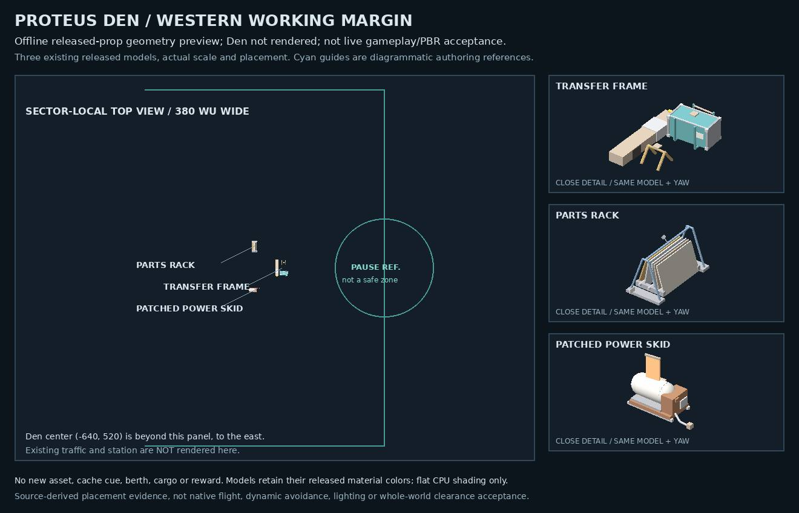

# Proteus Den working margin

## Scope and placement

This increment replaces Proteus's random everyday-kit scatter with a compact western service grouping beside an optional pause/reference pass. It reuses three already-admitted released bodies, not new assets. The composition is anchored to the unique `station_proteus` in `sector_proteus_well`; it translates with that station and falls back to the existing picker when the named anchor is missing, ambiguous or invalid.

At the authored Den position (-640, 520), the world X/Z positions and yaw radians are:

| Model / placement identity | X | Z | Yaw |
| --- | ---: | ---: | ---: |
| `place_illicit_transfer_frame` | -925 | 600 | 0 |
| `place_parts_rack` | -945 | 616 | π/2 |
| `place_power_skid_patched` | -945 | 584 | 0 |

The pause reference is (-850, 600), radius 36. The reference pass runs (-1025, 470) → (-850, 470) → (-850, 600) → (-850, 730) → (-1025, 730). These are authoring references, not navigation targets or gameplay triggers. There is no hidden-cache cue, new actor, cargo, reward, berth, docking/trust change or sanctuary. Existing traffic routes are unchanged; no crew operation or distant seam visibility is claimed.

The seed-only warm mapper preserves station identity alongside position so the authored recipe can match runtime. Non-Proteus placement and random-number consumption remain unchanged. Triton POI warm enumeration is unchanged and outside this fix.

## Checks and qualification

- Focused gate: `npm run check:proteus-den-working-margin` runs exactly `node --test test/proteus-den-working-margin.test.mjs`, once in `scripts.check`. Writer and independent final runs each passed 10/10.
- Writer compared 1,728 non-Proteus placement/RNG cases. Independent review compared 576 non-Proteus cases and 180 generic kit/wreck warm cases.
- Focused coverage includes unique/missing/ambiguous/translated anchors, RNG independence, census-envelope spacing, unchanged authored route references, scope invariants, and seeded warm recipe/stub parity.
- Conservative pairwise prop gaps: 12.76, 13.08 and 22.32 WU. Minimum pause/pass residual using a 48-WU representative hull: 19.15 WU. These calculations do not establish passage between props or generated-world collision closure.
- Fresh public base: `3095a835eb3dbda178d359bbb0541e3ee6124f4c`. Exact inverse edits restore both source bases and package bytes, including original EOF/CRLF formatting. Additive compatibility was checked separately; no sibling PR or unpublished Archive changes are included.
- Actual native avoidance, full Save/Continue execution, hostile-traffic interaction, whole-world collision closure and live visual readability remain unverified. Draft source acceptance is not merge, deployment or flight acceptance.

## Preview and provenance

This is a flat CPU-shaded geometry preview of the actual three released GLBs at the authored transforms, with unit scale and X/Z recentering. The Den and traffic are absent. Diagrammatic pause/pass references are not rendered gameplay. This is not live gameplay, PBR or whole-scene visual acceptance.

Sources are under `assets/ships/release/parts/places/` at the public base above:

| Source GLB | Bytes | Git blob |
| --- | ---: | --- |
| `place_illicit_transfer_frame.glb` | 26248 | `5bdcc07dfe26ef99f9e8ccba942babcc13f1e806` |
| `place_parts_rack.glb` | 25328 | `456610b1ac2430617ef9b2c1611caeaedfcdd3d1` |
| `place_power_skid_patched.glb` | 25568 | `7d487e7886d5d0e045ab84e55dff314d07cf3249` |

Final SHA-256 receipts:

- Placement: `d04da7c574175271049de2b057e9ec41749f8dc350faedccbfd740c8a9e7ae4f`
- Warm mapper: `4435337e72941f4755fee4a1b6a78487423c1b0e511b683b784e848b030625a5`
- Focused test: `879e662e0ed4bd30b9765c453b619ac9b7564c7119e96f8caf0259178f1a4417`
- Package: `ac6d10a25472827e105119eb07f77723e8e1193ed7464697869b93ec607138b4`
- Compact preview (80680 bytes): `1ce3a992633086e1826a75b5dab3faef34528297e516e9902c2ca70b1a475efd`
