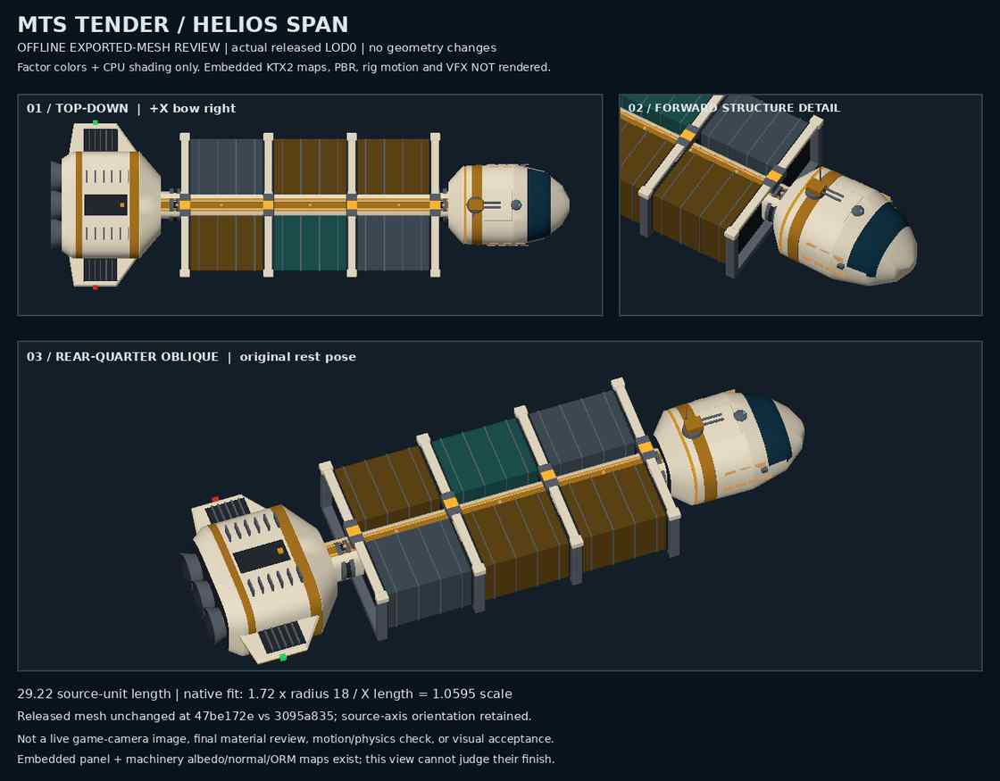
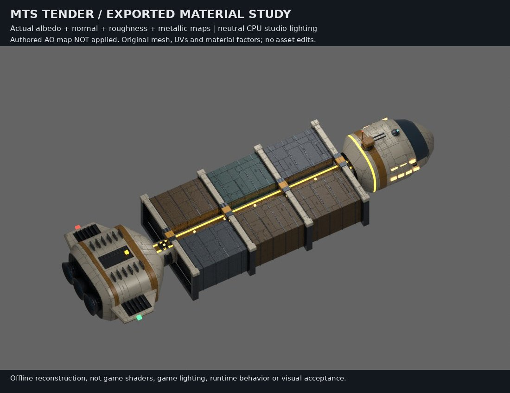

# MTS tender: released-model detail review

## Inspected asset

The existing released `assets/ships/release/parts/wholeships/helios_span_mts.glb` is unchanged between public base `3095a835eb3dbda178d359bbb0541e3ee6124f4c` and inspected master `47be172e0736cb3e32925a550807c684a155ef82`: Git blob `9b89bbe29d3c5988c9a13674deec9b3687c05137`, 1,177,488 bytes, SHA-256 `171d0120501fd1762f0eba7b1a72160b4057061d7a62fbf705e929c32c3bc6df`. Relevant parts-library and enemy definitions also match those references.

The LOD0 sheet shows six cargo modules, four repeated crossframes, an exposed spine, rounded cockpit and vented aft unit. Existing seams and fittings supply the industrial construction detail. These views do not justify geometry edits; source geometry was not changed and no new model is counted.

## Rendering and fit

Nineteen visible LOD0 primitives contain 34,277 triangles. The asset has seventeen materials and six embedded KTX2 maps covering panel/machinery albedo, normal and ORM channels. This CPU preview uses interpolated normals and material color factors only: those maps, PBR, shadows, motion rig and VFX are not rendered. Their absence from the sheet is not evidence of a missing or defective asset.

Top-down, forward detail and rear-quarter views retain source-axis coordinates. The inspected fit is `1.72 × 18 / 29.2214 ≈ 1.059497655`; preview coordinates remain source units. Existing motion/engine/cargo/utility/navigation/VFX sockets are retained but static.

## Qualification

This is an offline review of actual released geometry, not a game-camera capture, material/PBR review, physics or performance test, or full visual acceptance. The completed textured studio study below supplements this untextured geometry sheet; it does not establish runtime visual acceptance. No game source, model, placement or runtime behavior changed.

Image: 57,367 bytes, SHA-256 `4384904983514a28eaaa2c877db07adb9a1134c49714998f94afc0ad972a6580`.

## Completed textured studio study

All six actual embedded KTX2 maps were decoded in memory. Blender 4.3.2 Cycles CPU rendered 32 samples without denoising, using the actual albedo, normal, roughness, metallic and emissive inputs. Panel maps are 1024 × 1024 and machinery maps are 512 × 512. The nineteen visible meshes and 34,277 triangles match the inspected LOD0 geometry.

Neutral studio world lighting and two area lights replace game lighting. Authored AO remains present in importer settings but was **not applied** to shading or multiplied into base color. This is a studio reconstruction, not a game-renderer capture or a test of the runtime shader, lighting, rig, effects or performance.

No model, UV, normal, material-assignment or material-factor edits were made. The study closes the earlier material-preview feasibility question, not full visual acceptance or any larger asset/game goal.

Studio JPEG: 86,285 bytes, SHA-256 `def2f19f60b89cb889d80cda52e5d0dc639a09748a3cb07ffba9c809da9a7726`.
