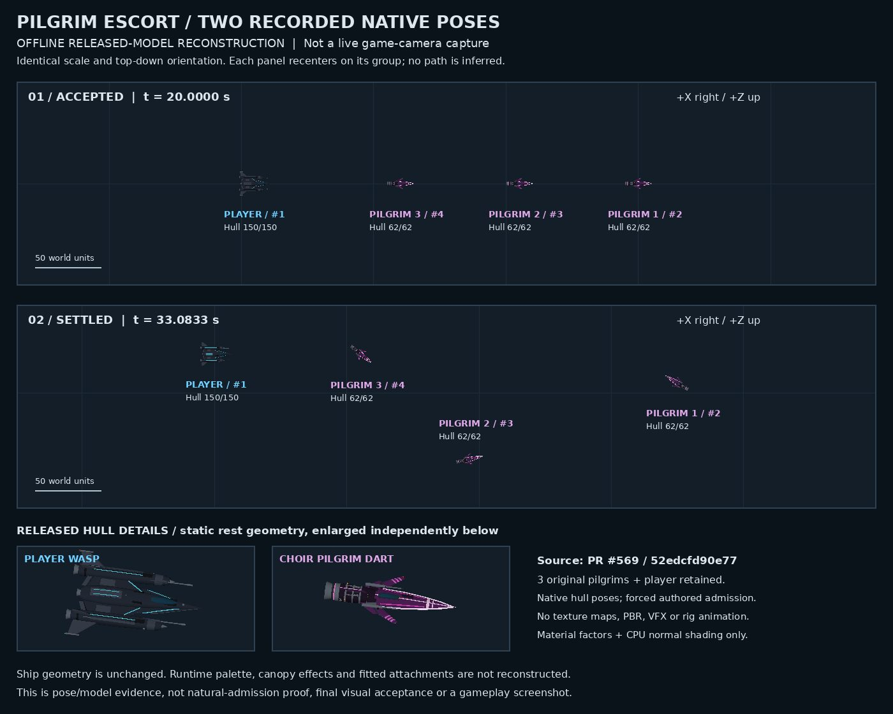

# Pilgrim escort: recorded native poses

## Evidence

These two actual native snapshots come from the successful route at PR569 commit `52edcfd90e775411285af384ee01b761132fc0bd`: acceptance at 20 seconds and settlement at 33.0833 seconds. All seven shipping source/test hashes remained unchanged during capture. Three original Choir actors and the player remained alive, with zero captured impacts. Recorded positions, orientations, identities and hull values drive the reconstruction; it is not an invented trajectory.

Released models:
- Player Wasp: `assets/ships/release/parts/wholeships/wasp_production_v1.glb`, blob `6d9912a982090e1911f3932eef7b8cd9d8aae880`.
- Choir Dart: `assets/ships/release/parts/wholeships/ashline_dart_choir.glb`, blob `4028baa44b2d1293aa924f06309d506052f750a3`.

Model selectors and radii come from exact constructor inspection, not additional recorded live-state fields: player radius 14, pilgrims 12. Fit uses `1.72 × constructor radius / all-node source X length`, retaining the source origin. CPU X/Z rotation matches renderer yaw `-entity.rot`, without heading interpolation. Both scene panels use a 650-WU span; detail insets are independently enlarged.

## Limits

This is an offline CPU material-factor geometry reconstruction of two poses, not a live game-camera capture. Texture sampling, PBR, runtime palette, canopy effects, fittings, rig animation and VFX are absent. Admission was forced and the pilot used the successful controlled axis; this does not establish natural scheduler admission, continuous visual behavior or full visual/game acceptance. No game source, model or PR569 head changed for this evidence publication.

Image: 126,941 bytes, SHA-256 `72d44c651df38794748f8f38f76c9a8bf8e94de0752763584d172b913b5020fb`.
