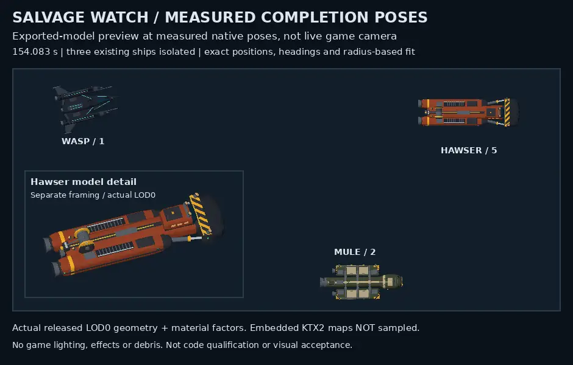

# Hawser exported-model completion preview

Three actual released exports are placed at recorded native completion poses at 154.083 seconds. The boxed Hawser detail uses separate framing. No assets were edited and no new models are counted. This CPU factor-color image does not sample the six embedded KTX2 maps in each asset; it is not live game-camera, PBR, effects or visual-acceptance evidence.

Reproduce with Python 3, NumPy, Pillow, DejaVu Sans, Node and the repository's installed @gltf-transform/core, @gltf-transform/extensions and meshoptimizer dependencies. From the repository root run `python design/program/world-experience-2026-10-24/hawser-native-preview/render.py --repo .`. Use `--output PATH` to select another output. Required Git asset blobs and SHA256 checks are pinned in render.py; they must already exist locally. The command does not fetch missing objects. Pillow/WebP versions may alter encoded bytes.

The included raster_core.py and decode.cjs preserve the geometry, transforms and material-factor decoder used for this preview. provenance.json contains measured poses; render.py retains radius-based fitting and the original separate inset framing. Only path/input/output adaptation was syntax-checked for publication; no second render is claimed.

[Source qualification report](https://github.com/coldshalamov/SpaceFace/blob/ad9b52dd00bf8cf78e64ba3ff70f7cb12390f3c5/design/program/world-experience-2026-10-24/HAWSER_ATTENDED_REPAIR.md).
