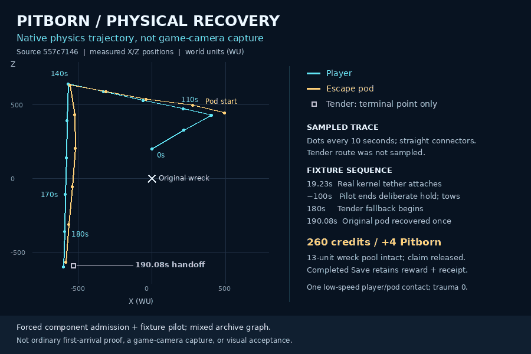

# Pitborn measured recovery trace



This is a plot of actual native physics samples from [draft PR582](https://github.com/coldshalamov/SpaceFace/pull/582), exact source commit `46ea815817f706c61b5aca77ccc23af144fd9405`, scene blob `557c71463cab778899f335474bf4118ed6fdf027`. It is not a game-camera image, model render, ordinary first-arrival proof or visual acceptance.

## What was observed

The real Wasp/player and kernel attachment physically move the original pod 1477.233 WU. The fixture attaches at 19.233 seconds, deliberately holds until about 100 seconds and completes a low-speed handoff at 190.083333 seconds after the tender's 180-second fallback begins. The original pod is removed once; 260 credits/+4 Pitborn, claim release and all 13 unconsumed wreck units remain. Actual completed Save/load retains the receipt without replay. One low-speed player/pod contact has zero trauma; this is not a contact-free route.

Dots are ten-second player/pod samples with straight connectors, not an exact continuous path. The tender is shown only at its measured terminal point, not an invented route. Symbols are point markers, not scaled hulls. Native component admission is forced, the pilot is a fixture, attachment uses the direct kernel API after flying into range, and the dependency graph is mixed. See the [full feature report](https://github.com/coldshalamov/SpaceFace/blob/46ea815817f706c61b5aca77ccc23af144fd9405/design/program/world-experience-2026-10-24/PITBORN_PHYSICAL_RECOVERY.md) for focused/native, history and persistence limits.

## Reproduce

With Python 3, Pillow and DejaVu Sans already installed, run from this directory:

```sh
python3 -B render.py samples.json pitborn-trajectory-local.webp
```

The output must not already exist. No packages are installed, network requests made or runtime assets changed. `samples.json` contains only the original packet's scene identity, measured samples and terminal measurements. The original full-packet SHA256 is retained in provenance, but reproduction needs only the included public input. The portable render was executed in RAM and reproduced the exact published WebP SHA256 `036676d09f59b4795fab68336d211b8d5a2ff0ba0d94d979743d20b7b7abc69d` (13,982 bytes). Rendering libraries/font versions can affect byte identity on another machine.

## Status

Exported diagnostic: yes. Pixels reviewed: yes. Source/model changes from this preview: none. New model count: zero. Game-camera, GPU/performance, natural arrival and full experience acceptance: open. Image and reproducible source are preserved here independently of whether a reader downloaded an attachment. All twelve project goals remain open.
