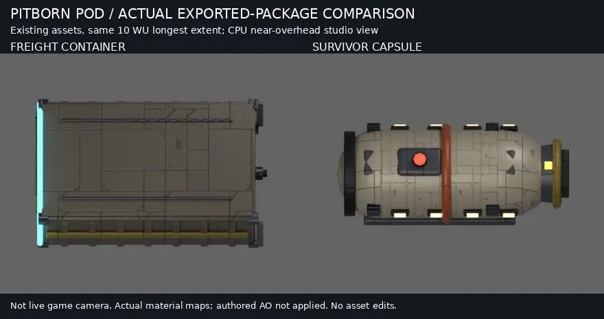

# Survivor pod presentation comparison

The scene now binds asset.slice.civilian_pod before spawn publication instead of presenting its survivor as an ordinary freight container. Existing asset, texture and geometry bytes are unchanged.

This is a corrected CPU Cycles studio comparison with actual albedo, normal, roughness and metallic maps, neutral lighting and no applied authored AO. It is not live game camera, browser or whole-game visual acceptance. The capsule is a rounded rescue shell with colored band, ports and dorsal beacon. Both are fitted to the existing 10WU maximum axis.

Measured capsule XZ radius5.0627626WU slightly exceeds physics radius5 by0.0627626WU (1.26% trim); previous generic freight radius5.7654234WU protrudes15.3%. Accepted existing visual fit, not exact collider coincidence. Physics mass10/ball/radius5/towability remain unchanged; no distressBeacon/rescuePriority gameplay flags are added.

Reproduction: Python with Pillow, Blender4.3.2 and the repository's installed Node glTF/meshoptimizer/Three dependencies. Run:
`python render.py --repo-root /path/to/SpaceFace --output-dir /path/to/output`
The standalone adaptation embeds the rendering algorithm, reads the pinned Git blobs locally without fetching and writes only the requested output directory. It was syntax checked but not rerendered after path portability edits. Consult provenance.json for source asset/map/image hashes, exact limitations and the rejected-preview correction. No claim of byte-identical output across renderer versions.

Image SHA256:08dbd9ac925fac94c037b25a04d79e47641a95f7b30a96162839722ac8836996.
