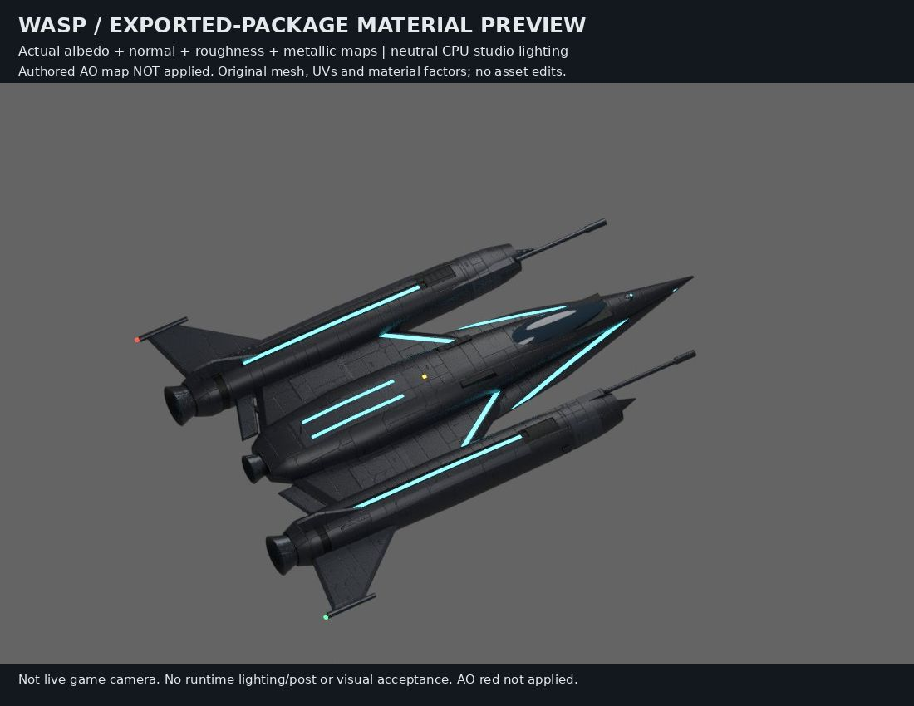

# Wasp exported-package material review

Existing release model: `assets/ships/release/parts/wholeships/wasp_production_v1.glb`, Git blob `6d9912a982090e1911f3932eef7b8cd9d8aae880`; 798,728 bytes, SHA256 `58aa882b40036e3af8ec56f190180443a4a6e937e13c38f2cc2e7adf7dc896c3`.

This is a neutral Cycles CPU studio reconstruction, not the live game camera. It retains original geometry, UVs, material assignments/factors and 22 LOD0 meshes (39,392 triangles). Six embedded KTX2 maps were decoded. Albedo, normal, roughness green and metallic blue are applied; AO red is NOT applied. No runtime lighting/post-processing or target-device performance is reproduced.

Review: dark military paneling, pod highlights, recesses, canopy reflection and cyan bands are readable. This view establishes no confirmed asset defect, so no whitening/recolor or runtime model edit was made. Zero new models; no visual acceptance.

Frozen image: 1,100 × 850 JPEG, 62,196 bytes, SHA256 `ae42a3d4b09b11a2fe612cd8cdb3bebd8fec0e8da3745a482a547fc2bc2f57f9`.

## Reproduce

Use Python 3/Pillow, Node, Blender 4.3.2 with bundled glTF importer, repository dependencies @gltf-transform/core, @gltf-transform/extensions, meshoptimizer and Three's Basis transcoder, and DejaVu fonts. The pinned Git blob must already exist locally; the script disables lazy fetch. No asset binaries are embedded.

Set SF_REPO to the repository root and SF_WASP_OUTPUT to an existing empty output directory, then run `python3 -B render.py`. It refuses to overwrite frozen outputs. The source uses RAM for decoded model/textures. Camera, two area lights, material color spaces and all renderer settings are explicit in the script.

The portable script changes only repository/output routing, self-loading source, removal of an unused import and no-overwrite protection. It was compiled, not rerendered. Provenance distinguishes its hash from the exact original render script. Reproduction requires the listed dependencies and sufficient output space; visual acceptance still requires actual gameplay.
