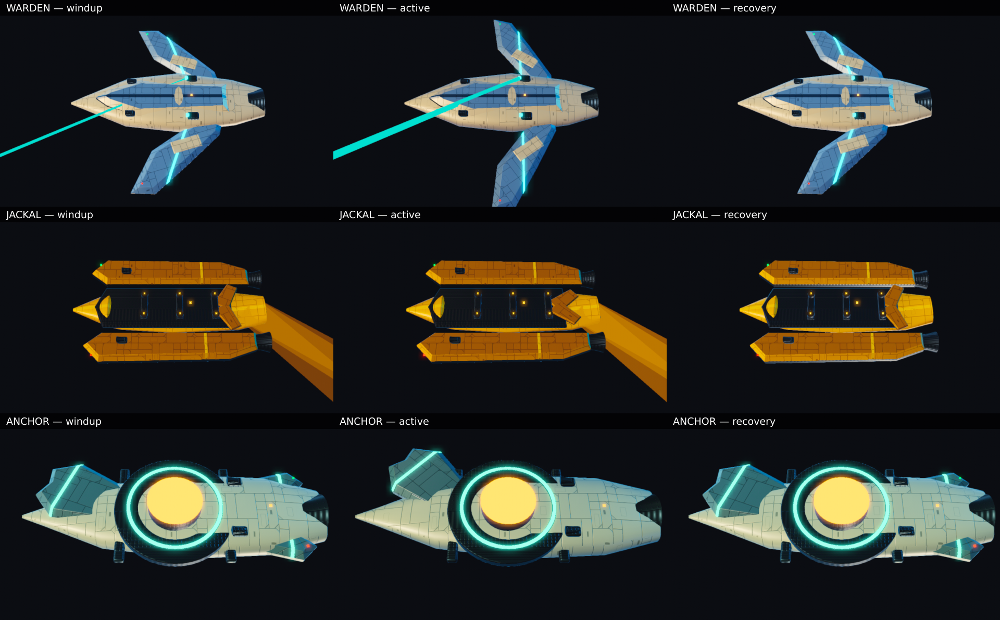

# Swarm specialist visual evidence

Captured on 2026-11-01 with Chrome for Testing 156.0.8078.80 and ANGLE SwiftShader.
These are screenshots from the game's renderer using the real hostile resolver, authored
boundary, optimized render packages, runtime materials and phase driver. The entities and
their phase data are explicit presentation fixtures; this is not an ordinary Swarm playthrough.

## Review images



Rows are Warden, Jackal and Anchor. Columns are windup, active and recovery. The close camera
shows the mechanisms and materials; the three overviews below show the full active tells.
All twelve full-resolution screenshots are retained alongside this sheet as lossless WebP.
Their decoded RGB pixels were checked against the original PNG captures byte for byte.

| Unit | What the captures establish | Complete active tell |
|---|---|---|
| Warden Escort | Navy and ivory forked hull, cyan projectors, rigid wings opening to ±35°, ward link attached to the fixed authored emitter, no link during recovery. The retro ports remain seated on the fixed body as the wings move. | [Warden active overview](warden-active-overview-inspect.webp) |
| Mine-Layer Jackal | Ochre catamaran, recessed three-cradle ordnance bay, paired gates opening to ±48°, three frozen forecast lanes attached to the ejector, no forecast during recovery. | [Jackal active overview](jackal-active-overview-inspect.webp) |
| Anchor Controller | Teal and ivory hull with three vanes, amber spool, vane travel of −42°/+42°/−42°, full 220 WU active field boundary, no field boundary during recovery. | [Anchor active overview](anchor-active-overview-inspect.webp) |

Each sampled phase runs at simulation time 1.25 seconds (tick 75), with its fixture phase
starting at tick 60 and ending at tick 90. Windup and recovery therefore have equal half-open
mechanical poses; their direction of travel and overlay state differ. This sheet is a pose
matrix, not a recording of continuous animation. The driver and production presentation
regressions separately verify phase transport, authored-root replacement and effect cleanup.

## Acceptance and provenance

[capture-report.json](capture-report.json) records all twelve accepted images, actual pivot
quaternions and angles, overlay visibility, camera positions, authored state, screenshot hashes
and hull-presence pixel measurements. The three active close captures were repeated after
merging upstream `aa212937b`, which changed shared renderer code. Those fresh captures also
require the exact `sf.render.swarm-*` package content hash to match the current optimized
package metadata. Model and animation bytes were unchanged by that upstream merge.

Strict authored admission is required before capture. A second image check requires at least
20% bright hull pixels in a small central region, scaled to camera distance. This prevents a
bright link, wake or field from being accepted while the software renderer's cold hull is still
absent. Three such early frames were rejected during inspection and replaced with successful
targeted recaptures; none is included in this evidence package. The images were then inspected
for complete hulls, seated ports, mechanism poses and complete wide-view tells.

The adjacent [asset contract receipt](../asset-presentation-tests.txt),
[release compression inspection](../compression.json) and [release pins](../release-pins.txt)
cover the generated source/release/package chain, actual meshopt and KTX2 payloads, source-bound
motion banks, every animated pivot's three LODs and fixed ancestry of both retro sockets.

## Reproduce

Run from the repository root with a compatible Chrome path in `SF_CHROMIUM` and the normal
boot assets materialized:

```sh
node scripts/fleet-look.mjs --specialists --with-overviews --views=close \
  --timeout=150 --out=scratch/swarm-specialists/reproduce

# The minimal post-merge renderer check used for the active close views:
node scripts/fleet-look.mjs --specialists --phases=active --views=close \
  --timeout=150 --out=scratch/swarm-specialists/post-merge-active
```

For a rejected cold capture, `--only=jackal_windup,warden_active_overview,anchor_active_overview`
selects just those names from `--specialists --phases=windup --with-overviews`.
The runner exits unsuccessfully if strict admission fails or the hull is still absent after
its bounded retries. It does not turn those failures into successful screenshots.

## Limits

The fixture shows the real presentation path with deterministic phase inputs. It does not prove
ordinary wave progression, encounter difficulty, sustained performance or optimal balance.
SwiftShader reported its lack of parallel shader compilation and slow cold render passes;
unrelated line-hardware boot admission also exceeded its deadline. Those warnings are not
treated as a hardware performance result. Anchor's wide view intentionally makes the hull
small so the entire 220 WU field is visible; its close views provide the mechanism detail.
