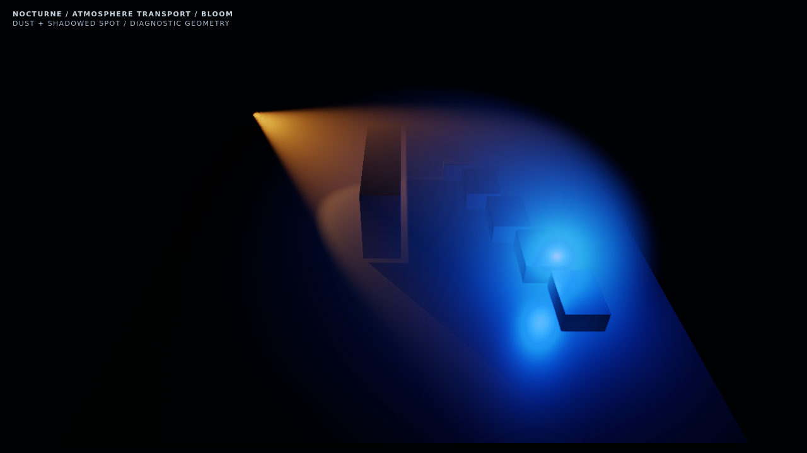
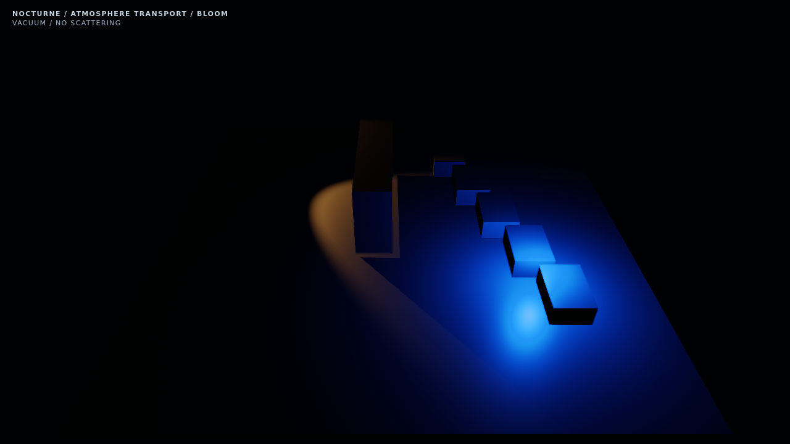
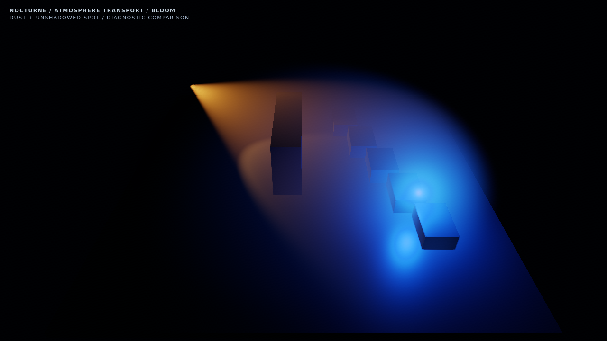

# NOCTURNE atmospheric transport validation

**PASS — focused shader/transport/compositor validation.** These are isolated diagnostic meshes at an oblique gameplay-scale camera. They are not gameplay screenshots or whole-game acceptance.

- Captured: 2026-10-23T16:50:31.983Z
- Browser: 134.0.6998.35
- Renderer: ANGLE (Google, Vulkan 1.3.0 (SwiftShader Device (Subzero) (0x0000C0DE)), SwiftShader driver)
- Three.js: vendored revision 184; exact source hashes in [JSON report](atmosphere-report.json).
- Resolution: 1280 × 720; bloom off; exposure 1.5; camera FOV 48°, position 0, 125, 160.
- Post route: bloom; AO off.
- Native depth-comparison spotlight shadow map: native-depth-comparison; resolution 512².
- WebGL2: true; float color: true; timer query: true.

## Matched images

| Dust and real shadows | Atmosphere disabled |
| --- | --- |
|  |  |

| Vacuum | Source shadow disabled |
| --- | --- |
|  |  |

[Integrated tier](atmosphere-integrated.png) · [After actual WebGL context restoration](atmosphere-context-restored.png)

Vacuum and disabled output have **0 differing pixels** below the 60-pixel diagnostic-label region. Dust changes 343974 pixels with mean RGB byte difference 9.3702. Disabling source shadows changes 169480 pixels. On/off/vacuum program counts are 6/6/6.

## Timing and budget boundary

| Diagnostic | Atmosphere off | Atmosphere on |
| --- | ---: | ---: |
| CPU submission median | 0.500 ms | 0.600 ms |
| CPU submission p95 | 0.700 ms | 0.800 ms |
| GPU query median | 88.835 ms | 293.841 ms |
| GPU query p95 | 112.804 ms | 325.369 ms |
| Total draws per frame | 8 | 9 |

16 interleaved samples per condition after warm-up; static spotlight shadow held between frames. CPU values measure synchronous submission, not total GPU completion. The atmosphere uses one half-resolution draw, two MRT history targets / four textures (7372800 bytes), plus the full-resolution scene depth attachment. **Software timing is a reproducibility diagnostic, not an integrated-GPU or whole-game budget result.** GPU budget acceptance remains open.

## Coverage and limits

The executable check verifies real shader compilation, vacuum parity, atmospheric change, native spotlight shadow format, quality scaling, shader stability under on/off/vacuum changes, and actual WebGL context loss/restoration. It is single scattering; one spotlight receives volumetric source occlusion. Other sources are unshadowed. Atmospheric radiance enters HDR composition before tone mapping but is not separately fed through bloom's bright-extraction pyramid. The dense test medium deliberately exposes low-sample noise near concentrated sources.
