# NOCTURNE authored content shader validation

**PASS — focused content, physical illumination and shader validation.** Synthetic industrial, derelict and alien authoring rigs; combat target is the exact pinned Kestrel release GLB. No running simulation. Production lighting/material modules at the documented gameplay camera. This is not public-route or target-hardware acceptance.

Renderer: `ANGLE (Google, Vulkan 1.3.0 (SwiftShader Device (Subzero) (0x0000C0DE)), SwiftShader driver)`. Three revision 184, material hook `spaceface-illustrated-surface-v19-nocturne`. Camera: 144 WU, 60° tilt, 50° vertical field of view; 960×540.

Eight fixed points, three fixed spots and one 512² shadow map. Direct and probe comparisons keep bloom and atmosphere off and preserve emitter materials. Pixel measurements exclude emitters, background and the label.

| Composition | Direct surface pixels (summed RGB delta ≥6) | Direct mean absolute RGB byte delta | Probe surface pixels (any nonzero delta) | Probe mean absolute RGB byte delta | Shader programs stable |
|---|---:|---:|---:|---:|---|
| industrial | 120201 | 32.60 | 145369 | 2.159 | true |
| derelict | 73047 | 25.04 | 12444 | 0.050 | true |
| combat | 4540 | 8.93 | 0 | 0.000 | true |
| alien | 23109 | 18.89 | 19884 | 0.318 | true |

The derelict probe is deliberately subtle; a nonzero pixel confirms shader transport, not strong visual contribution. Direct illumination is evaluated separately with a larger change threshold.

The same industrial composition was also checked under the bright Arcade Look, a 1.3-strength directional key and 0.035 ambient, retaining the same exposure. Direct illumination changes 122916 non-emissive pixels. The fixed directional census compiles/exercises the real shader local/sun split.

| Bright mood, local sources off | Bright mood, direct sources on |
|---|---|
| 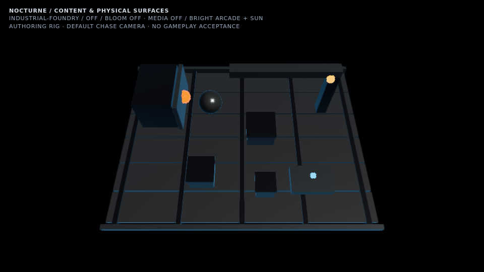 | 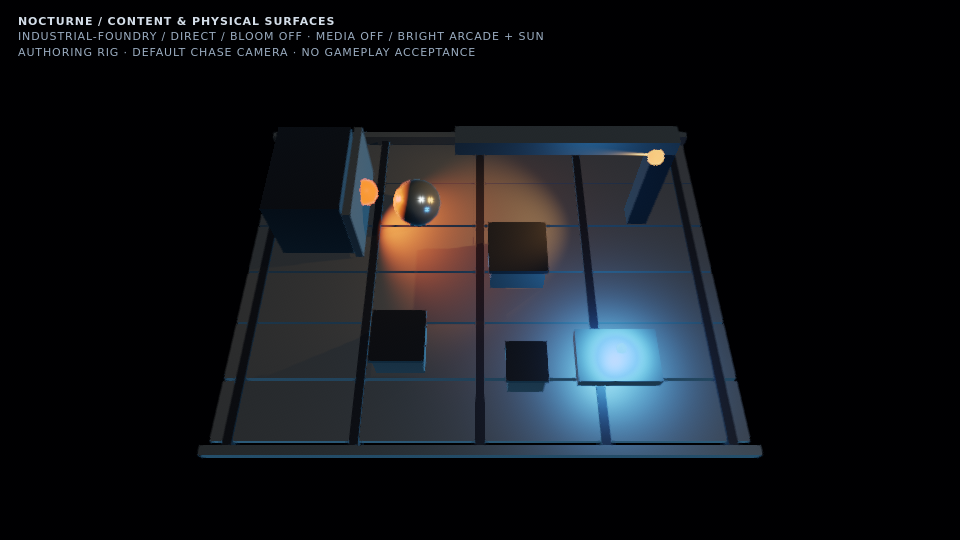 |

Combat target: [assets/ships/release/render-packages/kestrel/render.glb](../../../assets/ships/release/render-packages/kestrel/render.glb), git blob SHA-1 `761698bdd8482225b179066a45827c0685366960`. Vendored GLTFLoader/KTX2/Meshopt, configureAuthoredMaterialProfiles, illustratedSurface; direct GLB geometry, not the game render-package draw plan.

CPU submit timing only, with the same fixed-light shader on both sides; no target GPU budget, baseline renderer comparison or frame-pacing acceptance. Raw submit timings and source SHA-256 identities are in [content-report.json](content-report.json).

## industrial

Elevated amber gantry, lateral furnace aperture and isolated cyan workbench.

| Local lighting off | Direct light only | Complete composition |
|---|---|---|
| 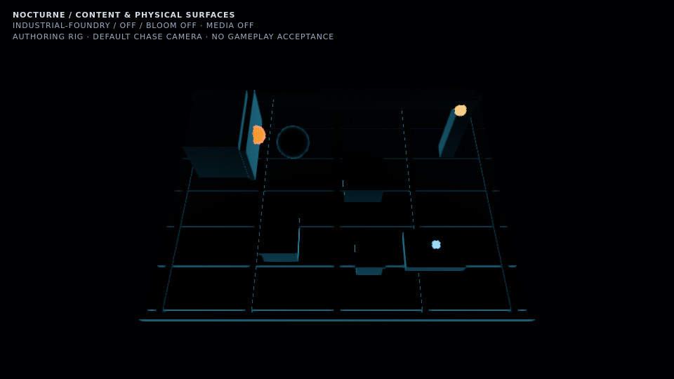 | 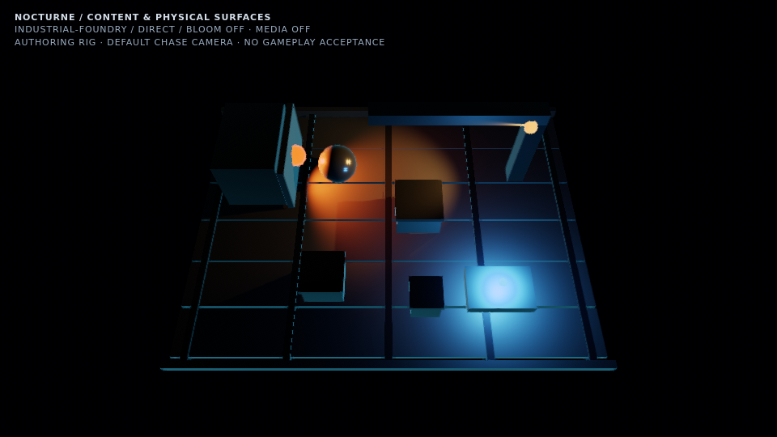 | 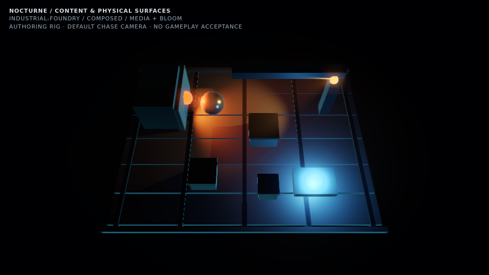 |

## derelict

Broken compartments, separated emergency batteries and a low leaking core.

| Local lighting off | Direct light only | Complete composition |
|---|---|---|
| 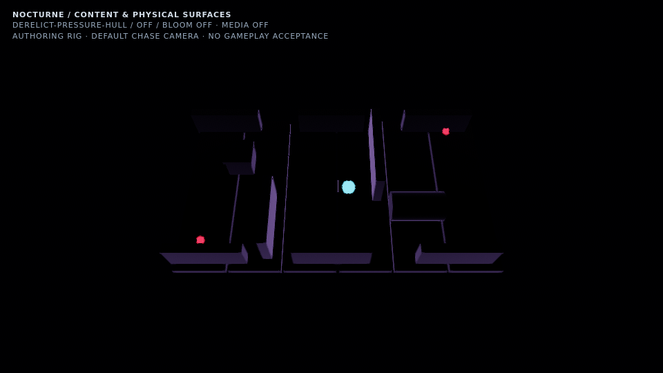 | 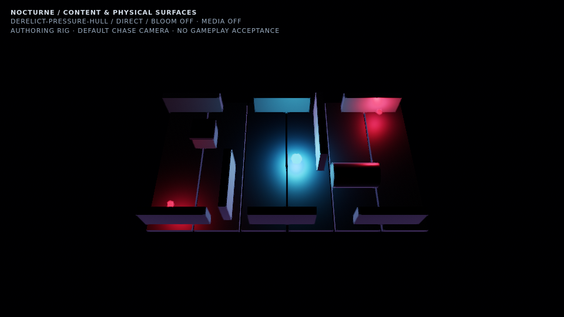 | 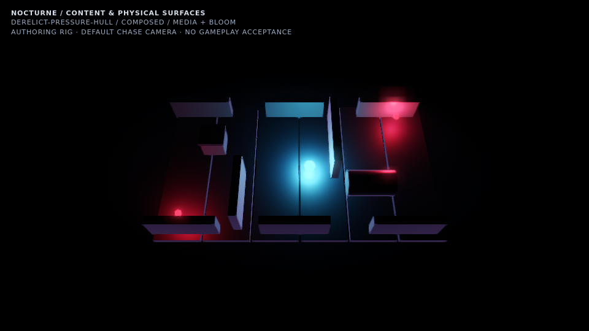 |

## combat

Moving bow searchlight, aft drive pools and small navigation sources in clear vacuum. The illuminated target is the exact HEAD Kestrel release GLB with authored textures/material profiles (normalized to a 30 WU hull).

| Local lighting off | Direct light only | Complete composition |
|---|---|---|
| 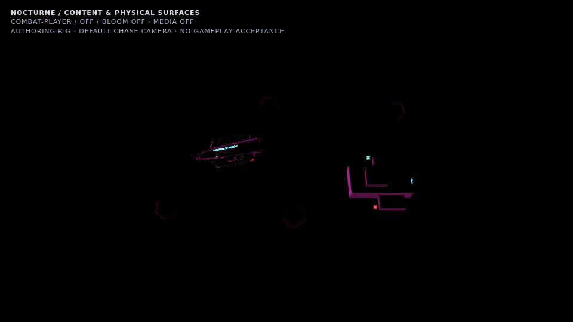 | 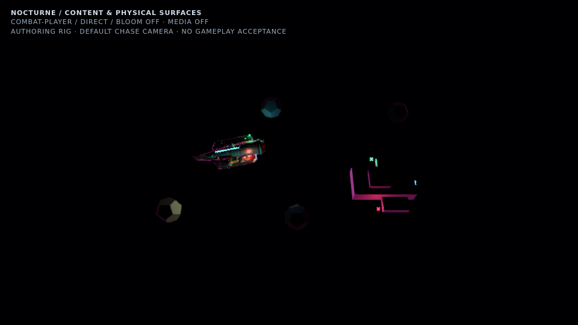 | 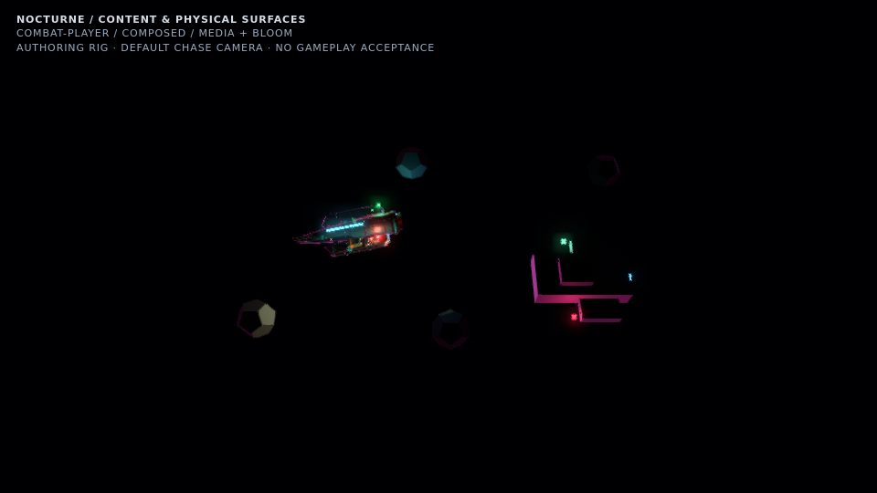 |

## alien

Low green biological pool, elevated violet crown, particulate spores and translated instanced metal debris.

| Local lighting off | Direct light only | Complete composition |
|---|---|---|
| 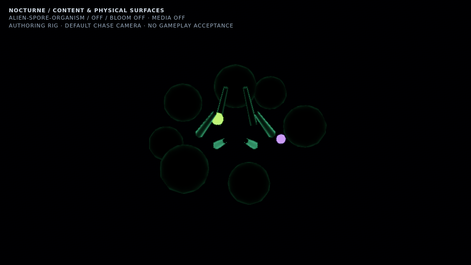 | 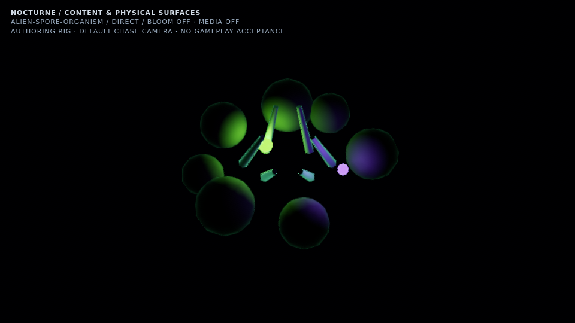 | 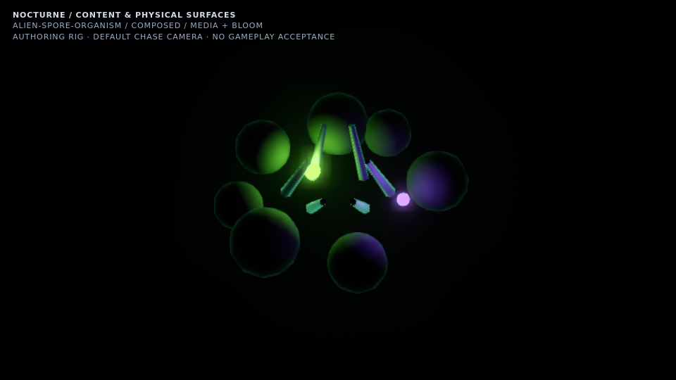 |

## Lifecycle change after capture

The screenshots and source hashes above were captured before a narrow context-loss teardown change. Content/probe release now honors `disposeGpu: false`, restores borrowed materials, and drops owned references without dispatching clone disposal events. Bloom attachment likewise suppresses scene-target disposal during lost-context detach. Steady rendering, lighting parameters and shaders are unchanged. The follow-up focused suite passes all 20 cases, including both normal and lost-context reflection release. See [the exact before/after hash receipt](content-lifecycle-followup.json), [raw test output](content-lifecycle-tests.txt), and [the shared atmosphere lifecycle receipt](atmosphere-lifecycle-followup.json). The original captured hashes have not been replaced.
